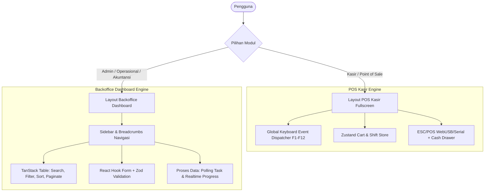
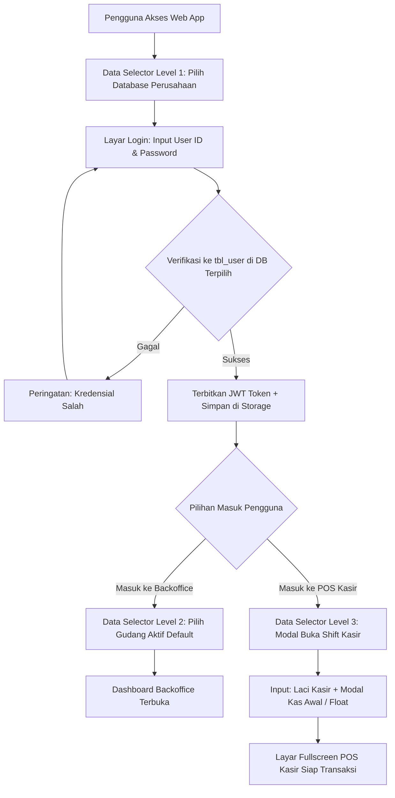
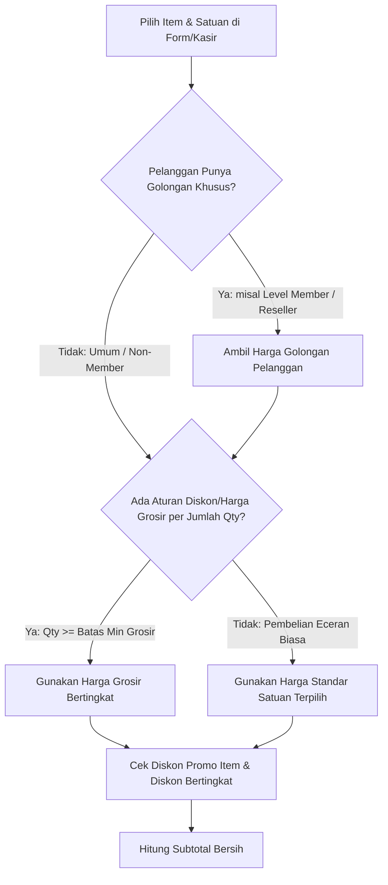
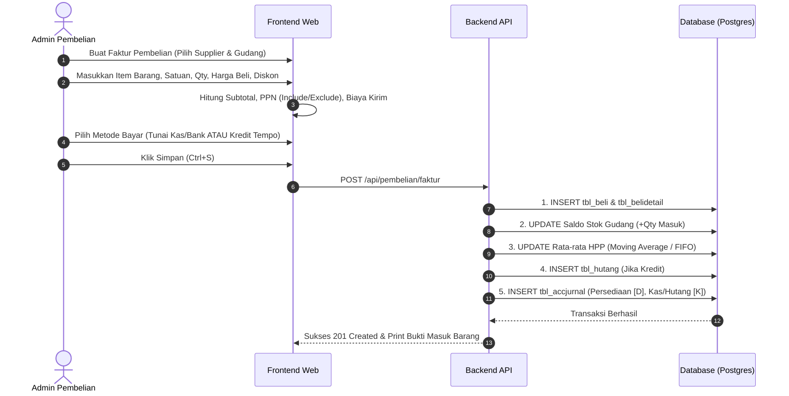
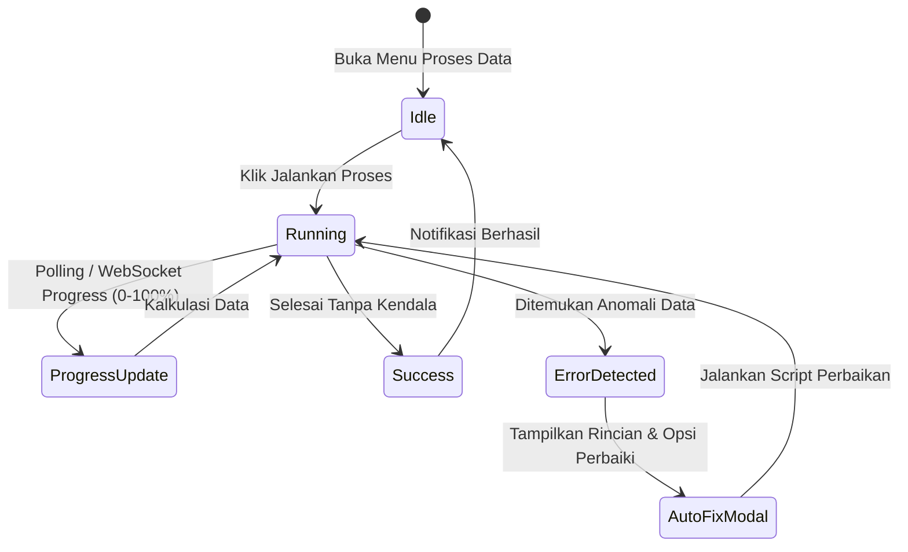

# 🚀 BLUEPRINT & ALUR SISTEM LENGKAP: FRONTEND WEB iPos 4.0
> **Target Pengguna Dokumen**: AI Coding Agent / Frontend Engineer  
> **Tech Stack Acuan**: React (Next.js App Router / Vite SPA) + Tailwind CSS + shadcn/ui + Zustand + TanStack Query + Zod  
> **Versi Dokumen**: 1.0 (Komprehensif & Siap Implementasi)

---

## 📑 DAFTAR ISI
1. [Arsitektur Sistem & Prinsip Desain UI/UX](#1-arsitektur-sistem--prinsip-desain-uiux)
2. [Sistem Autentikasi, Login, & Data Selector (Database / Gudang / Shift)](#2-sistem-autentikasi-login--data-selector-database--gudang--shift)
3. [Peta Rute & Struktur Navigasi Halaman](#3-peta-rute--struktur-navigasi-halaman)
4. [Arsitektur State Management & Keyboard Shortcut Engine](#4-arsitektur-state-management--keyboard-shortcut-engine)
5. [Mesin Aturan Bisnis Retail iPos 4.0](#5-mesin-aturan-bisnis-retail-ipos-40)
6. [Spesifikasi Detail Alur Setiap Modul](#6-spesifikasi-detail-alur-setiap-modul)
   - [6.1 Modul POS Kasir (Fast-Paced Retail)](#61-modul-pos-kasir-fast-paced-retail)
   - [6.2 Modul Master Data](#62-modul-master-data)
   - [6.3 Modul Pembelian & Hutang Usaha](#63-modul-pembelian--hutang-usaha)
   - [6.4 Modul Penjualan Backoffice & Piutang Usaha](#64-modul-penjualan-backoffice--piutang-usaha)
   - [6.5 Modul Persediaan & Pergudangan](#65-modul-persediaan--pergudangan)
   - [6.6 Modul Akuntansi & Kas/Bank](#66-modul-akuntansi--kasbank)
   - [6.7 Modul Laporan Komprehensif](#67-modul-laporan-komprehensif)
   - [6.8 Modul Khusus: PROSES DATA](#68-modul-khusus-proses-data)
   - [6.9 Modul Pengaturan & Otorisasi Pengguna](#69-modul-pengaturan--otorisasi-pengguna)
7. [Integrasi Hardware Kasir (Peripherals)](#7-integrasi-hardware-kasir-peripherals)
8. [Struktur Folder & Komponen Frontend Direkomendasikan](#8-struktur-folder--komponen-frontend-direkomendasikan)
9. [Checklist Verifikasi Implementasi Agent](#9-checklist-verifikasi-implementasi-agent)

---

## 1. Arsitektur Sistem & Prinsip Desain UI/UX

Sistem frontend web iPos 4.0 mengadopsi model **Hybrid Architecture**:



### 1.1 Dua Gaya Antarmuka Utama

1. **POS Kasir (Dedicated Fullscreen Mode)**:
   - **Tampilan**: Bersih dari navigasi sidebar admin; layar penuh (*fullscreen focus*); kontras tinggi; ukuran font total belanja dan item jelas.
   - **Interaksi**: **100% Keyboard-driven** tanpa perlu menyentuh mouse sama sekali. Mendukung barcode scanner berkecepatan tinggi dengan buffer debounce otomatis.
   - **Fitur Khusus**: Shift kasir (Buka/Tutup Kasir + Saldo Awal), Tahan Belanja (*Hold / Pending Bill*), Panggil Belanja (*Resume Bill*), Diskon Item/Faktur, Multi-pembayaran (Tunai, QRIS, Kartu Debit/Kredit, Piutang Pelanggan).

2. **Backoffice Dashboard (Modern Responsive Admin)**:
   - **Tampilan**: Layout sidebar navigasi kolapsibel, header indikator shift/cabang/gudang aktif, breadcrumbs, dan area konten fluid.
   - **Interaksi**: Standard web form dengan auto-complete searchable select box, bulk table selection, export Excel/PDF, print invoice cetak faktur standar A4/Half-Letter.
   - **Fitur Khusus**: Multi-tab drawer untuk detail data tanpa meninggalkan tabel, batch action, dan modal konfirmasi destruktif.

---

## 2. Sistem Autentikasi, Login, & Data Selector (Database / Gudang / Shift)

Arsitektur data iPos 4.0 memiliki karakteristik unik: **Multi-Database per Perusahaan/Toko**. Satu server database PostgreSQL (biasanya di port 5444 / `iPgSQL`) menampung banyak database terpisah (contoh: `i4_toko_makmur`, `i4_cabang_bandung`, `i4_barunatrial`).

Oleh karena itu, sistem login frontend web tidak bisa langsung mengautentikasi pengguna sebelum **Konteks Database Terpilih**.



### 2.1 Tiga Tingkatan Data Selector (The 3-Tier Selector)

#### 1. Data Selector Level 1: Database Perusahaan / Toko (Company Selector)
- **Fungsi**: Memilih database PostgreSQL yang menjadi target seluruh transaksi API.
- **Implementasi UI**:
  - Ditempatkan di halaman `/login` sebelum atau terintegrasi di form login.
  - Komponen: Searchable Dropdown / Grid Card profil toko yang mengambil data dari endpoint backend: `GET /api/system/databases`.
  - Informasi pada kartu database: `Nama Database` (misal: `i4_barunatrial`), `Nama Toko/Perusahaan` (dari kueri `tbl_perusahaan`), `Alamat`, dan `Status Latensi Server`.
  - **Auto-Persistence**: Pilihan terakhir disimpan di `localStorage` (`ipos_last_db`). Saat membuka web di hari berikutnya, database terakhir langsung otomatis terpilih (*pre-selected*).

#### 2. Data Selector Level 2: Gudang / Kantor Aktif (Warehouse Selector)
- **Fungsi**: Setiap transaksi mutasi barang (Penjualan, Pembelian, Stok Opname, Transfer) membutuhkan parameter `kodegudang`.
- **Implementasi UI**:
  - Dropdown selector di **Header Navbar Backoffice** (selalu terlihat).
  - Mengambil daftar gudang aktif dari tabel `tbl_gudang` (misal: `Gudang Utama`, `Gudang Toko Depan`, `Gudang Bahan`).
  - Mengganti gudang di header langsung memperbarui konteks operasional tanpa perlu logout.

#### 3. Data Selector Level 3: Shift Kasir & Laci Kas (Cashier Shift Selector)
- **Fungsi**: Mencegah kecurangan kas dan memastikan akuntabilitas fisik uang tunai per kasir.
- **Implementasi UI**:
  - Modal pop-up yang **muncul otomatis dan memblokir layar** saat kasir mengakses `/pos` jika belum ada shift aktif:
    1. **Pilihan No. Kasir / Mesin Kasir**: `Kasir 01`, `Kasir 02`, dst.
    2. **Gudang Kasir**: Dropdown gudang tempat kasir mengambil stok (biasanya `Gudang Toko`).
    3. **Modal Kas Awal (Opening Cash Float)**: Input rupiah (contoh: `Rp 200.000` untuk uang kembalian pecahan kecil).
  - Tombol: `[Enter / F7] Buka Shift & Masuk Transaksi`.
  - Di footer POS kasir selalu tercantum indikator: `Kasir: Budi | Shift: Pagi | Kas Masuk: Rp 1.450.000`.

### 2.2 Mekanisme Context Injection pada Request API (Axios / Ky)

Frontend secara otomatis menyertakan konteks database dan gudang aktif ke dalam **setiap permintaan HTTP** melalui Custom Request Headers:

```typescript
// lib/api.ts
import axios from 'axios';
import { useAuthStore } from '@/stores/useAuthStore';
import { useTenantStore } from '@/stores/useTenantStore';

export const apiClient = axios.create({
  baseURL: process.env.NEXT_PUBLIC_API_URL || 'http://localhost:3000/api',
});

apiClient.interceptors.request.use((config) => {
  const token = useAuthStore.getState().token;
  const activeDb = useTenantStore.getState().activeDatabase;
  const activeWarehouse = useTenantStore.getState().activeWarehouseId;

  if (token) {
    config.headers.Authorization = `Bearer ${token}`;
  }
  // Menyuntikkan konteks database perusahaan aktif
  if (activeDb) {
    config.headers['X-Database-Name'] = activeDb;
  }
  // Menyuntikkan konteks gudang aktif
  if (activeWarehouse) {
    config.headers['X-Warehouse-Id'] = activeWarehouse;
  }
  return config;
});
```

### 2.3 Store Zustand untuk Manajemen Sesi (`useTenantStore.ts`)

```typescript
// stores/useTenantStore.ts
import { create } from 'zustand';
import { persist } from 'zustand/middleware';

interface ShiftData {
  shiftId: string;
  cashierId: string;
  cashierName: string;
  openedAt: string;
  initialCash: number;
}

interface TenantState {
  activeDatabase: string | null;
  companyName: string | null;
  activeWarehouseId: string | null;
  activeWarehouseName: string | null;
  activeShift: ShiftData | null;
  
  setActiveDatabase: (db: string, companyName: string) => void;
  setActiveWarehouse: (id: string, name: string) => void;
  openShift: (shift: ShiftData) => void;
  closeShift: () => void;
  resetAll: () => void;
}

export const useTenantStore = create<TenantState>()(
  persist(
    (set) => ({
      activeDatabase: null,
      companyName: null,
      activeWarehouseId: null,
      activeWarehouseName: null,
      activeShift: null,
      
      setActiveDatabase: (activeDatabase, companyName) => 
        set({ activeDatabase, companyName }),
      setActiveWarehouse: (activeWarehouseId, activeWarehouseName) => 
        set({ activeWarehouseId, activeWarehouseName }),
      openShift: (activeShift) => set({ activeShift }),
      closeShift: () => set({ activeShift: null }),
      resetAll: () => set({ 
        activeDatabase: null, 
        companyName: null, 
        activeWarehouseId: null, 
        activeWarehouseName: null, 
        activeShift: null 
      }),
    }),
    { name: 'ipos_tenant_storage' }
  )
);
```

### 2.4 Matriks Hak Akses & Session Payload

Tabel autentikasi bawaan database iPos 4.0:
- `tbl_user`: Kolom `user_id`, `user_pass` (MD5 / enkripsi password), `user_nama`, `user_klp`.
- `tbl_userklp`: Master kelompok pengguna (contoh: `ADMINISTRATOR`, `KASIR`, `SUPERVISOR`, `OPERATOR`).
- `tbl_userakses`: Matriks permission per menu (`menu_id`, hak: `baca`, `tambah`, `edit`, `hapus`, `cetak`).

Payload token JWT saat login sukses:
```json
{
  "token": "eyJhbGciOiJIUzI1NiIsInR5cCI6...",
  "user": {
    "userId": "KASIR1",
    "name": "Budi Santoso",
    "group": "KASIR",
    "permissions": {
      "pos": ["read", "create", "print"],
      "penjualan_faktur": ["read"],
      "master_item": ["read"],
      "laporan_penjualan": ["read"]
    }
  },
  "company": {
    "database": "i4_barunatrial",
    "name": "TOKO BARUNA JAYA",
    "address": "Jl. Merdeka No. 45"
  }
}
```

---

## 3. Peta Rute & Struktur Navigasi Halaman

```text
/ (Root)
│
├── /pos                              # [FULLSCREEN] Antarmuka Kasir Utama
│   ├── /pos/buka-shift               # Input modal kas awal saat buka toko
│   └── /pos/tutup-shift              # Rekonsiliasi fisik uang tunai & tutup register
│
├── /dashboard                        # Overview penjualan harian, omset, stok menipis, piutang jatuh tempo
│
├── /master                           # MASTER DATA
│   ├── /master/item                  # Daftar Barang & Jasa (Grid, Filter Jenis/Merek, Barcode)
│   ├── /master/item/baru             # Form Tambah Item (Multi-satuan, Multi-harga)
│   ├── /master/item/:id/edit         # Form Edit Item
│   ├── /master/kategori              # Kategori & Sub-kategori Barang
│   ├── /master/merek                 # Master Merek
│   ├── /master/satuan                # Master Satuan (PCS, DUS, LUSIN, dll)
│   ├── /master/gudang                # Master Gudang Penyimpanan
│   ├── /master/pelanggan             # Master Pelanggan & Grup Pelanggan (Diskon/Level)
│   ├── /master/supplier              # Master Supplier
│   ├── /master/sales                 # Master Tenaga Salesman
│   └── /master/kas-bank              # Master Akun Rekening Kas & Bank
│
├── /pembelian                        # MODUL PEMBELIAN & HUTANG
│   ├── /pembelian/pesanan            # Pesanan Pembelian (Purchase Order / PO)
│   ├── /pembelian/faktur             # Faktur Pembelian Masuk Barang
│   ├── /pembelian/retur              # Retur Pembelian ke Supplier
│   └── /pembelian/bayar-hutang       # Pembayaran Hutang Usaha & Kartu Hutang
│
├── /penjualan                        # MODUL PENJUALAN BACKOFFICE & PIUTANG
│   ├── /penjualan/pesanan            # Pesanan Penjualan (Sales Order / SO)
│   ├── /penjualan/faktur             # Faktur Penjualan Backoffice (Kredit/Tempo)
│   ├── /penjualan/surat-jalan        # Surat Jalan Pengiriman Barang
│   ├── /penjualan/retur              # Retur Penjualan dari Pelanggan
│   └── /penjualan/bayar-piutang      # Pembayaran Piutang Usaha & Kartu Piutang
│
├── /persediaan                       # MODUL STOK & GUDANG
│   ├── /persediaan/stok-opname       # Fisik vs Sistem Opname + Penyesuaian
│   ├── /persediaan/item-masuk        # Penerimaan Non-Beli (Hadiah, Retur Internal)
│   ├── /persediaan/item-keluar       # Pengeluaran Non-Jual (Rusak, Konsumsi Sendiri)
│   ├── /persediaan/transfer-gudang   # Mutasi Antar Gudang
│   ├── /persediaan/penyesuaian-harga # Update Harga Jual Masal
│   └── /persediaan/perakitan         # Bundle / Assembly Barang Paket
│
├── /akuntansi                        # MODUL KEUANGAN & PEMBUKUAN
│   ├── /akuntansi/coa                # Bagan Akun Perkiraan (Chart of Accounts Tree)
│   ├── /akuntansi/saldo-awal         # Set Saldo Awal Neraca/Akun
│   ├── /akuntansi/kas-masuk          # Penerimaan Biaya / Kas Non-Operasional
│   ├── /akuntansi/kas-keluar         # Pengeluaran Biaya Operasional
│   ├── /akuntansi/transfer-kas       # Transfer Antar Kas / Bank
│   └── /akuntansi/jurnal-umum        # Jurnal Memorial Manual (Debet-Kredit)
│
├── /laporan                          # PUSAT LAPORAN
│   ├── /laporan/penjualan            # Rekap & Detail Penjualan, Laba Kotor per Nota/Item
│   ├── /laporan/pembelian            # Rekap & Detail Pembelian
│   ├── /laporan/persediaan           # Nilai Stok, Kartu Stok Detail, Stok Minimum
│   ├── /laporan/kas-bank             # Aliran Kas & Mutasi Rekening
│   ├── /laporan/hutang-piutang       # Umur Piutang/Hutang (Aging), Rekap Saldo
│   └── /laporan/akuntansi            # Neraca, Laba Rugi, Buku Besar, Neraca Saldo
│
├── /proses-data                      # [CRITICAL] PEMELIHARAAN & TUTUP BUKU
│   ├── /proses-data/hitung-ulang-stok# Re-index Kartu Stok & Kalkulasi HPP FIFO/Average
│   ├── /proses-data/hitung-ulang-acc # Hitung Ulang Saldo Akuntansi dari Jurnal
│   ├── /proses-data/tutup-buku       # Tutup Buku Periode Bulanan & Tahunan
│   └── /proses-data/anomali-db       # Deteksi & Perbaikan Integritas Data
│
└── /pengaturan                       # SISTEM & HAK AKSES
    ├── /pengaturan/perusahaan        # Profil Usaha, Alamat, Logo Struk
    ├── /pengaturan/user              # User, Password, Kasir Login
    ├── /pengaturan/hak-akses         # Matriks Hak Akses (Role & Permission)
    ├── /pengaturan/nomor-transaksi   # Format Penomoran Faktur (Prefix, Digit, Auto-reset)
    └── /pengaturan/printer           # Setting ESC/POS Thermal, Customer Display, Barcode
```

---

## 3. Arsitektur State Management & Keyboard Shortcut Engine

### 3.1 Peta Keyboard Shortcut POS Kasir (Standar iPos)

Agen frontend **harus mengikat shortcut global** berikut pada saat halaman `/pos` aktif:

| Tombol Shortcut | Aksi Sistem | Penjelasan Teknis |
| :--- | :--- | :--- |
| **F1** | Panduan Bantuan | Menampilkan modal popup daftar semua tombol shortcut kasir. |
| **F2** | Cari Barang / Barcode | Memindahkan fokus instan ke input pencarian barang/barcode. |
| **F3** | Ubah Qty Item Aktif | Membuka dialog / inline edit jumlah qty item yang sedang disorot di keranjang. |
| **F4** | Ubah Satuan Item | Mengganti satuan item aktif (Satuan 1 -> Satuan 2 -> Satuan 3) & kalkulasi ulang harga. |
| **F5** | Ubah Diskon Item | Memberikan diskon per baris item (Rp nominal atau %). |
| **F6** | Ubah Salesman | Memilih salesman yang bertugas untuk transaksi berjalan. |
| **F7** | Bayar / Checkout | Membuka modal pembayaran cepat (Input uang tunai, tombol uang pas, kembalian). |
| **F8** | Tunda Transaksi (Hold) | Menyimpan keranjang aktif ke antrean pending dan membuka keranjang baru kosong. |
| **F9** | Buka Transaksi Tertunda | Menampilkan daftar nota yang ditahan (*pending bills*) untuk dilanjutkan. |
| **F10** | Cetak Struk Terakhir | Mencetak ulang struk nota transaksi terakhir tanpa membuka kasir baru. |
| **F11** | Buka Cash Drawer | Mengirimkan byte sinyal ESC/POS pembuka laci kasir manual. |
| **F12** | Batalkan Transaksi | Mengosongkan keranjang aktif setelah konfirmasi (ESC / Enter). |
| **Panah Atas / Bawah** | Navigasi Keranjang | Memindahkan highlight seleksi item yang ada di baris keranjang belanja. |
| **Delete** | Hapus Item | Menghapus item baris terpilih dari keranjang belanja. |
| **Esc** | Tutup Modal / Batal | Menutup popup/modal yang sedang terbuka dan mengembalikan fokus ke input scanner. |

### 3.2 Implementasi Shortcut Hook (`usePosShortcuts`)

```typescript
// hooks/usePosShortcuts.ts
import { useEffect } from 'react';

interface ShortcutHandlers {
  onSearchItem: () => void;      // F2
  onChangeQty: () => void;       // F3
  onChangeUnit: () => void;      // F4
  onChangeDiscount: () => void;  // F5
  onSelectSales: () => void;     // F6
  onCheckout: () => void;        // F7
  onHoldBill: () => void;        // F8
  onResumeBill: () => void;      // F9
  onReprintLast: () => void;     // F10
  onOpenDrawer: () => void;      // F11
  onCancelBill: () => void;      // F12
  onCloseModal: () => void;      // Esc
}

export function usePosShortcuts(handlers: ShortcutHandlers, enabled = true) {
  useEffect(() => {
    if (!enabled) return;

    const handleKeyDown = (e: KeyboardEvent) => {
      // Cegah default browser behavior untuk F-keys (misal F1 help, F3 search, F5 refresh)
      switch (e.key) {
        case 'F1':
          e.preventDefault();
          // Show Help Modal
          break;
        case 'F2':
          e.preventDefault();
          handlers.onSearchItem();
          break;
        case 'F3':
          e.preventDefault();
          handlers.onChangeQty();
          break;
        case 'F4':
          e.preventDefault();
          handlers.onChangeUnit();
          break;
        case 'F5':
          e.preventDefault();
          handlers.onChangeDiscount();
          break;
        case 'F6':
          e.preventDefault();
          handlers.onSelectSales();
          break;
        case 'F7':
          e.preventDefault();
          handlers.onCheckout();
          break;
        case 'F8':
          e.preventDefault();
          handlers.onHoldBill();
          break;
        case 'F9':
          e.preventDefault();
          handlers.onResumeBill();
          break;
        case 'F10':
          e.preventDefault();
          handlers.onReprintLast();
          break;
        case 'F11':
          e.preventDefault();
          handlers.onOpenDrawer();
          break;
        case 'F12':
          e.preventDefault();
          handlers.onCancelBill();
          break;
        case 'Escape':
          handlers.onCloseModal();
          break;
      }
    };

    window.addEventListener('keydown', handleKeyDown);
    return () => window.removeEventListener('keydown', handleKeyDown);
  }, [handlers, enabled]);
}
```

---

## 4. Mesin Aturan Bisnis Retail iPos 4.0

Agen frontend **wajib mengimplementasikan kalkulator harga dan satuan** sesuai dengan aturan baku iPos 4.0:

### 4.1 Logika Multi-Satuan & Konversi Bertingkat

Setiap item memiliki hingga 3 tingkat satuan:
- **Satuan 1 (Base Unit)**: Satuan terkecil (Contoh: `PCS`, `konversi = 1`). Stok di database disimpan dalam Satuan 1.
- **Satuan 2**: Satuan menengah (Contoh: `PACK`, `konversi = 10` -> 1 PACK = 10 PCS).
- **Satuan 3**: Satuan terbesar (Contoh: `DUS`, `konversi = 120` -> 1 DUS = 12 PACK = 120 PCS).

**Rumus Perhitungan Pengurangan Stok Fisik:**
$$\text{Stok Berkurang (Base)} = \text{Qty Dipilih} \times \text{Nilai Konversi Satuan}$$

### 4.2 Mesin Penentuan Harga Jual (Pricing Hierarchy Engine)

iPos 4.0 memiliki hirarki penentuan harga otomatis dengan urutan prioritas berikut:



1. **Harga Berdasarkan Satuan**: Setiap Satuan (Satuan 1, 2, 3) memiliki harga jual eceran masing-masing.
2. **Harga Berdasarkan Level/Golongan Pelanggan**:
   - Pelanggan Umum: Menggunakan Harga Standar.
   - Pelanggan Member Gold / Reseller / Bengkel: Menggunakan kolom harga tier (Harga 2, Harga 3, atau Persentase Potongan Khusus Golongan).
3. **Harga Grosir Berdasarkan Jumlah (Quantity Breaks)**:
   - Pembelian $\ge 1$ s/d $5$: Rp 10.000 / PCS
   - Pembelian $\ge 6$ s/d $23$: Rp 9.500 / PCS
   - Pembelian $\ge 24$ (1 Dus): Rp 9.000 / PCS

### 4.3 Logika Diskon Bertingkat (Cascading Discount)

Di iPos 4.0, format diskon sering kali berupa string bertingkat, contoh: `"10+5%"` atau diskon nominal tetap:

$$\text{Diskon 1} = \text{Harga} \times 0.10$$
$$\text{Harga Setelah Diskon 1} = \text{Harga} - \text{Diskon 1}$$
$$\text{Diskon 2} = \text{Harga Setelah Diskon 1} \times 0.05$$
$$\text{Harga Akhir Bersih} = \text{Harga Setelah Diskon 1} - \text{Diskon 2}$$

**Fungsi Parser TypeScript:**
```typescript
export function calculateCascadingDiscount(basePrice: number, discountStr: string): number {
  if (!discountStr || discountStr.trim() === '') return basePrice;
  
  // Jika format angka tunggal langsung (misal "15" atau "15%")
  const tiers = discountStr.replace(/%/g, '').split('+').map(t => parseFloat(t.trim())).filter(t => !isNaN(t));
  
  let currentPrice = basePrice;
  for (const percent of tiers) {
    const discountAmount = currentPrice * (percent / 100);
    currentPrice -= discountAmount;
  }
  return Math.round(currentPrice * 100) / 100;
}
```

### 4.4 Perhitungan Pajak (PPN)

Terdapat 3 mode pajak per transaksi:
- **Non-PPN**: Pajak = $0$. Total = $\sum \text{Subtotal Bersih}$.
- **Include (Termasuk PPN - misal 11%)**:
  $$\text{DPP (Dasar Pengenaan Pajak)} = \frac{\text{Total Bersih}}{1 + (\text{Tarif} / 100)}$$
  $$\text{Nilai PPN} = \text{Total Bersih} - \text{DPP}$$
- **Exclude (Belum Termasuk PPN)**:
  $$\text{Nilai PPN} = \text{Total Bersih} \times \left(\frac{\text{Tarif}}{100}\right)$$
  $$\text{Grand Total} = \text{Total Bersih} + \text{Nilai PPN}$$

---

## 5. Spesifikasi Detail Alur Setiap Modul

### 5.1 Modul POS Kasir (Fast-Paced Retail)

#### Wireframe Tata Letak POS (Fullscreen 100vw x 100vh)

```text
+--------------------------------------------------------------------------------------------------+
|  iPos 4.0 Web POS  | Kasir: Budi | Shift: Pagi | No. Nota: JL-261019-0001 | Gudang: Toko Depan    |
+--------------------------------------------------------------------------------------------------+
| [F2] INPUT BARCODE / CARI BARANG (AUTO-FOCUSED)                        | TOTAL TAGIHAN           |
| [ 8992753210012                             ] [ENTER: TAMBAH]          | Rp 1.450.000            |
+------------------------------------------------------------------------+-------------------------+
| KERANJANG BELANJA (Active Cart Grid)                                   | RINGKASAN & AKSI CEPAT  |
| #  | KODE ITEM | NAMA BARANG       | SAT  | QTY | HARGA    | DISC  | SUB | Subtotal  : 1.450.000   |
| 1  | BRG-001   | Indomie Goreng    | DUS  | 2   | 115.000  | 0     | 230 | Diskon Fak:         0   |
| 2* | BRG-045   | Minyak Goreng 2L  | PCS  | 4   |  35.000  | 5%    | 133 | Pajak PPN :         0   |
| 3  | BRG-102   | Beras Ramos 5kg   | SAK  | 2   |  70.000  | 0     | 140 | TOTAL     : 1.450.000   |
|                                                                        | ----------------------- |
|                                                                        | Pelanggan : UMUM (F6)   |
|                                                                        | Salesman  : ANDI        |
+------------------------------------------------------------------------+-------------------------+
| TOMBOL BANTUAN SHORTCUT BAWAH:                                                                   |
| [F1] Bantuan | [F3] Qty | [F4] Satuan | [F5] Disc | [F7] BAYAR | [F8] Tahan | [F9] Buka Nota | [F12] Batal |
+--------------------------------------------------------------------------------------------------+
```

#### Alur Transaksi Kasir (State Transition):
1. **Inisiasi Shift**: Jika kasir belum buka shift, paksa modal input saldo kas awal (Opening Float).
2. **Scan / Pencarian Item**:
   - Barcode di-scan $\rightarrow$ sistem mencocokkan ke `barcode`, `kodeitem`, atau alias satuan.
   - Jika ditemukan: otomatis bertambah ke keranjang (+1 Qty jika sudah ada di keranjang).
   - Jika tidak ditemukan: buka modal cepat daftar pencarian nama barang (Filter Realtime).
3. **Penyesuaian Baris**: Gunakan panah atas/bawah untuk memilih baris item $\rightarrow$ tekan F3 (ganti qty), F4 (ganti satuan), atau F5 (ganti diskon).
4. **Checkout (F7)**:
   - Muncul modal pembayaran besar dengan tombol uang pecahan instan (Rp 20.000, Rp 50.000, Rp 100.000, dan tombol **UANG PAS**).
   - Opsi pembayaran: Tunai, QRIS (menampilkan QR dinamis), EDC/Kartu, atau Tempo/Kredit (jika pelanggan terdaftar).
   - Validasi: Uang Bayar $\ge$ Grand Total (untuk tunai). Hitung kembalian otomatis.
5. **Finalisasi & Cetak**:
   - Simpan data transaksi ke database (`tbl_jual`, `tbl_jualdetail`, dan auto-jurnal `tbl_accjurnal`).
   - Trigger sinyal cetak ESC/POS ke thermal printer & kick cash drawer.
   - Reset keranjang ke kondisi awal siap menerima pelanggan berikutnya dalam $< 200\text{ ms}$.

---

### 5.2 Modul Master Data

Setiap form master data menggunakan arsitektur validasi `zod` dan dialog drawer / sliding panel agar pengguna tidak kehilangan konteks tabel.

#### Master Item / Produk:
- **Informasi Pokok**: Kode Item (auto-generate / manual), Barcode, Nama Barang, Jenis/Kategori, Merek, Rak/Lokasi.
- **Tipe Item**:
  - `Barang Jadi` (Memiliki stok fisik & kartu stok).
  - `Jasa` (Tidak memiliki stok fisik, biaya operasional).
  - `Rakitan / Paket Bundle` (Stok dihitung dari bahan baku komponen).
- **Konfigurasi Satuan & Konversi**:
  - Satuan Dasar (Satuan 1), Satuan Menengah (Satuan 2 + Qty Konversi 1), Satuan Besar (Satuan 3 + Qty Konversi 2).
- **Konfigurasi Multi-Harga**:
  - Berdasarkan Satuan: Harga Pokok Pembelian (HPP Acuan), Harga Jual 1, Harga Jual 2, Harga Jual 3.
  - Berdasarkan Jumlah (Grosir): Form dinamis daftar tier min-qty $\rightarrow$ harga satuan.
  - Berdasarkan Golongan Pelanggan: Matriks harga per level grup.
- **Akun Akuntansi Default**:
  - Akun Penjualan (Default: `4-1100`), Akun HPP (Default: `5-1100`), Akun Persediaan (Default: `1-1300`).

---

### 5.3 Modul Pembelian & Hutang Usaha



#### Pembayaran Hutang Usaha:
- Filter per Supplier $\rightarrow$ Menampilkan daftar faktur pembelian yang belum lunas (outstanding balance).
- Alokasi Pembayaran: User memasukkan total nominal yang dibayarkan $\rightarrow$ ada tombol otomatis "Alokasikan FIFO" (membayar faktur paling lama dulu) atau alokasi centang manual per faktur.
- Potongan / Diskon Pembayaran Hutang (Dicatat ke Akun Diskon Pembelian / Pendapatan Lain).

---

### 5.4 Modul Penjualan Backoffice & Piutang Usaha

Digunakan untuk penjualan partai besar, grosir, tender, atau pesanan yang membutuhkan Surat Jalan dan Faktur Pajak resmi.

- **Pesanan Penjualan (Sales Order / SO)**:
  - Belum memotong stok barang fisik. Berfungsi sebagai reservasi stok (*allocated stock*).
  - Status SO: `Pending`, `Diproses Sebagian`, `Selesai`, `Batal`.
- **Faktur Penjualan Backoffice**:
  - Dapat diimpor langsung dari no SO yang sudah ada (mengisi otomatis item-item SO).
  - Mengurangi stok gudang terpilih.
  - Menetapkan tanggal jatuh tempo piutang dan batas limit kredit pelanggan (*credit limit check*).
  - Validasi: Jika piutang pelanggan sudah melebihi limit, sistem memunculkan peringatan dialog otorisasi Supervisor.
- **Surat Jalan Pengiriman**:
  - Form cetak dokumen tanpa nominal harga (hanya kuantitas barang, satuan, dan alamat kirim).
- **Pembayaran Piutang Usaha**:
  - Mengurangi saldo piutang pelanggan dan mencatat penerimaan ke Kas/Bank.

---

### 5.5 Modul Persediaan & Pergudangan

1. **Stok Opname (Audit Fisik vs Sistem)**:
   - Tahap 1: Ekspor template daftar barang per gudang / blok rak.
   - Tahap 2: Input hasil hitung fisik (Qty Real).
   - Tahap 3: Sistem menampilkan selisih (Lebih / Kurang) serta nilai nominal selisihnya.
   - Tahap 4: Klik tombol **"Posting Penyesuaian"** $\rightarrow$ Sistem membuat transaksi penyesuaian otomatis dan jurnal akuntansi biaya selisih stok opname (`tbl_itemmasuk` atau `tbl_itemkeluar`).

2. **Transfer Item Antar Gudang**:
   - Pemindahan stok dari Gudang Asal ke Gudang Tujuan.
   - Validasi: Qty transfer tidak boleh melebihi stok tersedia di Gudang Asal.

3. **Perakitan Barang (Bundle Assembly)**:
   - 1 Barang Jadi (Parent) disusun oleh beberapa Bahan Baku (Child Items).
   - Eksekusi Assembly memotong stok bahan baku dan menambah stok barang jadi secara proporsional.

---

### 5.6 Modul Akuntansi & Kas/Bank

Mengacu pada arsitektur akuntansi berpasangan (*double-entry*) iPos 4:

1. **Bagan Akun (Chart of Accounts)**:
   - Tampilan Tree View interaktif: Header (`H`) vs Detail (`D`).
   - Kode akun berjenjang (`1-0000`, `1-1100`, `1-1110`).
   - Flag khusus `kasbank = true` untuk akun kas/rekening bank.

2. **Kas Masuk & Kas Keluar**:
   - Form ringkas untuk operasional tanpa melalui faktur (misal: bayar listrik, air, gaji, modal disetor).
   - Memilih akun sumber Kas/Bank dan akun lawan beban/pendapatan.

3. **Jurnal Umum Memorial**:
   - Form input multi-baris dinamis.
   - Validasi wajib di sisi frontend: **$\sum \text{Debet} == \sum \text{Kredit}$**. Tombol simpan dinonaktifkan jika jurnal tidak imbang (*unbalanced*).

---

### 5.7 Modul Laporan Komprehensif

Semua halaman laporan harus memiliki komponen standar:
- **Filter Bar Kompak**: Rentang Tanggal (Preset: Hari ini, Minggu ini, Bulan ini, Custom), Cabang/Gudang, Kategori/Supplier/Pelanggan.
- **Ringkasan Kartu Metrik (KPI Summary Cards)**: Total Nilai, Total Qty, Margin Rata-rata.
- **Toolbar Aksi**: Tombol Print langsung (Preview cetak nota/laporan), Ekspor Excel (.xlsx), Ekspor PDF.

| Kategori Laporan | Jenis Laporan Spesifik | Output Utama |
| :--- | :--- | :--- |
| **Penjualan** | Rekap Harian Kasir | Omset tunai, kartu, kasir bertugas, selisih kas. |
| | Detail Penjualan per Barang | Qty terjual, harga rata-rata, total omset per SKU. |
| | Laba Rugi Penjualan per Faktur | Harga Jual vs HPP = Margin Laba Bersih Penjualan. |
| **Persediaan** | Kartu Stok Detail | Riwayat kronologis saldo awal, masuk, keluar, dan saldo akhir. |
| | Nilai Persediaan Stok | Total valuasi aset persediaan per gudang berdasarkan HPP. |
| | Peringatan Stok Minimum | Daftar barang yang stok fisiknya $\le$ batas minimum reorder. |
| **Keuangan** | Neraca Standar & Skontro | Posisi Aktiva, Kewajiban, dan Modal per tanggal tertentu. |
| | Laba Rugi Periodik | Pendapatan, HPP, Biaya Operasional, dan Laba Bersih. |
| | Buku Besar (General Ledger) | Mutasi per akun buku besar berurutan tanggal. |
| | Umur Piutang & Hutang (Aging) | Kelompok jatuh tempo: 0-30 hari, 31-60 hari, >90 hari. |

---

### 5.8 Modul Khusus: PROSES DATA

Modul ini adalah jantung integritas data iPos 4.0. Frontend **harus menyediakan antarmuka khusus dengan indikator progres real-time, log terminal aktivitas, dan proteksi concurrency**.



#### 1. Proses Hitung Ulang Saldo Stok & HPP (Re-index Stok)
- **Fungsi**: Membaca ulang seluruh transaksi kronologis sejak awal tahun buku untuk memperbaiki kartu stok yang rusak akibat transaksi masa lalu yang disunting (*backdated edits*).
- **Komponen UI**:
  - Filter: Pilihan Semua Gudang atau Satu Gudang Tertentu.
  - Pilihan Periode Tahun/Bulan Buku.
  - Progress Bar Persentase ($0\% \rightarrow 100\%$) dan indikator teks: `"Memproses Barang BRG-00123 (1.420 / 8.500)..."`.
  - Log Console Box (bergaya terminal dengan auto-scroll).

#### 2. Proses Hitung Ulang Saldo Akuntansi
- **Fungsi**: Menghitung ulang saldo buku besar (`tbl_acctmpns`) berdasarkan seluruh riwayat `tbl_accjurnal` dan saldo awal akun (`tbl_acc_sa`).
- **Komponen UI**:
  - Tombol aksi satu-klik: "Hitung Ulang Saldo Akuntansi".
  - Alert Box status balance: `"Status Buku Besar: SEIMBANG (Total Debet == Total Kredit)"` atau peringatan jika selisih.

#### 3. Proses Tutup Buku (Closing)
- **Tutup Buku Bulanan**:
  - Mengunci transaksi operasional pada bulan yang ditutup agar kasir/admin tidak bisa mengubah faktur yang sudah diaudit.
  - Menghitung saldo akhir bulan berjalan sebagai saldo awal bulan berikutnya.
- **Tutup Buku Tahunan**:
  - Menghitung Laba/Rugi Bersih Tahun Berjalan.
  - Otomatis membuat jurnal penutup saldo Laba Tahun Berjalan (`ACC_LABAJALAN`) ke Laba Ditahan (`ACC_LABATAHAN`).
  - Mengosongkan saldo akun pendapatan dan biaya (Kelompok 4, 5, 6, 7, 8) ke nilai $0$ untuk tahun baru.

#### 4. Deteksi & Perbaikan Anomali Database
- **Fungsi**: Mengidentifikasi inkonsistensi yang umum terjadi pada database PostgreSQL iPos 4:
  - *Orphan records* (detail transaksi tanpa induk nota).
  - Jurnal akuntansi yang tidak seimbang (*unbalanced debet/kredit*).
  - Transaksi penjualan tanpa jurnal otomatis.
  - Stok bernilai minus padahal opsi proteksi minus aktif.
- **Komponen UI**:
  - Tombol **"Pindai Kesehatan Database"**.
  - Tabel hasil pemindaian dengan Badge Status (`Normal` [Hijau], `Peringatan` [Kuning], `Bahaya / Rusak` [Merah]).
  - Tombol aksi **"Perbaiki Otomatis"** untuk setiap anomali yang ditemukan.

---

### 5.9 Modul Pengaturan & Otorisasi Pengguna

#### Matriks Hak Akses (Role-Based Permissions):
Sistem hak akses menggunakan matriks checkboxes per menu:
- `Daftar / Buka Menu (Read)`
- `Tambah Data (Create)`
- `Edit Data (Update)`
- `Hapus Data (Delete)`
- `Cetak Dokumen (Print)`
- `Buka Laci / Diskon Khusus (Special Override)`

Di sisi frontend, sediakan komponen pelindung:
```tsx
<PermissionGuard permission="penjualan.faktur.create">
  <Button onClick={handleCreateFaktur}>Tambah Faktur Baru</Button>
</PermissionGuard>
```

---

## 6. Integrasi Hardware Kasir (Peripherals)

Aplikasi berbasis web memerlukan jembatan komunikasi ke perangkat keras kasir:

### 6.1 Cetak Struk ESC/POS (Thermal Printer 58mm / 80mm)
Terdapat 3 pendekatan yang didukung:
1. **WebUSB / Web Serial API (Direct dari Browser)**:
   - Mengirim byte ESC/POS mentah langsung ke printer USB thermal tanpa dialog print browser.
   - Karakter kontrol pemotong kertas (*Auto-Cutter*): `\x1D\x56\x41\x00`.
   - Karakter pembuka laci (*Cash Drawer Kick Pulse*): `\x1B\x70\x00\x19\xFA`.
2. **Localhost Print Agent / WebSocket Service**:
   - Layanan ringan (desktop daemon di PC kasir) yang mendengarkan `ws://localhost:9123` untuk menerima payload JSON dan mencetak ke driver printer default Windows.
3. **HTML Print Dialog Fallback**:
   - CSS `@media print` dengan ukuran `@page { size: 80mm auto; margin: 0; }` jika WebUSB tidak tersedia.

### 6.2 Barcode Scanner Input Handler
Scanner barcode bekerja sebagai emulasi keyboard (*Keyboard Wedge*) yang mengetik sangat cepat diakhiri tombol `Enter`.

**Aturan Implementasi Input Scanner**:
- Listener keyboard mendeteksi ketukan tombol beruntun dengan interval $< 50\text{ ms}$ antar karakter.
- Mengalihkan teks tersebut langsung ke buffer barcode meskipun kursor sedang tidak berada di input pencarian.
- Mengirimkan event penambahan item ke keranjang saat karakter terminasi `Enter` diterima.

---

## 7. Struktur Folder & Komponen Frontend Direkomendasikan

```text
frontend/
├── src/
│   ├── app/ (atau routes/)
│   │   ├── (auth)/
│   │   │   └── login/page.tsx
│   │   ├── (pos)/
│   │   │   └── pos/page.tsx              # Tampilan Fullscreen POS Kasir
│   │   └── (backoffice)/                 # Tampilan Dashboard Admin
│   │       ├── layout.tsx                # Sidebar, Navbar, Breadcrumbs
│   │       ├── dashboard/page.tsx
│   │       ├── master/
│   │       │   ├── item/page.tsx
│   │       │   └── pelanggan/page.tsx
│   │       ├── pembelian/
│   │       ├── penjualan/
│   │       ├── persediaan/
│   │       ├── akuntansi/
│   │       ├── laporan/
│   │       └── proses-data/page.tsx      # Terminal & Runner Proses Data
│   │
│   ├── components/
│   │   ├── ui/                           # Komponen shadcn/ui (button, table, dialog, dll)
│   │   ├── pos/                          # Komponen Khusus POS
│   │   │   ├── PosCartGrid.tsx           # Tabel keranjang aktif dengan keyboard nav
│   │   │   ├── PosPaymentModal.tsx       # Modal F7 Checkout & Pecahan Uang
│   │   │   ├── PosItemSearchModal.tsx    # Modal F2 Cari Item Cepat
│   │   │   └── PosShortcutBar.tsx        # Baris bantuan F1-F12 di footer
│   │   ├── shared/
│   │   │   ├── DataTable.tsx             # Tabel serbaguna dengan filter, sorting, paginasi
│   │   │   ├── BarcodePrintDialog.tsx    # Cetak label barcode
│   │   │   └── PermissionGuard.tsx       # Pelindung tombol berdasarkan role
│   │
│   ├── hooks/
│   │   ├── usePosShortcuts.ts            # Listener global keyboard F1-F12
│   │   ├── useBarcodeScanner.ts          # Detektor input scanner kecepatan tinggi
│   │   ├── useEscPosPrinter.ts           # Koneksi WebUSB printer thermal
│   │   └── usePriceCalculator.ts         # Mesin kalkulasi multi-satuan & harga grosir
│   │
│   ├── stores/
│   │   ├── usePosStore.ts                # Zustand: Active cart, pending bills, active shift
│   │   └── useAuthStore.ts               # User session, role & hak akses
│   │
│   ├── lib/
│   │   ├── api.ts                        # Axios / Ky client instance
│   │   ├── formatters.ts                 # formatRupiah, formatDate, formatNumber
│   │   └── escpos.ts                     # Generator byte command ESC/POS thermal
│   │
│   └── types/
│       ├── item.ts
│       ├── transaksi.ts
│       ├── akuntansi.ts
│       └── proses-data.ts
```

---

## 8. Checklist Verifikasi Implementasi Agent

Gunakan checklist ini untuk memvalidasi kelengkapan fitur sebelum menyatakan pekerjaan selesai:

- [ ] **Mode Kasir (POS)**:
  - [ ] Layar fullscreen tanpa sidebar backoffice.
  - [ ] Shortcut F1 s/d F12 berfungsi tepat sesuai peruntukan.
  - [ ] Input barcode langsung fokus dan responsif.
  - [ ] Tahan (Hold) dan Panggil (Resume) nota belanja berjalan mulus.
  - [ ] Modal pembayaran mendukung kalkulasi kembalian otomatis dan tombol pecahan uang kilat.
  - [ ] Perintah cetak struk dan pembuka laci (kick drawer) terintegrasi.
- [ ] **Mesin Harga & Satuan**:
  - [ ] Mengubah satuan (Satuan 1, 2, 3) otomatis mengubah nilai konversi stok dan harga jual.
  - [ ] Diskon bertingkat (contoh `10+5%`) terhitung secara presisi.
  - [ ] Pemilihan member/pelanggan otomatis memicu harga khusus level pelanggan.
  - [ ] Mode PPN (Non-PPN, Include, Exclude) menghasilkan angka pajak dan total yang akurat.
- [ ] **Modul Operasional & Akuntansi**:
  - [ ] Faktur pembelian dan penjualan otomatis memicu mutasi stok dan jurnal ganda.
  - [ ] Form Jurnal Umum memvalidasi keseimbangan debet dan kredit sebelum diizinkan simpan.
  - [ ] Laporan Neraca dan Laba Rugi menampilkan struktur hierarki akun yang benar.
- [ ] **Modul Proses Data**:
  - [ ] Halaman proses data memiliki terminal log dan indikator progress bar.
  - [ ] Fungsi hitung ulang stok dan HPP dapat dijalankan dengan aman.
  - [ ] Fungsi tutup buku bulanan dan tahunan memiliki konfirmasi ganda sebelum eksekusi.
  - [ ] Pemindai anomali data database dapat mendeteksi dan menawarkan perbaikan data.
