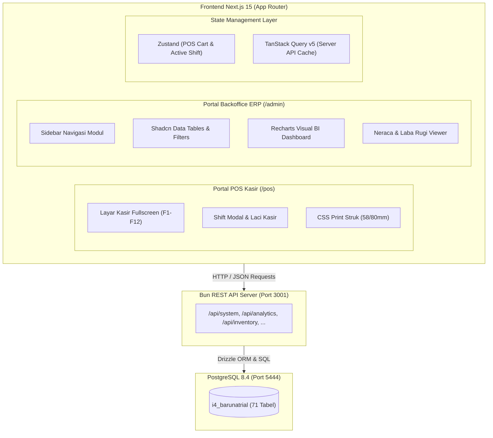
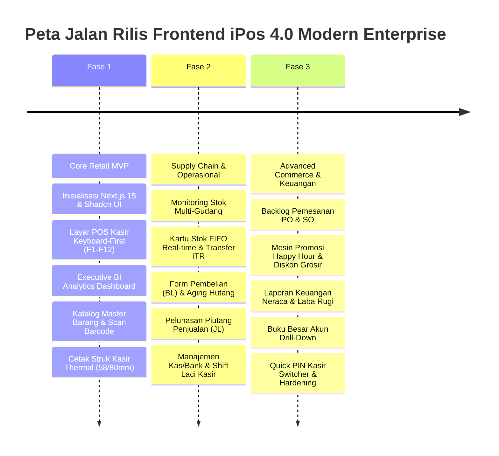

# PRODUCT REQUIREMENT DOCUMENT (PRD)
## FRONTEND ENTERPRISE MODERN IPOS 4.0

| Metadata | Keterangan |
| :--- | :--- |
| **Produk** | Frontend iPos 4.0 Modern Enterprise (Web & Desktop-Ready) |
| **Target Database** | PostgreSQL 8.4.6 (`i4_barunatrial`) |
| **Backend Engine** | Bun 1.3.13 REST API Server (`http://localhost:3001`) |
| **Frontend Stack** | Next.js 15 (App Router), React 19, TypeScript, Tailwind CSS, shadcn/ui |
| **State & Cache** | TanStack Query (React Query) v5, Zustand |
| **Versi Dokumen** | 1.0.0 (Final Approved Architecture) |

---

## 1. Executive Summary & Visi Produk

Program iPos 4.0 adalah sistem POS (Point of Sale) dan Akuntansi ritel yang terbukti andal dalam industri perdagangan di Indonesia. Rekonstruksi modern ini memindahkan aplikasi desktop tradisional (*legacy Windows Forms*) ke antarmuka **Web Enterprise Modern berbasis Next.js 15**, tanpa mengubah integritas skema database PostgreSQL 8.4 yang sudah ada.

### Visi Utama
1. **Kecepatan Transaksi Kasir (*Sub-Second POS Speed*)**: Kasir dapat memproses transaksi ritel 100% menggunakan *keyboard shortcuts* dan *barcode scanner* tanpa menyentuh mouse.
2. **Dual-Experience Layout**: Memisahkan secara tegas antarmuka kasir toko (*Dedicated POS Terminal*) dengan portal manajemen (*Backoffice ERP & Executive BI*).
3. **Visibilitas Finansial Real-Time**: Pemilik toko memiliki visibilitas langsung terhadap omzet, margin kotor per barang, klasifikasi inventaris Pareto ABC, dead stock mengendap, dan risiko churn pelanggan.
4. **Standard Web Printing**: Pencetakan struk belanja thermal (58mm/80mm) dan faktur A4 langsung melalui browser menggunakan CSS print media query standar.

---

## 2. Persona Pengguna & Kebutuhan Utama

```
+-----------------------------------------------------------------------------------+
|                              PERSONA PENGGUNA IPOS 4.0                            |
+----------------------+--------------------+--------------------+------------------+
| Kasir Toko           | Petugas Gudang     | Bagian Keuangan    | Pemilik Toko     |
+----------------------+--------------------+--------------------+------------------+
| - Layar Full-Screen  | - Cek stok gudang  | - Aging hutang     | - Executive BI   |
| - Keyboard F1-F12    | - Form transfer    | - Aging piutang    | - Gross profit   |
| - Scan barcode cepat | - Stok opname      | - Pelunasan giro   | - Dead stock     |
| - Cetak struk kasir  | - Terima konsinyasi| - Jurnal buku besar| - Churn warning  |
| - Buka/tutup shift   | - Serial / IMEI    | - Laba Rugi/Neraca | - Multi-cabang   |
+----------------------+--------------------+--------------------+------------------+
```

---

## 3. Arsitektur Frontend & Tech Stack



### Rincian Pustaka & Framework
- **Framework Core**: `next` (v15+ App Router), `react` (v19), `typescript` (v5+).
- **Styling & UI Components**: `tailwindcss` v4 / v3.4, `@shadcn/ui` (Radix UI primitives).
- **Icons**: `lucide-react`.
- **State Management**:
  - `zustand`: Keranjang belanja kasir (*cart store*), riwayat keyboard event, sesi shift kasir aktif, dark/light theme.
  - `@tanstack/react-query` v5: Caching data server, pagination, auto-refetch, query invalidation.
- **Form & Validasi**: `react-hook-form`, `zod`.
- **Visualisasi Grafik**: `recharts` / shadcn charts untuk visualisasi tren omzet, margin, dan Pareto ABC.
- **Format Mata Uang & Angka**: `Intl.NumberFormat('id-ID')`.

---

## 4. Rincian Spesifikasi Modul (9 Modul Inti)

### Modul 1: Portal Kasir Cepat (Point of Sale - `/pos`)
- **Tampilan Antarmuka**: Layar penuh (*full-screen kiosk style*), minim distraksi tombol, auto-focus input barcode.
- **Peta Tombol Keyboard (Keyboard Shortcuts)**:
  - `F1`: Bantuan pintasan tombol (*Keyboard Help Modal*).
  - `F2`: Cari barang manual (Pop-up modal katalog barang dengan filter nama/kategori).
  - `F3`: Ubah kuantitas (*quantity*) baris aktif.
  - `F4`: Ubah satuan barang (PCS, LUSIN, BOX) dengan konversi harga otomatis.
  - `F5`: Beri potongan/diskon item atau diskon faktur global.
  - `F7`: Ganti pelanggan (Pilih pelanggan umum atau pelanggan member/grosir untuk harga khusus).
  - `F8`: Bayar / Checkout (Membuka dialog pembayaran tunai, kredit, transfer, e-money).
  - `F9`: Cetak ulang nota terakhir (*Reprint last receipt*).
  - `F10`: Pending transaksi (*Hold transaction*) / Ambil transaksi pending.
  - `F12`: Tutup shift kasir (*Close Cash Drawer*).
  - `Esc`: Batal baris / Kembali ke input barcode.
- **Manajemen Sesi Shift Kasir**:
  - Sebelum transaksi pertama, kasir wajib memasukkan modal awal laci (`POST /api/cash-bank/drawer/open`).
  - Saat tutup kasir, sistem meminta kasir memasukkan total uang fisik di laci, menghitung selisih sistem vs riil, dan mencetak laporan serah terima shift (`POST /api/cash-bank/drawer/close`).
- **Pencetakan Nota Kasir**:
  - CSS `@media print` khusus ukuran `58mm` dan `80mm`.
  - Memanggil `window.print()` otomatis setelah konfirmasi pembayaran berhasil.

---

### Modul 2: Executive Dashboard & Business Intelligence (`/admin/analytics`)
- **KPI Summary Cards**:
  - Total Omzet Tahun Berjalan (e.g. 2026: Rp 3.028.138.933,-).
  - Total Faktur (1.003 transaksi).
  - Rasio Pembayaran: Tunai vs Kredit (100% Penjualan Tempo).
  - Rata-rata Nilai Belanja (*Average Basket Size*: Rp 3.019.081,-).
- **Grafik Tren Penjualan Bulanan**:
  - Line / Bar Chart omzet per bulan (Januari s/d Desember) dengan pembanding volume transaksi.
- **Tabel Profitabilitas Barang & Kategori**:
  - 20 barang penyumbang laba kotor terbesar beserta persentase margin (e.g. `LINER EK100`: GP Rp 42,3 Juta / margin 80,57%).
  - Analisa kontribusi margin per kelompok kategori barang.
- **Visualisasi Klasifikasi Inventaris Pareto ABC**:
  - Diagram pie/bar distribusi Kelas A (80% revenue), Kelas B (15%), dan Kelas C (5%).
  - Widget Peringatan **Dead Stock**: Daftar barang mengendap tanpa penjualan di 2026 dan kalkulasi total modal macet (Rp 1,02 Miliar).
- **Customer Retention & Churn Warning**:
  - Tabel pelanggan berisiko hilang (*inactive* > 90 hari) dengan riwayat belanja historis ratusan juta (e.g. `PT. INTIMAS SURYA`, `PAK RIFAI`).

---

### Modul 3: Master Data Barang, Barcode & Multi-Satuan (`/admin/master`)
- **Katalog Barang**:
  - Tabel barang dengan pencarian instan, filter kategori (*jenis*), merek, dan tipe item (*Barang Jadi, Rakitan, Jasa*).
  - Detail item: kode, nama, barcode utama, harga pokok HPP, harga jual standar.
- **Multi-Satuan & Barcode Alternatif**:
  - Tampilan hierarki satuan bertingkat (e.g. 1 DUS = 12 BOX = 144 PCS).
  - Barcode unik per masing-masing level satuan.
- **Simulator Resolusi Harga Bertingkat**:
  - Widget uji kalkulasi harga: masukkan kode item, pilih satuan, masukkan kuantitas, dan pilih grup pelanggan (General, Toko, Bengkel, Agen) -> sistem menampilkan harga akhir dan margin secara instan.
- **Bill of Materials (BOM) Item Rakitan**:
  - Tampilan resep komponen rakitan beserta kalkulasi estimasi HPP rakitan dari komponen penyusunnya.

---

### Modul 4: Inventaris, Multi-Gudang & Konsinyasi (`/admin/inventory`)
- **Monitoring Stok per Gudang**:
  - Matriks stok fisik per kantor/gudang (Gudang Utama `UTM`, Cabang, dll).
  - Valuasi total nilai aset persediaan per gudang.
- **Kartu Stok FIFO Interaktif**:
  - Riwayat kronologis transaksi masuk (BL, KI, SA, ITR-IN) dan keluar (JL, RJ, ITR-OUT).
  - Pelacakan batch FIFO, harga modal per batch, sisa stok, dan saldo berjalan.
- **Formulir Transfer Antar-Gudang (ITR)**:
  - Input kantor asal, kantor tujuan, tanggal, daftar item, kuantitas transfer.
  - Mengurangi stok gudang asal dan menambah stok gudang tujuan secara atomik.
- **Formulir Stok Opname**:
  - Input stok fisik riil hasil penghitungan lapangan vs stok buku sistem.
  - Otomatisasi penyesuaian selisih stok lebih / stok kurang beserta pencatatan HPP FIFO.
- **Rekap Konsinyasi Masuk (KI)**:
  - Pemantauan barang titipan supplier yang telah laku terjual dan nilai hutang konsinyasi yang harus dibayarkan.

---

### Modul 5: Pembelian & Manajemen Hutang Supplier (`/admin/purchasing`)
- **Riwayat Faktur Pembelian (BL)**:
  - Daftar faktur pembelian barang (`tbl_imhd`), pencarian supplier, tanggal jatuh tempo, dan status lunas/tempo.
- **Formulir Faktur Pembelian Baru**:
  - Pemilihan supplier, opsi PPN (Include / Exclude 11%), diskon nota, termin jatuh tempo kredit.
  - Input item barang dengan kalkulasi otomatis subtotal dan HPP batch masuk.
- **Analisa Umur Hutang (*Aging Schedule*)**:
  - Pengelompokan hutang supplier: *Belum Jatuh Tempo, 1-30 Hari, 31-60 Hari, 61-90 Hari, >90 Hari*.
- **Formulir Pelunasan Hutang (`tbl_byrhutanghd`)**:
  - Pemilihan supplier -> sistem otomatis memunculkan seluruh faktur BL yang belum lunas.
  - Alokasi nominal pembayaran per faktur, potongan pelunasan, dan pemilihan akun kas/bank pembayar.

---

### Modul 6: Penjualan & Piutang Pelanggan (`/admin/sales`)
- **Riwayat Faktur Penjualan (JL)**:
  - Daftar transaksi kasir dan faktur penjualan tempo (`tbl_ikhd`).
- **Analisa Umur Piutang Pelanggan**:
  - Aging piutang per pelanggan (Current, 1-30, 31-60, 61-90, >90 hari keterlambatan).
- **Formulir Pelunasan Piutang (`tbl_byrpiutanghd`)**:
  - Pencatatan pembayaran piutang dari pelanggan untuk satu atau beberapa faktur tempo sekaligus.
  - Integrasi pencatatan kas/bank masuk dan pembaruan sisa piutang di `tbl_ikhd`.
- **Manajemen Poin Loyalitas Pelanggan**:
  - Cek saldo poin berjalan per pelanggan.
  - Formulir penukaran/klaim hadiah poin reward pelanggan (`tbl_pointambil`).

---

### Modul 7: Pemesanan (PO/SO) & Mesin Promosi (`/admin/orders`)
- **Backlog Pesanan Pembelian & Penjualan**:
  - Daftar PO ke supplier dan SO dari pelanggan yang masih berstatus terbuka (*backlog*).
  - Progress bar pemenuhan kuantitas (*percentage fulfilled* = `totalterima / totalitem * 100`).
- **Pemenuhan Parsial (*Partial Fulfillment*)**:
  - Form penerimaan barang bertahap untuk PO atau pengiriman bertahap untuk SO.
- **Simulator & Konfigurasi Promosi**:
  - Pengaturan diskon periode / jam promo (*Happy Hour*) per hari dalam seminggu (`tbl_itemdisp`).
  - Pengaturan potongan kuantitas bertingkat untuk pembeli partai besar (`tbl_itempotongan`).

---

### Modul 8: Manajemen Kas, Bank & Biaya Operasional (`/admin/cash-bank`)
- **Dashboard Akun Kas & Bank**:
  - Tampilan saldo aktif seluruh rekening kas kecil, kas kasir, Bank BCA, Bank Mandiri.
- **Formulir Kas Masuk**:
  - Pencatatan pendapatan non-penjualan (e.g. pendapatan sewa, jasa, bunga bank).
- **Formulir Kas Keluar / Biaya Operasional**:
  - Pencatatan pengeluaran beban operasional (gaji, listrik, perlengkapan toko, transport) dengan pemetaan akun debit beban vs kas keluar.
- **Mutasi Transfer Antar-Bank**:
  - Pencatatan pemindahan dana antar akun kas dan bank internal perusahaan.
- **Deposit Pelanggan & Uang Muka**:
  - Pencatatan titipan dana uang muka pesanan penjualan atau pembelian.

---

### Modul 9: Akuntansi & Laporan Keuangan Eksekutif (`/admin/accounting`)
- **Laporan Laba Rugi Komprehensif**:
  - Menampilkan Pendapatan Usaha, Harga Pokok Penjualan (HPP), Laba Kotor, Beban Operasional, dan Laba Bersih Usaha.
  - Filter rentang periode tanggal (bulanan / tahunan).
- **Neraca Keuangan (*Balance Sheet*)**:
  - Struktur hierarki Aktiva (Lancar & Tetap) vs Pasiva (Kewajiban Hutang & Ekuitas Modal).
  - Validasi otomatis keseimbangan debet vs kredit (*Total Aktiva = Total Pasiva*).
- **Buku Besar Pembantu (*General Ledger Drill-Down*)**:
  - Pemilihan akun perkiraan -> menampilkan saldo awal, mutasi kronologis debit/kredit, keterangan nomor transaksi, dan saldo akhir berjalan.

---

## 5. Struktur Halaman & Routing Next.js

```text
frontend/
├── src/
│   ├── app/
│   │   ├── (auth)/
│   │   │   └── login/page.tsx               # Login JWT & PIN Kasir
│   │   ├── (pos)/
│   │   │   ├── layout.tsx                   # POS Fullscreen Layout (No Sidebar)
│   │   │   └── pos/page.tsx                 # Dedicated POS Terminal (F1-F12)
│   │   └── (admin)/
│   │       ├── layout.tsx                   # Admin Sidebar & Header Layout
│   │       ├── dashboard/page.tsx           # Executive BI & Revenue Analytics
│   │       ├── master/
│   │       │   ├── items/page.tsx           # Katalog Barang & Barcode
│   │       │   └── pricing/page.tsx         # Simulator Harga Bertingkat & BOM
│   │       ├── inventory/
│   │       │   ├── stock/page.tsx           # Stok Multi-Gudang
│   │       │   ├── card/page.tsx            # Kartu Stok FIFO
│   │       │   ├── transfer/page.tsx        # Transfer Antar-Gudang (ITR)
│   │       │   └── opname/page.tsx          # Penyesuaian Stok Opname
│   │       ├── purchasing/
│   │       │   ├── invoices/page.tsx        # Faktur Pembelian (BL)
│   │       │   └── payables/page.tsx        # Aging & Pelunasan Hutang
│   │       ├── sales/
│   │       │   ├── invoices/page.tsx        # Faktur Penjualan (JL)
│   │       │   ├── receivables/page.tsx     # Aging & Pelunasan Piutang
│   │       │   └── loyalty/page.tsx         # Poin Reward Pelanggan
│   │       ├── orders/
│   │       │   ├── backlog/page.tsx         # Outstanding PO & SO
│   │       │   └── promotions/page.tsx      # Aturan Happy Hour & Diskon Grosir
│   │       ├── cash-bank/
│   │       │   ├── accounts/page.tsx        # Saldo Kas & Bank
│   │       │   ├── transactions/page.tsx    # Kas Masuk / Keluar / Mutasi
│   │       │   └── shifts/page.tsx          # Riwayat Buka/Tutup Kasir Laci
│   │       └── accounting/
│   │           ├── profit-loss/page.tsx     # Laporan Laba Rugi
│   │           ├── balance-sheet/page.tsx   # Laporan Neraca
│   │           └── ledger/page.tsx          # Buku Besar Akun
│   ├── components/
│   │   ├── pos/                             # Komponen Khusus POS (Cart, Numpad, Tender)
│   │   ├── admin/                           # Komponen Backoffice (Sidebar, Header, UserMenu)
│   │   ├── ui/                              # Shadcn UI Primitives (Button, Dialog, Table, etc.)
│   │   └── shared/                          # CurrencyFormatter, BarcodeReader, PrintReceipt
│   ├── hooks/
│   │   ├── use-pos-keyboard.ts              # Global Keyboard Shortcuts Listener
│   │   ├── use-barcode-scanner.ts           # Hardware Scanner Buffer Interceptor
│   │   └── use-auth.ts                      # JWT Session & RBAC Permission Hook
│   ├── stores/
│   │   ├── pos-cart.store.ts                # Zustand POS Shopping Cart State
│   │   └── pos-shift.store.ts               # Sesi Kasir & Modal Laci Aktif
│   └── lib/
│       ├── api-client.ts                    # Axios / Fetch wrapper ke Bun API (Port 3001)
│       └── utils.ts                         # Formatting uang rupiah, tanggal, dll
```

---

## 6. Peta Jalan Implementasi 3 Fase (Roadmap)



### Rincian Deliverable per Fase

#### Fase 1: Core Retail MVP (Fokus Utama Kasir & Pemilik Toko)
1. Inisialisasi repositori frontend Next.js 15, Tailwind CSS, shadcn/ui, TanStack Query, dan Zustand.
2. Implementasi **Portal POS Kasir Dedikasi (`/pos`)**:
   - Keyboard-first interaction engine (`F1` s/d `F12`, `Enter`, `Esc`).
   - Autocomplete & scan barcode produk instan.
   - Perhitungan kembalian kasir dan dialog pembayaran tunai / kartu.
   - Template cetak struk kasir thermal 58mm/80mm via CSS media print.
3. Implementasi **Executive BI Dashboard (`/admin/dashboard`)**:
   - Card omzet tahun 2026, total faktur, rasio kredit, average basket size.
   - Grafik performa omzet bulanan.
   - Widget ranking profitabilitas barang dan margin kotor.
   - Widget deteksi dead stock mengendap dan churn pelanggan.
4. Implementasi **Master Data Barang & Barcode (`/admin/master/items`)**:
   - Katalog barang, filter kategori/merek, simulator harga bertingkat pelanggan.

#### Fase 2: Supply Chain & Operasional Toko
1. Implementasi **Modul Inventaris & Multi-Gudang (`/admin/inventory`)**:
   - Stok per gudang, kartu mutasi stok FIFO, form transfer cabang (ITR), dan form stok opname.
2. Implementasi **Modul Pembelian & Hutang (`/admin/purchasing`)**:
   - Riwayat faktur beli, analisa schedule aging hutang supplier, form pelunasan hutang.
3. Implementasi **Modul Penjualan & Piutang (`/admin/sales`)**:
   - Riwayat penjualan tempo kasir, analisa aging piutang, form pelunasan piutang, saldo poin member.
4. Implementasi **Modul Kas, Bank & Laci Kasir (`/admin/cash-bank`)**:
   - Dashboard saldo rekening kas/bank, form kas masuk/keluar operasional, riwayat buka/tutup laci kasir.

#### Fase 3: Advanced Commerce & Pelaporan Keuangan
1. Implementasi **Modul Pemesanan (PO/SO) & Promosi (`/admin/orders`)**:
   - Backlog pesanan belum tuntas, fulfillment parsial/penuh, konfigurasi promo berkala & happy hour.
2. Implementasi **Modul Akuntansi & Laporan Keuangan (`/admin/accounting`)**:
   - Laporan Laba Rugi komprehensif, Neraca Keuangan Aktiva vs Pasiva, Buku Besar akun.
3. Implementasi **Sistem Keamanan & Quick PIN Kasir**:
   - Proteksi route berbasis role JWT, Quick PIN switcher di terminal kasir POS tanpa relogin browser.
4. Hardening, QA testing, dan dokumentasi panduan operasional pengguna.
