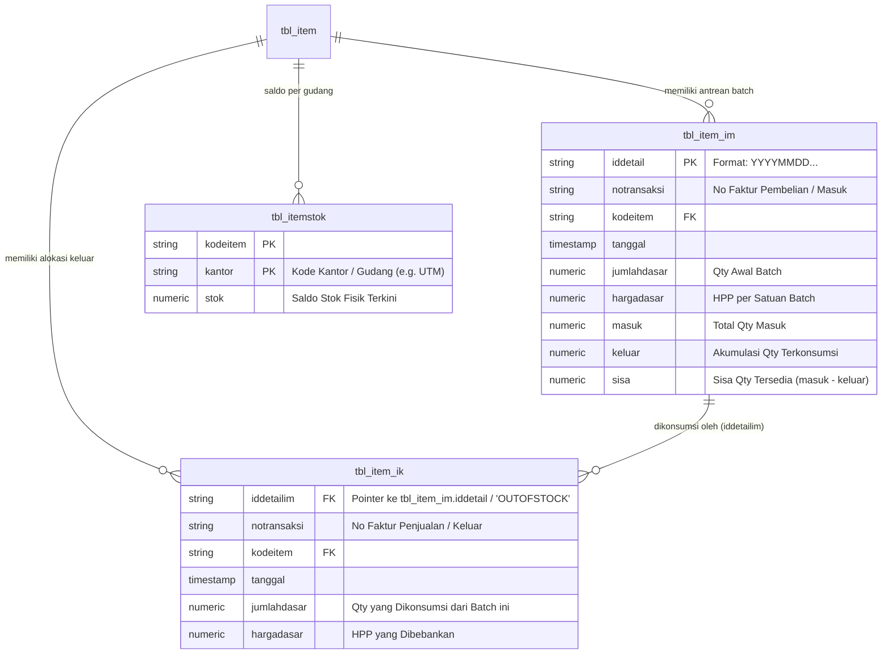
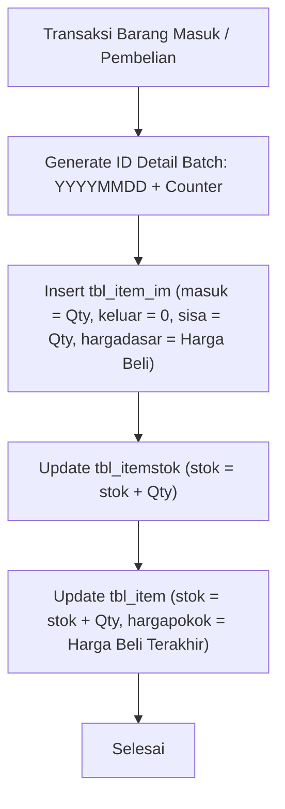
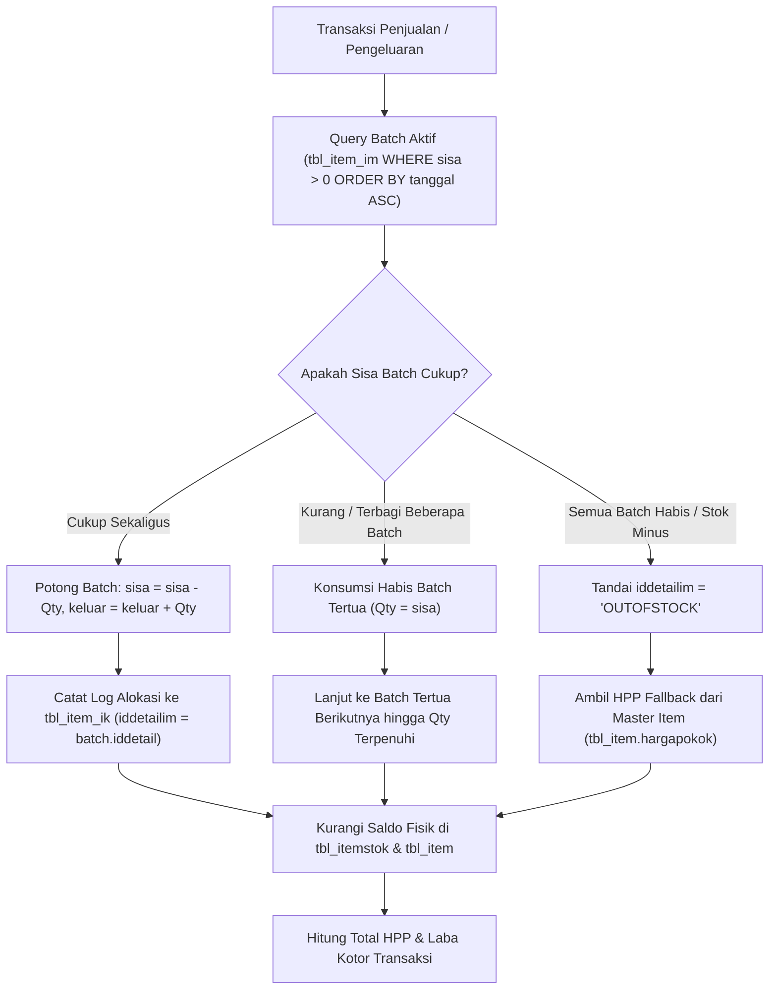

# 📦 DOKUMENTASI LENGKAP: ENGINE MUTASI STOK & HPP FIFO (iPos 4.0)

> **File Service**: `backend/src/services/fifo-inventory.service.ts`  
> **Teknologi**: TypeScript + Bun + PostgreSQL (`iPgSQL` 8.4 / 14+)  
> **Basis Arsitektur**: Reverse Engineering Logika Bisnis & Skema Database Program Toko iPos 4.0  

---

## 📑 DAFTAR ISI
1. [Prinsip & Filosofi Metode FIFO iPos 4.0](#1-prinsip--filosofi-metode-fifo-ipos-40)
2. [Arsitektur Database & Bukti Nyata (*Evidence-Based*)](#2-arsitektur-database--bukti-nyata-evidence-based)
3. [Alur Algoritma & Transisi Status](#3-alur-algoritma--transisi-status)
   - [3.1 Alur Barang Masuk (Pembelian / Inflow)](#31-alur-barang-masuk-pembelian--inflow)
   - [3.2 Alur Barang Keluar (Penjualan / Outflow)](#32-alur-barang-keluar-penjualan--outflow)
   - [3.3 Penanganan Kasus Khusus: *OUTOFSTOCK Fallback*](#33-penanganan-kasus-khusus-outofstock-fallback)
   - [3.4 Alur Stok Opname (Penyesuaian Fisik vs Sistem)](#34-alur-stok-opname-penyesuaian-fisik-vs-sistem)
4. [Spesifikasi Teknis `FifoInventoryService`](#4-spesifikasi-teknis-fifoinventoryservice)
5. [Contoh Penggunaan & Integrasi Frontend / POS Kasir](#5-contoh-penggunaan--integrasi-frontend--pos-kasir)
6. [Audit & Rekonsiliasi Integritas Data](#6-audit--rekonsiliasi-integritas-data)

---

## 1. Prinsip & Filosofi Metode FIFO iPos 4.0

Program Toko iPos 4.0 menggunakan metode **FIFO (*First In, First Out*)** murni untuk penilaian persediaan barang dagang dan perhitungan **Harga Pokok Penjualan (HPP / *Cost of Goods Sold*)**.

### Prinsip Utama:
* Barang yang dibeli atau masuk lebih awal akan menjadi barang pertama yang dikeluarkan/dijual ketika terjadi transaksi penjualan.
* Nilai modal barang yang dibebankan ke Laporan Laba Rugi (sebagai HPP) mengacu pada **harga beli riil dari batch tertua yang masih memiliki sisa kuantitas**.
* Perhitungan ini menjamin nilai persediaan akhir di Neraca selalu mencerminkan harga pasar atau harga pembelian yang paling mutakhir.

---

## 2. Arsitektur Database & Bukti Nyata (*Evidence-Based*)

Berdasarkan investigasi langsung ke basis data PostgreSQL `i4_barunatrial`, iPos 4.0 mengelola FIFO melalui arsitektur **dua tabel berpasangan (*Queue & Ledger*)**:



### Bukti Data Nyata dari Database PostgreSQL:
1. **Batch Masuk (`tbl_item_im`)**:
   ```sql
   SELECT iddetail, notransaksi, kodeitem, masuk, keluar, sisa, hargadasar 
   FROM tbl_item_im WHERE kodeitem = 'PACKING KOP 6D22 ASBES VEKTOR';
   ```
   *Data:* `iddetail: 202201100000000000014`, `masuk: 24`, `keluar: 0`, `sisa: 24`, `hargadasar: 135.000`.

2. **Alokasi Keluar (`tbl_item_ik`)**:
   ```sql
   SELECT iddetailim, notransaksi, jumlahdasar, hargadasar 
   FROM tbl_item_ik WHERE kodeitem = 'PEN PISTON 6D22';
   ```
   *Data:* Faktur `0001/JL/UTM/0122` mengambil 6 unit dari batch `202201100000000000913` seharga Rp 120.000/unit.

3. **Bukti Edge Case `OUTOFSTOCK`**:
   Pada faktur `4492/JL/UTM/0126`, ketika seluruh batch habis, iPos 4.0 mencatat:
   `iddetailim = 'OUTOFSTOCK'`, dan membebankan HPP dari `tbl_item.hargapokok`.

---

## 3. Alur Algoritma & Transisi Status

### 3.1 Alur Barang Masuk (Pembelian / Inflow)


---

### 3.2 Alur Barang Keluar (Penjualan / Outflow)


---

### 3.3 Penanganan Kasus Khusus: *OUTOFSTOCK Fallback*
Jika bisnis mengizinkan penjualan barang saat stok di sistem sedang kosong (karena faktur beli belum sempat diinput admin):
* Sistem **TIDAK AKAN CRASH** atau menghasilkan HPP 0.
* Sistem secara otomatis mengaktifkan *fallback mechanism*:
  $$\text{HPP Unit} = \text{tbl\_item.hargapokok (Harga Pokok Standar di Master Data)}$$
* Pointer alokasi diberi label **`OUTOFSTOCK`**. Ketika proses bulanan (*recalculation*) dijalankan setelah faktur beli disusulkan, iPos 4.0 akan merealokasi baris `OUTOFSTOCK` ini ke batch pembelian yang sesungguhnya.

---

### 3.4 Alur Stok Opname (Penyesuaian Fisik vs Sistem)
1. Hitung $\Delta = \text{Jumlah Fisik} - \text{Jumlah Sistem}$.
2. **Jika $\Delta > 0$ (Surplus / Barang Lebih)**:
   * Diberlakukan sebagai Barang Masuk (`tipe = 'OP'`).
   * Dibuatkan batch FIFO baru di `tbl_item_im` seharga harga pokok master.
3. **Jika $\Delta < 0$ (Defisit / Barang Kurang / Rusak / Hilang)**:
   * Diberlakukan sebagai Barang Keluar (`tipe = 'OP'`).
   * Diserap dari batch FIFO tertua melalui `recordStockOut()`.
4. Selisih dicatat ke tabel `tbl_itemopname` dan dijurnal ke akun penyesuaian persediaan (`5-1200 Beban Selisih Stok`).

---

## 4. Spesifikasi Teknis `FifoInventoryService`

Layanan ini mengemas seluruh aturan di atas ke dalam kelas TypeScript modern yang siap dipanggil dari route handler atau API backend Anda.

### Definisi Interface Data:
```typescript
export interface StockInParams {
  notransaksi: string;
  tanggal: Date | string;
  kodeitem: string;
  kodekantor?: string; // Default: 'UTM'
  jumlah: number;
  harga: number;       // Harga per satuan dasar
  satuan?: string;     // Default: 'PCS'
  tipe?: string;       // 'BL' | 'IM' | 'SA' | 'RJ' | 'OP'
}

export interface StockOutParams {
  notransaksi: string;
  tanggal: Date | string;
  kodeitem: string;
  kodekantor?: string;
  jumlah: number;
  satuan?: string;
  tipe?: string;       // 'JL' | 'IK' | 'RB' | 'OP'
  iddetailtrs?: string;
}

export interface FifoAllocationResult {
  kodeitem: string;
  totalQtyOut: number;
  totalHpp: number;
  avgHppPerUnit: number;
  isOutOfStockFallback: boolean;
  allocations: {
    iddetailim: string;
    batchNotransaksi: string;
    qtyAllocated: number;
    unitCost: number;
    subtotalHpp: number;
    isOutOfStock: boolean;
  }[];
}
```

### Daftar Method yang Tersedia:

| Method | Deskripsi | Return Value |
|---|---|---|
| `recordStockIn(params)` | Mendaftarkan batch baru ke `tbl_item_im` dan menambah saldo stok. | `Promise<{ iddetail: string }>` |
| `recordStockOut(params)` | Mengonsumsi batch FIFO tertua, membebankan HPP riil, dan mencatat alokasi. | `Promise<FifoAllocationResult>` |
| `simulateFifoDepletion(item, qty)` | **Simulasi Real-Time untuk POS**: Melihat estimasi HPP tanpa mengubah database. | `Promise<FifoAllocationResult>` |
| `getItemStockCard(item)` | Menghasilkan riwayat mutasi kartu stok lengkap dengan running balance HPP. | `Promise<StockCardRow[]>` |
| `recordStockOpname(params)` | Menyelaraskan stok fisik vs sistem dan menyesuaikan batch FIFO secara otomatis. | `Promise<OpnameResult>` |

---

## 5. Contoh Penggunaan & Integrasi Frontend / POS Kasir

### 5.1 Simulasi HPP Real-time di Kasir (Sebelum Tombol "Bayar" Ditekan)
Fitur ini mencegah kasir menjual barang di bawah harga pokok:

```typescript
import { FifoInventoryService } from "./services/fifo-inventory.service";

// Saat kasir memasukkan item ke keranjang belanja
const sim = await FifoInventoryService.simulateFifoDepletion("PEN PISTON 6D22", 2);

console.log(`Estimasi HPP Total : Rp ${sim.totalHpp.toLocaleString("id-ID")}`);
console.log(`HPP per Satuan     : Rp ${sim.avgHppPerUnit.toLocaleString("id-ID")}`);

// Cek apakah harga jual kasir di bawah HPP
const hargaJualKasir = 100000;
if (hargaJualKasir < sim.avgHppPerUnit) {
  console.warn("⚠️ PERINGATAN: Harga jual kasir di bawah harga modal (HPP)!");
}
```

### 5.2 Menyimpan Transaksi Penjualan Kasir
```typescript
// Eksekusi mutasi stok saat transaksi final dibayar
const result = await FifoInventoryService.recordStockOut({
  notransaksi: "0050/JL/UTM/1026",
  tanggal: new Date(),
  kodeitem: "PEN PISTON 6D22",
  jumlah: 2,
  tipe: "JL",
});

console.log("HPP Berhasil Dibebankan:", result.totalHpp);
// Jurnal otomatis: Debet 5-1100 (HPP) / Kredit 1-1301 (Persediaan) sebesar result.totalHpp
```

### 5.3 Menampilkan Kartu Stok di Frontend Web
```typescript
const kartuStok = await FifoInventoryService.getItemStockCard("PEN PISTON 6D22");

// Data siap di-render ke TanStack Table / UI Kartu Stok:
kartuStok.forEach(row => {
  console.log(`${row.tanggal} | ${row.notransaksi} | ${row.direction} ${row.qty} | Saldo: ${row.saldo_akhir_qty} | Nilai Aset: Rp ${row.saldo_akhir_nilai}`);
});
```

---

## 7. Fitur Kartu Stok & Deteksi Saldo Item Minus

### 7.1 Anatomi Kartu Stok iPos 4.0
Berdasarkan template laporan resmi [`Kartu Stok.repx`](file:///c:/Program%20Files%20(x86)/Program%20Kreatif/Program%20iPos%204.0/Report/Kartu%20Stok.repx), Kartu Stok menyajikan mutasi buku pembantu persediaan dengan struktur kolom:
1. **Tanggal**: Waktu pencatatan mutasi secara kronologis.
2. **No Transaksi**: Nomor bukti faktur (`BL`, `JL`, `IM`, `IK`, `OP`, `TR`).
3. **Dept. / Kantor**: Lokasi fisik gudang/toko barang.
4. **Keterangan**: Nama supplier, pelanggan, atau alasan penyesuaian.
5. **Masuk (Qty In)**: Jumlah penambahan barang.
6. **Keluar (Qty Out)**: Jumlah pengurangan barang.
7. **Saldo (Running Balance)**: Akumulasi saldo berjalan $\text{Saldo}_{t} = \text{Saldo}_{t-1} + \text{Masuk} - \text{Keluar}$.

### 7.2 Tiga Dimensi Saldo Item Minus
1. **Saldo Minus Agregat Terkini (`tbl_itemstok.stok < 0`)**:
   Stok saat ini di gudang bernilai negatif karena penjualan melebihi pembelian riil.
2. **Saldo Minus Kronologis (*Negative Stock Dip*)**:
   Barang dijual sebelum faktur pembelian sempat diinput admin, menyebabkan saldo kartu stok sempat anjlok ke angka negatif di masa lalu.
3. **Penjualan Berstatus `OUTOFSTOCK` (`tbl_item_ik.iddetailim = 'OUTOFSTOCK'`)**:
   Transaksi penjualan yang dipaksa keluar saat kuota batch FIFO habis, mengakibatkan HPP terdistorsi karena menggunakan harga pokok fallback master data.

### 7.3 Cara Menjalankan Deteksi Saldo Minus
Jalankan perintah audit berikut di terminal:
```bash
bun run detect:stock-minus
```
Atau integrasikan langsung di kode TypeScript:
```typescript
import { FifoInventoryService } from "./services/fifo-inventory.service";

const report = await FifoInventoryService.detectNegativeStock();
console.log(`Item Bersaldo Minus : ${report.totalCurrentNegativeItems}`);
console.log(`Transaksi OUTOFSTOCK: ${report.totalOutOfStockSalesCount}`);
```

