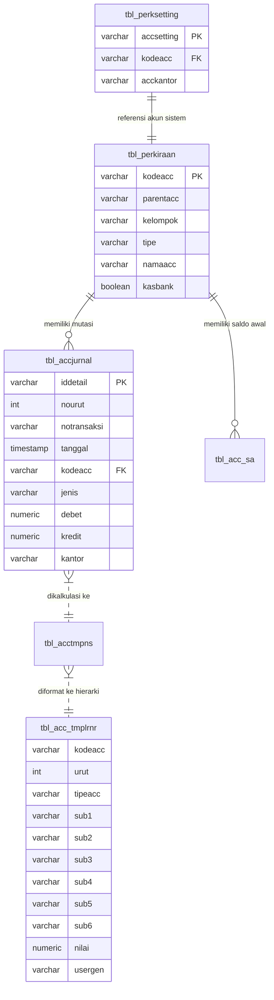

# Panduan Generate Laporan Akuntansi iPos 4.0 Berbasis Database PostgreSQL

Dokumen ini berisi analisis arsitektur data akuntansi **iPos 4.0**, cara kerja *stored procedure* internal, struktur tabel, serta panduan lengkap cara menghasilkan laporan keuangan (**Neraca**, **Laba Rugi**, **Neraca Saldo / Lajur**, **Buku Besar**, **Jurnal Umum**, dan **Buku Pembantu Piutang / Hutang**) baik menggunakan fungsi bawaan database maupun kueri SQL / Drizzle ORM independen.

---

## 1. Arsitektur Akuntansi iPos 4.0

Aplikasi iPos 4.0 mengadopsi sistem pembukuan berpasangan (*double-entry bookkeeping*). Setiap transaksi operasional (penjualan kasir, faktur penjualan, pembelian, retur, pembayaran piutang/hutang, kas masuk/keluar, dan penyesuaian stok) otomatis menghasilkan jurnal ke dalam tabel `tbl_accjurnal`.

### Struktur Bagan Akun (Chart of Accounts / COA)

Tabel master akun adalah `tbl_perkiraan`. Setiap akun memiliki atribut:
- `kodeacc`: Kode akun unik (format bertingkat seperti `1-0000`, `1-1100`, `1-1110`).
- `parentacc`: Kode akun induk pembentuk pohon hierarki.
- `tipe`:
  - `'H'` (*Header*): Akun induk/kelompok, tidak menampung transaksi langsung.
  - `'D'` (*Detail*): Akun transaksi (leaf), tempat mutasi dicatat.
- `kelompok`: Menentukan sifat akuntansi dan posisi normal saldo:

| Kelompok | Kategori Akuntansi | Saldo Normal | Aturan Penambahan | Laporan Utama |
| :---: | :--- | :---: | :---: | :--- |
| **1** | **AKTIVA (Asset)** | Debet | Debet bertambah, Kredit berkurang | Neraca |
| **2** | **KEWAJIBAN (Liability)** | Kredit | Kredit bertambah, Debet berkurang | Neraca |
| **3** | **MODAL (Equity)** | Kredit | Kredit bertambah, Debet berkurang | Neraca |
| **4** | **PENDAPATAN (Revenue)** | Kredit | Kredit bertambah, Debet berkurang | Laba Rugi |
| **5** | **HPP (Cost of Goods Sold)** | Debet | Debet bertambah, Kredit berkurang | Laba Rugi |
| **6** | **BIAYA (Operating Expense)** | Debet | Debet bertambah, Kredit berkurang | Laba Rugi |
| **7** | **PENDAPATAN LAIN (Other Income)** | Kredit | Kredit bertambah, Debet berkurang | Laba Rugi |
| **8** | **BIAYA LAIN (Other Expense)** | Debet | Debet bertambah, Kredit berkurang | Laba Rugi |

---

## 2. Tabel-Tabel Utama Akuntansi



### Penjelasan Tabel:
1. **`tbl_perkiraan`**: Master akun buku besar. Field `kasbank = true` menandai akun Kas / Bank.
2. **`tbl_perksetting`**: Pemetaan akun default transaksi otomatis. Contoh:
   - `ACC_LABATAHAN`: Akun Laba Ditahan (misal `3-2000`).
   - `ACC_LABAJALAN`: Akun Laba Tahun Berjalan (misal `3-3000`).
   - `ACC_ITEM_JUAL`: Akun default penjualan (`4-1100`).
   - `ACC_ITEM_HPP`: Akun default HPP (`5-1100`).
   - `ACC_JUAL_KREDIT`: Akun default piutang dagang (`1-1210`).
   - `ACC_BELI_KREDIT`: Akun default hutang dagang (`2-1101`).
3. **`tbl_acc_sa`**: Saldo awal akun saat tutup buku atau setup awal.
4. **`tbl_accjurnal`**: Buku jurnal induk. Menyimpan seluruh mutasi transaksi harian.
5. **`tbl_acctmpns`**: Tabel temporer hasil pengolahan neraca saldo (`proseslap_ns`).
6. **`tbl_acc_tmplrnr`**: Tabel penampung laporan akhir Neraca dan Laba Rugi yang sudah disusun dalam format pohon hierarki indentasi (`sub1` s/d `sub6`).

---

## 3. Metode 1: Menggunakan Stored Procedure Bawaan iPos 4

iPos 4 telah menyediakan fungsi-fungsi PL/pgSQL di PostgreSQL yang melakukan seluruh kalkulasi secara otomatis.

### A. Laporan Laba Rugi (Profit & Loss)

Fungsi database:
```sql
SELECT acc_genrep_labarugi(
  '2024-01-01 00:00:00'::timestamp, -- saawal : Awal tahun buku
  '2024-01-01 00:00:00'::timestamp, -- saakhir: Batas saldo awal
  '2024-01-01 00:00:00'::timestamp, -- pawal  : Periode awal laporan
  '2024-12-31 23:59:59'::timestamp, -- pakhir : Periode akhir laporan
  'admin',                          -- user_gen: ID user (untuk isolasi data temporer)
  'IDR',                            -- pmatauang: Kode mata uang
  1,                                -- prate    : Nilai kurs
  2                                 -- pdesdigit: Digit desimal
);
```

#### Alur Logika Eksekusi `acc_genrep_labarugi`:
1. Menghapus data sementara milik user: `DELETE FROM tbl_acc_tmplrnr WHERE usergen = 'admin';`
2. Memanggil `proseslap_ns(...)` untuk menghitung mutasi kelompok 4, 5, 6, 7, dan 8 pada rentang `pawal` s/d `pakhir`.
3. Membaca pohon akun dari `tbl_perkiraan` secara rekursif via `acc_genrep_lrnr`:
   - **Total Pendapatan** = $\sum(\text{Kredit} - \text{Debet})$ dari kelompok `4`.
   - **Total HPP** = $\sum(\text{Debet} - \text{Kredit})$ dari kelompok `5`.
   - **Laba Kotor** = Total Pendapatan - Total HPP.
   - **Total Biaya Operasional** = $\sum(\text{Debet} - \text{Kredit})$ dari kelompok `6`.
   - **Pendapatan Lain-lain** = $\sum(\text{Kredit} - \text{Debet})$ dari kelompok `7`.
   - **Biaya Lain-lain** = $\sum(\text{Debet} - \text{Kredit})$ dari kelompok `8`.
   - **Laba Bersih** = $(\text{Laba Kotor} - \text{Biaya}) + (\text{Pendapatan Lain} - \text{Biaya Lain})$.
4. Mengisi hasil ke tabel `tbl_acc_tmplrnr`.

#### Mengambil Hasil Laporan Laba Rugi:
```sql
SELECT 
  urut,
  kodeacc,
  tipeacc, -- 'H' (Header), 'D' (Detail), 'TH' (Total Header)
  setsub AS level_indentasi,
  COALESCE(sub1, sub2, sub3, sub4, sub5, sub6, '') AS nama_akun,
  nilai
FROM tbl_acc_tmplrnr
WHERE usergen = 'admin'
ORDER BY urut;
```

---

### B. Laporan Neraca (Balance Sheet)

Fungsi database:
```sql
SELECT acc_genrep_neraca(
  '2024-01-01 00:00:00'::timestamp, -- saawal : Tanggal awal saldo tahunan
  '2024-01-01 00:00:00'::timestamp, -- saakhir: Batas saldo awal sebelum periode
  '2024-01-01 00:00:00'::timestamp, -- pawal  : Tanggal awal periode
  '2024-12-31 23:59:59'::timestamp, -- pakhir : Tanggal akhir periode
  'admin',                          -- user_gen
  'IDR',                            -- pmatauang
  1,                                -- prate
  2                                 -- pdesdigit
);
```

#### Alur Logika Eksekusi `acc_genrep_neraca`:
1. Memanggil `proseslap_ns`:
   - Mengambil saldo awal kelompok 1, 2, 3 dari `tbl_acc_sa` ditambah mutasi jurnal sebelum `pawal`.
   - Menghitung laba ditahan tahun berjalan dari mutasi pendapatan dan beban sebelum `pawal`, lalu otomatis dialokasikan ke akun `ACC_LABAJALAN` (`3-3000`).
   - Menghitung saldo akhir per akun:
     - Aktiva (1): $\text{Debet} - \text{Kredit}$
     - Kewajiban (2) & Modal (3): $\text{Kredit} - \text{Debet}$
2. Mengagregasikan pohon akun secara hierarkis:
   - **Total Aktiva** (`1-0000`)
   - **Total Kewajiban** (`2-0000`)
   - **Total Modal** (`3-0000`)
   - **Total Pasiva** = Total Kewajiban + Total Modal
3. Keseimbangan Neraca: **Total Aktiva = Total Pasiva**.

#### Mengambil Hasil Laporan Neraca:
```sql
SELECT 
  urut,
  kodeacc,
  tipeacc,
  setsub AS level_indentasi,
  COALESCE(sub1, sub2, sub3, sub4, sub5, sub6, '') AS nama_akun,
  nilai
FROM tbl_acc_tmplrnr
WHERE usergen = 'admin'
ORDER BY urut;
```

---

### C. Laporan Neraca Saldo & Neraca Lajur (Trial Balance / Worksheet)

Fungsi `proseslap_ns` mengisi tabel `tbl_acctmpns`:
```sql
SELECT proseslap_ns(
  '2024-01-01 00:00:00'::timestamp,
  '2024-01-01 00:00:00'::timestamp,
  '2024-01-01 00:00:00'::timestamp,
  '2024-12-31 23:59:59'::timestamp,
  'admin', 'IDR', 1, 2
);
```

#### Mengambil Data Neraca Saldo / Lajur:
```sql
SELECT 
  ns.kodeacc,
  p.namaacc,
  p.kelompok,
  -- Saldo Awal
  ns.rdebet  AS sa_debet,
  ns.rkredit AS sa_kredit,
  -- Mutasi Periode
  ns.debet   AS mutasi_debet,
  ns.kredit  AS mutasi_kredit,
  -- Jurnal Penyesuaian
  ns.pdebet  AS penyesuaian_debet,
  ns.pkredit AS penyesuaian_kredit,
  -- Saldo Disesuaikan
  ns.tdebet  AS saldo_akhir_debet,
  ns.tkredit AS saldo_akhir_kredit,
  -- Kolom Laba Rugi
  ns.lrdebet,
  ns.lrkredit,
  -- Kolom Neraca
  ns.ndebet,
  ns.nkredit
FROM tbl_acctmpns ns
JOIN tbl_perkiraan p ON ns.kodeacc = p.kodeacc
WHERE ns.usergen = 'admin'
ORDER BY ns.kodeacc;
```

---

## 4. Metode 2: Menggunakan Kueri SQL / Drizzle ORM Independen

Jika backend Web / API Anda melayani banyak pengguna secara bersamaan (*concurrent*), disarankan tidak bergantung pada tabel temporer (`tbl_acc_tmplrnr`) agar tidak terjadi *race condition*. Berikut kueri murni yang dapat langsung dieksekusi:

### A. Laporan Buku Besar (General Ledger)

Laporan Buku Besar memerlukan 2 tahap: menghitung Saldo Awal sebelum periode dan menampilkan rincian jurnal selama periode berjalan.

```sql
-- 1. Hitung Saldo Awal Akun Kas Kecil (1-1110) per 2024-10-01
WITH sa_master AS (
  SELECT COALESCE(SUM(jumlah), 0) AS nominal
  FROM tbl_acc_sa
  WHERE kodeacc = '1-1110' AND tanggal < '2024-10-01 00:00:00'
),
mutasi_sebelum AS (
  SELECT 
    COALESCE(SUM(debet), 0) AS debet_lalu,
    COALESCE(SUM(kredit), 0) AS kredit_lalu
  FROM tbl_accjurnal
  WHERE kodeacc = '1-1110' AND tanggal < '2024-10-01 00:00:00'
)
SELECT 
  (SELECT nominal FROM sa_master) + 
  (SELECT (debet_lalu - kredit_lalu) FROM mutasi_sebelum) AS saldo_awal;

-- 2. Transaksi Mutasi Buku Besar Periode Berjalan
SELECT 
  j.nourut,
  j.notransaksi,
  j.tanggal,
  j.keterangan,
  j.debet,
  j.kredit,
  -- Running Balance dihitung menggunakan Window Function:
  SUM(j.debet - j.kredit) OVER (
    ORDER BY j.tanggal, j.nourut 
    ROWS BETWEEN UNBOUNDED PRECEDING AND CURRENT ROW
  ) AS mutasi_berjalan
FROM tbl_accjurnal j
WHERE j.kodeacc = '1-1110'
  AND j.tanggal BETWEEN '2024-10-01 00:00:00' AND '2024-10-31 23:59:59'
ORDER BY j.tanggal, j.nourut;
```
*(Catatan: Untuk akun kewajiban/modal/pendapatan dengan saldo normal kredit, gunakan rumus `kredit - debet`).*

---

### B. Laporan Jurnal Umum (General Journal)

Menampilkan seluruh aktivitas pembukuan dalam periode:
```sql
SELECT 
  j.tanggal,
  j.notransaksi,
  j.nourut,
  j.kodeacc,
  p.namaacc,
  j.keterangan,
  j.debet,
  j.kredit,
  j.jenis,      -- 'Jurnal' atau 'Penyesuaian'
  j.tipeinput,  -- 'R' (Real/Sistem) atau 'U' (Umum/Manual)
  j.kantor
FROM tbl_accjurnal j
JOIN tbl_perkiraan p ON j.kodeacc = p.kodeacc
WHERE j.tanggal BETWEEN '2024-10-01 00:00:00' AND '2024-10-31 23:59:59'
ORDER BY j.tanggal, j.notransaksi, j.nourut;
```

---

### C. Ringkasan Laba Rugi Berjalan (Kueri Agregasi Langsung)

```sql
SELECT 
  p.kelompok,
  CASE p.kelompok
    WHEN '4' THEN 'Pendapatan Usaha'
    WHEN '5' THEN 'Harga Pokok Penjualan (HPP)'
    WHEN '6' THEN 'Biaya Operasional'
    WHEN '7' THEN 'Pendapatan Lain-lain'
    WHEN '8' THEN 'Biaya Lain-lain'
  END AS kategori,
  p.kodeacc,
  p.namaacc,
  CASE 
    WHEN p.kelompok IN ('4', '7') THEN SUM(j.kredit - j.debet)
    ELSE SUM(j.debet - j.kredit)
  END AS nominal
FROM tbl_accjurnal j
JOIN tbl_perkiraan p ON j.kodeacc = p.kodeacc
WHERE p.kelompok IN ('4', '5', '6', '7', '8')
  AND j.tanggal BETWEEN '2024-01-01 00:00:00' AND '2024-12-31 23:59:59'
GROUP BY p.kelompok, p.kodeacc, p.namaacc
ORDER BY p.kodeacc;
```

---

### D. Buku Pembantu Piutang (AR Subledger) & Hutang (AP Subledger)

iPos 4 menghubungkan piutang/hutang dengan data kontak (`tbl_supel`):
- **Kartu Piutang per Pelanggan:**
```sql
SELECT 
  ik.tanggal,
  ik.notransaksi,
  s.kodesupel,
  s.nama AS nama_pelanggan,
  ik.totalakhir AS faktur_piutang,
  ik.jmltunai   AS uang_muka_atau_tunai,
  ik.jmlkredit  AS saldo_piutang,
  ik.byr_krd_jt AS tanggal_jatuh_tempo
FROM tbl_ikhd ik
JOIN tbl_supel s ON ik.kodesupel = s.kodesupel
WHERE ik.jmlkredit > 0
ORDER BY ik.tanggal DESC;
```

- **Riwayat Pembayaran Piutang:**
```sql
SELECT 
  hd.tanggal,
  hd.notransaksi AS no_bukti_bayar,
  s.nama AS pelanggan,
  dt.notrsmasuk AS no_faktur_yang_dibayar,
  dt.krd_total  AS total_tagihan,
  dt.krd_jml_pot AS potongan,
  dt.krd_jml_byr AS jumlah_dibayar,
  hd.carabayar,
  hd.acc_bayar  AS masuk_ke_akun_kas
FROM tbl_byrpiutanghd hd
JOIN tbl_byrpiutangdt dt ON hd.notransaksi = dt.notransaksi
JOIN tbl_supel s ON hd.kodesupel = s.kodesupel
WHERE hd.tanggal BETWEEN '2024-10-01 00:00:00' AND '2024-10-31 23:59:59'
ORDER BY hd.tanggal DESC;
```

---

## 5. Contoh Implementasi Layanan di Backend (Bun + Drizzle ORM)

Berikut contoh fungsi TypeScript untuk mengambil laporan Neraca dan Laba Rugi dari backend Bun:

```typescript
// backend/src/services/accounting.service.ts
import { db } from "../db";
import { sql } from "drizzle-orm";

export interface ReportItem {
  urut: number;
  kodeacc: string;
  tipeacc: "H" | "D" | "TH";
  level: number;
  nama: string;
  nilai: number;
}

export class AccountingService {
  /**
   * Generate Laporan Laba Rugi
   */
  static async getLabaRugi(
    startDate: string,
    endDate: string,
    userId = "backend_worker"
  ): Promise<ReportItem[]> {
    const start = `${startDate} 00:00:00`;
    const end = `${endDate} 23:59:59`;

    // 1. Jalankan fungsi database iPos 4
    await db.execute(sql`
      SELECT acc_genrep_labarugi(
        ${start}::timestamp,
        ${start}::timestamp,
        ${start}::timestamp,
        ${end}::timestamp,
        ${userId},
        'IDR',
        1,
        2
      );
    `);

    // 2. Ambil hasilnya dari tbl_acc_tmplrnr
    const rows = await db.execute<any>(sql`
      SELECT 
        urut,
        kodeacc,
        tipeacc,
        setsub as level,
        COALESCE(sub1, sub2, sub3, sub4, sub5, sub6, '') AS nama,
        COALESCE(nilai, 0)::float AS nilai
      FROM tbl_acc_tmplrnr
      WHERE usergen = ${userId}
      ORDER BY urut;
    `);

    return rows as unknown as ReportItem[];
  }

  /**
   * Generate Laporan Neraca
   */
  static async getNeraca(
    startDate: string,
    endDate: string,
    userId = "backend_worker"
  ): Promise<ReportItem[]> {
    const startYear = `${startDate.substring(0, 4)}-01-01 00:00:00`;
    const startPeriod = `${startDate} 00:00:00`;
    const endPeriod = `${endDate} 23:59:59`;

    // 1. Jalankan fungsi database iPos 4
    await db.execute(sql`
      SELECT acc_genrep_neraca(
        ${startYear}::timestamp,
        ${startPeriod}::timestamp,
        ${startPeriod}::timestamp,
        ${endPeriod}::timestamp,
        ${userId},
        'IDR',
        1,
        2
      );
    `);

    // 2. Ambil hasilnya dari tbl_acc_tmplrnr
    const rows = await db.execute<any>(sql`
      SELECT 
        urut,
        kodeacc,
        tipeacc,
        setsub as level,
        COALESCE(sub1, sub2, sub3, sub4, sub5, sub6, '') AS nama,
        COALESCE(nilai, 0)::float AS nilai
      FROM tbl_acc_tmplrnr
      WHERE usergen = ${userId}
      ORDER BY urut;
    `);

    return rows as unknown as ReportItem[];
  }
}
```

---

## 6. Tips & Best Practices

1. **Isolasi `user_gen`**:
   Saat mengeksekusi `acc_genrep_labarugi` atau `acc_genrep_neraca`, gunakan identifier unik untuk parameter `user_gen` (misal UUID sesi atau `backend_${userId}`) agar data laporan tidak tertukar atau saling menimpa saat beberapa klien meminta laporan secara simultan.
2. **Koneksi Multi-Kantor (`kantor`)**:
   Jika database iPos memiliki lebih dari 1 kantor cabang (misal `UTM` untuk Pusat, `GD` untuk Gudang), filter field `kantor` di `tbl_accjurnal` atau perhatikan mapping `acckantor` di `tbl_perksetting`.
3. **Pembersihan Data Temporer**:
   Setelah selesai membaca data dari `tbl_acc_tmplrnr` dan `tbl_acctmpns`, disarankan menjalankan perintah pembersihan:
   ```sql
   DELETE FROM tbl_acc_tmplrnr WHERE usergen = :userId;
   DELETE FROM tbl_acctmpns WHERE usergen = :userId;
   ```
4. **Periode Saldo Awal**:
   Untuk Neraca, selalu set `saawal` pada tanggal pembukuan awal tahun (misal `YYYY-01-01`), karena akun riil Neraca (Aktiva, Kewajiban, Modal) bersifat kumulatif sejak bisnis berjalan.
