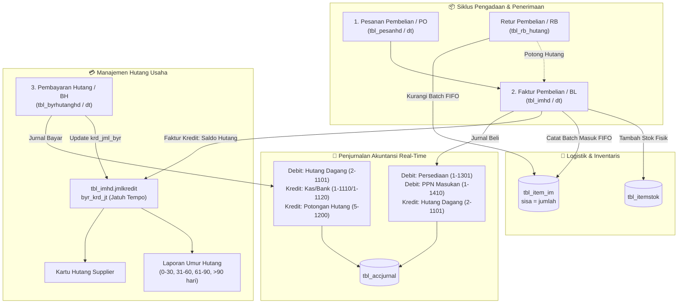

# Panduan Arsitektur & Spesifikasi Modul Pembelian dan Manajemen Hutang Supplier iPos 4.0

Dokumen ini merupakan panduan teknis dan spesifikasi arsitektural komprehensif mengenai **Modul Pembelian (Purchasing)**, **Retur Pembelian (Purchase Returns)**, dan **Manajemen Hutang Supplier (Accounts Payable)** pada iPos 4.0. Spesifikasi ini disusun sebagai acuan rekayasa ulang (*reverse-engineering & modernization*) untuk implementasi aplikasi Web POS / ERP modern berbasis Web (React, Bun, TypeScript, Drizzle ORM, dan PostgreSQL).

---

## 📑 Daftar Isi
1. [Arsitektur Global Siklus Pembelian & Hutang Usaha](#1-arsitektur-global-siklus-pembelian--hutang-usaha)
2. [Master Data Pemasok / Supplier (`tbl_supel`)](#2-master-data-pemasok--supplier-tbl_supel)
3. [Pesanan Pembelian / Purchase Order (`tbl_pesanhd` & `tbl_pesandt`)](#3-pesanan-pembelian--purchase-order-tbl_pesanhd--tbl_pesandt)
4. [Faktur Pembelian & Penerimaan Barang (`tbl_imhd` & `tbl_imdt`)](#4-faktur-pembelian--penerimaan-barang-tbl_imhd--tbl_imdt)
   - [4.1 Pembelian Tunai vs Kredit (Termin & Jatuh Tempo)](#41-pembelian-tunai-vs-kredit-termin--jatuh-tempo)
   - [4.2 Diskon Nota, Biaya Masuk HPP, & PPN Masukan (11%)](#42-diskon-nota-biaya-masuk-hpp--ppn-masukan-11)
   - [4.3 Integrasi Otomatis ke Antrean FIFO (`tbl_item_im`) & Stok Fisik](#43-integrasi-otomatis-ke-antrean-fifo-tbl_item_im--stok-fisik)
   - [4.4 Penjurnalan Akuntansi Pembelian Real-Time](#44-penjurnalan-akuntansi-pembelian-real-time)
5. [Retur Pembelian (`tbl_rb_hutang` / `tbl_imhd` Tipe `RB`)](#5-retur-pembelian-tbl_rb_hutang--tbl_imhd-tipe-rb)
6. [Modul Pembayaran Hutang Supplier (`tbl_byrhutanghd` & `tbl_byrhutangdt`)](#6-modul-pembayaran-hutang-supplier-tbl_byrhutanghd--tbl_byrhutangdt)
   - [6.1 Pelunasan Penuh, Bertahap (Cicilan), & Potongan Pelunasan](#61-pelunasan-penuh-bertahap-cicilan--potongan-pelunasan)
   - [6.2 Penjurnalan Pelunasan Hutang](#62-penjurnalan-pelunasan-hutang)
7. [Laporan Analisa Umur Hutang (*Aging Schedule*) & Kartu Hutang](#7-laporan-analisa-umur-hutang-aging-schedule--kartu-hutang)
8. [Blueprint Kode Implementasi Service Modern (TypeScript)](#8-blueprint-kode-implementasi-service-modern-typescript)

---

## 1. Arsitektur Global Siklus Pembelian & Hutang Usaha

Siklus pengadaan barang dagang pada iPos 4.0 mengintegrasikan 4 domain operasional: **Pengadaan (Purchasing)**, **Logistik Persediaan (FIFO Inventory)**, **Manajemen Hutang (Accounts Payable)**, dan **Buku Besar Finansial (General Ledger)**.



---

## 2. Master Data Pemasok / Supplier (`tbl_supel`)

Data pemasok disimpan di tabel `tbl_supel` dengan filter `tipe = 'SU'`.

| Kolom | Tipe Data | Keterangan & Aturan Bisnis |
| :--- | :--- | :--- |
| `kode` | `VARCHAR` (PK) | Kode unik supplier (format otomatis: `SP0001`, `SU0038`). |
| `tipe` | `VARCHAR` | Jenis relasi: `SU` (*Supplier*) atau `PL` (*Pelanggan*). |
| `nama` | `VARCHAR` | Nama entitas / PT / CV / Toko supplier. |
| `alamat`, `kota`, `provinsi`, `kodepos` | `VARCHAR` | Informasi lokasi fisik supplier. |
| `telepon`, `fax`, `kontak` | `VARCHAR` | PIC dan nomor telepon penagihan supplier. |
| `harijt` | `INTEGER` | Termin hari jatuh tempo pembayaran kredit (misal `30` hari). |
| `limitjmlhupi` | `NUMERIC` | Batas maksimum plafon hutang yang diizinkan oleh supplier. |
| `bank`, `norek`, `atasnama` | `VARCHAR` | Rekening bank supplier untuk keperluan pembayaran transfer kasir/akuntansi. |
| `npwp` | `VARCHAR` | NPWP supplier untuk rekonsiliasi faktur pajak masukan. |

---

## 3. Pesanan Pembelian / Purchase Order (`tbl_pesanhd` & `tbl_pesandt`)

Modul PO digunakan untuk memesan barang ke pemasok sebelum barang fisik tiba di gudang.

* **Tabel Header**: `tbl_pesanhd` (nomor transaksi format `PB` / `OB`, misal `0001/PB/UTM/0924`).
* **Tabel Detail**: `tbl_pesandt` (rincian kode item, kuantitas pesan, harga satuan estimasi, satuan pesan).
* **Karakteristik Operasional**:
  1. PO **tidak memotong/menambah stok fisik** di gudang (`tbl_itemstok`).
  2. PO **tidak membentuk ayat jurnal akuntansi** (`tbl_accjurnal`), kecuali jika terdapat pembayaran Uang Muka / Down Payment (`dppesanan`).
  3. Saat barang tiba, form Pembelian dapat mengimpor data dari nomor PO (`tbl_imhd.notrsorder = tbl_pesanhd.notransaksi`). Kuantitas diterima otomatis memotong sisa pesanan di `tbl_pesandt.jmlpesan`.

---

## 4. Faktur Pembelian & Penerimaan Barang (`tbl_imhd` & `tbl_imdt`)

Tabel `tbl_imhd` (*Item Masuk Header*) dan `tbl_imdt` (*Item Masuk Detail*) mencatat faktur pembelian resmi dari pemasok dengan nomor berformat `BL` (misal `3098/BL/UTM/1026`).

### 4.1 Pembelian Tunai vs Kredit (Termin & Jatuh Tempo)

Saat operator menyimpan faktur pembelian:
* **Pembelian Tunai (`carabayar = 'TN'` / `jmltunai > 0`)**:
  - `totalakhir` langsung dibayar lunas melalui kas toko (`1-1110`) atau rekening bank.
  - `krd_jml_byr = totalakhir`, status faktur langsung lunas, tidak menimbulkan saldo hutang.
* **Pembelian Kredit / Tempo (`jmlkredit > 0`)**:
  - `jmlkredit = totalakhir`.
  - Tanggal Jatuh Tempo dihitung otomatis:
    $$\text{byr\_krd\_jt} = \text{Tanggal Transaksi} + \text{harijt (dari tbl\_supel)}$$
  - Kolom `krd_jml_byr` bernilai `0` (menandakan hutang belum dicicil).

---

### 4.2 Diskon Nota, Biaya Masuk HPP, & PPN Masukan (11%)

Perhitungan nilai akhir faktur pembelian:

$$\begin{aligned}
\text{Subtotal} &= \sum (\text{jumlah} \times \text{harga} \times (1 - \text{potongan})) \\
\text{Total Akhir} &= \text{Subtotal} - \text{potnomfaktur} + \text{pajak (PPN 11\%)} + \text{biayalain}
\end{aligned}$$

* **`potnomfaktur` (Diskon Nota Global)**: Potongan tunai yang diberikan supplier atas pembelian dalam jumlah besar.
* **`biayalain` (Ongkos Angkut Pembelian)**: Berdasarkan konfigurasi `tbl_conf.TRS_IM_BIAYA_HPP`:
  - Jika bernilai `1`: Ongkir dialokasikan secara proporsional ke harga pokok perolehan item barang (menaikkan HPP per unit).
  - Jika bernilai `0`: Ongkir dicatat sebagai beban angkut terpisah di laporan laba rugi.
* **`pajak` (PPN Masukan)**: Pajak pertambahan nilai yang dibayar ke supplier (dikreditkan pada akun PPN Masukan `1-1410`).

---

### 4.3 Integrasi Otomatis ke Antrean FIFO (`tbl_item_im`) & Stok Fisik

Setiap baris detail barang pada `tbl_imdt` langsung memicu update inventaris secara instan:
1. **Penambahan Stok Fisik**:
   Stok barang di gudang tujuan pada tabel `tbl_itemstok` bertambah sebesar `jumlah`.
2. **Penerbitan Antrean Masuk FIFO (`tbl_item_im`)**:
   Engine membuat baris baru di `tbl_item_im` dengan:
   * `notransaksi`: Nomor faktur beli (`.../BL/...`).
   * `tanggal`: Waktu barang masuk.
   * `kodeitem`: Kode barang.
   * `jumlah`: Kuantitas masuk.
   * `hargasatuan`: Harga pokok perolehan bersih (setelah diskon + alokasi ongkir).
   * `sisa`: Bernilai sama dengan `jumlah` (siap dikonsumsi oleh transaksi kasir/penjualan berikutnya).

---

### 4.4 Penjurnalan Akuntansi Pembelian Real-Time

Sistem membaca pengaturan pemetaan akun pada `tbl_perksetting` untuk kantor yang bersangkutan:

#### Contoh Transaksi Riil Faktur Beli Kredit (`3098/BL/UTM/1026`):
- Subtotal: `Rp 325.000`
- Diskon Nota: `Rp 16.250`
- Total Bersih Kredit: `Rp 308.750`

Ayat jurnal otomatis di `tbl_accjurnal`:
| Posisi | Kode Akun | Nama Akun Perkiraan | Nilai (Rp) | Keterangan |
| :---: | :---: | :--- | :---: | :--- |
| **Debet** | `1-1301` | Persediaan Barang Dagang | 325.000,00 | Penambahan nilai aset barang masuk |
| **Kredit**| `2-1101` | Hutang Dagang Supplier | 308.750,00 | Kewajiban tagihan tempo supplier |
| **Kredit**| `1-1390` | Potongan Pembelian / Biaya | 16.250,00 | Diskon yang mengurangi kewajiban |

*Keseimbangan Jurnal:*
$$\text{Total Debet } (325.000) = \text{Total Kredit } (308.750 + 16.250) \quad \text{SEIMBANG ✅}$$

---

## 5. Retur Pembelian (`tbl_rb_hutang` / `tbl_imhd` Tipe `RB`)

Jika barang yang diterima dari pemasok cacat, rusak, atau salah kirim, toko membuat nota **Retur Pembelian (format `RB`)**.

### Alur Retur Pembelian:
1. **Pengurangan Stok**:
   Stok barang di `tbl_itemstok` berkurang, dan kuantitas sisa pada batch FIFO `tbl_item_im` terkait disesuaikan.
2. **Pemotongan Hutang Supplier (`tbl_rb_hutang`)**:
   Tabel `tbl_rb_hutang` menautkan nota retur dengan nomor faktur pembelian asli yang dipotong:
   * `noretur`: Nomor nota retur (misal `0002/RB/UTM/0824`).
   * `notrspot`: Nomor faktur pembelian asli (misal `1371/BL/UTM/0124`).
   * `jmlpot`: Nilai nominal retur yang memotong tagihan faktur tersebut.
3. **Ayat Jurnal Retur Beli**:
   $$\begin{aligned}
   \text{[D] } & 2\text{-}1101 \quad \text{Hutang Dagang (Hutang ke supplier berkurang)} \\
   \text{[K] } & 1\text{-}1301 \quad \text{Persediaan Barang Dagang (Stok fisik dikembalikan)}
   \end{aligned}$$

---

## 6. Modul Pembayaran Hutang Supplier (`tbl_byrhutanghd` & `tbl_byrhutangdt`)

Saat bagian keuangan toko melakukan pembayaran tagihan ke supplier, transaksi dicatat pada modul **Bayar Hutang (format `BH`, misal `0747/BH/UTM/0426`)**.

### 6.1 Pelunasan Penuh, Bertahap (Cicilan), & Potongan Pelunasan

Struktur tabel pembayaran hutang:
* **Header (`tbl_byrhutanghd`)**:
  - `notransaksi`: Nomor bukti bayar hutang (`.../BH/...`).
  - `kodesupel`: Kode pemasok yang dibayar.
  - `tanggal`: Tanggal pembayaran dilakukan.
  - `totalbayar`: Total uang yang dibayarkan keluar dari kas/bank.
  - `acc_bayar`: Akun kasir/bank sumber dana (misal `1-1110` Kas, `1-1120` Bank BCA).
  - `carabayar`: `TN` (Tunai), `TF` (Transfer Bank), `BG` (Bilyet Giro).
  - `stslunas`: Flag status pelunasan.
* **Detail Alokasi Faktur (`tbl_byrhutangdt`)**:
  Satu bukti bayar hutang dapat melunasi **beberapa faktur pembelian sekaligus**:
  - `notransaksi`: Nomor bukti `BH`.
  - `notrsmasuk`: Nomor faktur pembelian yang dilunasi (`.../BL/...`).
  - `jmlkredit`: Saldo hutang awal faktur sebelum pembayaran.
  - `krd_jml_pot`: Potongan pelunasan cepat (*cash discount*, misal diskon 2% jika lunas dalam 10 hari).
  - `krd_jml_byr`: Porsi uang yang dialokasikan untuk faktur ini.
  - `krd_total`: Nilai sisa hutang setelah bayar = $\text{jmlkredit} - \text{krd\_jml\_byr} - \text{krd\_jml\_pot}$.

### Update Status Faktur Asli:
Engine otomatis memperbarui kolom akumulasi pembayaran pada faktur pembelian terkait di `tbl_imhd`:
$$\text{tbl\_imhd.krd\_jml\_byr} = \text{tbl\_imhd.krd\_jml\_byr} + \text{krd\_jml\_byr}$$
$$\text{Sisa Hutang Faktur} = \text{tbl\_imhd.totalakhir} - \text{tbl\_imhd.krd\_jml\_byr} - \text{tbl\_imhd.krd\_jml\_pot}$$
- Jika $\text{Sisa Hutang} \le 0$, maka faktur dinyatakan **LUNAS**.

---

### 6.2 Penjurnalan Pelunasan Hutang

Bukti transaksi riil pembayaran hutang `0747/BH/UTM/0426` senilai `Rp 2.175.000` via transfer Bank BCA (`1-1120`):

| Posisi | Kode Akun | Nama Akun Perkiraan | Debet (Rp) | Kredit (Rp) | Keterangan |
| :---: | :---: | :--- | :---: | :---: | :--- |
| **Debet** | `2-1101` | Hutang Dagang | 2.175.000,00 | 0,00 | Kewajiban hutang supplier berkurang |
| **Kredit**| `1-1120` | Kas Bank (BCA) | 0,00 | 2.175.000,00 | Dana keluar dari rekening bank |

*(Jika ada potongan pelunasan cepat Rp 50.000, maka Debet Hutang Rp 2.225.000, Kredit Bank Rp 2.175.000, dan Kredit Potongan Pembayaran Hutang Akun `5-1200` Rp 50.000).*

---

## 7. Laporan Analisa Umur Hutang (*Aging Schedule*) & Kartu Hutang

### 7.1 Matriks Umur Hutang (*Aging Schedule*)
Untuk mengelola arus kas (*cash flow*) dan mencegah penalti denda keterlambatan supplier, sistem mengelompokkan faktur-faktur yang belum lunas ke dalam 5 keranjang umur per tanggal analisis (*As-of Date*):

$$\text{Hari Keterlambatan} = \text{Tanggal Analisis} - \text{Tanggal Jatuh Tempo (byr\_krd\_jt)}$$

| Kategori Keranjang (*Bucket*) | Kriteria Keterlambatan | Tingkat Risiko Arus Kas | Tindakan Keuangan Toko |
| :--- | :--- | :---: | :--- |
| **Current / Belum JT** | $\text{Hari Keterlambatan} \le 0$ | 🟢 Aman | Jadwalkan pembayaran sesuai tempo normal. |
| **1 - 30 Hari** | $1 \le \text{Hari} \le 30$ | 🟡 Perhatian | Prioritaskan pelunasan pada jadwal kas minggu ini. |
| **31 - 60 Hari** | $31 \le \text{Hari} \le 60$ | 🟠 Peringatan | Hubungi supplier untuk konfirmasi jadwal pembayaran. |
| **61 - 90 Hari** | $61 \le \text{Hari} \le 90$ | 🔴 Kritis | Risiko penghentian pasokan barang (*delivery hold*). |
| **> 90 Hari** | $\text{Hari} > 90$ | 🛑 Sangat Kritis | Hutang macet / restrukturisasi kewajiban. |

---

### 7.2 Kartu Hutang Supplier (*Supplier Ledger*)
Laporan kronologis yang menyajikan mutasi hutang supplier dari waktu ke waktu:
$$\text{Saldo Akhir} = \text{Saldo Awal (tbl\_hupi\_sa)} + \sum \text{Faktur Beli Kredit} - \sum \text{Pembayaran Hutang} - \sum \text{Retur Beli}$$

---

## 8. Blueprint Kode Implementasi Service Modern (TypeScript)

Berikut adalah implementasi service komprehensif siap pakai untuk backend TypeScript/Bun:

### `src/services/purchasing-payable.service.ts`

```typescript
import postgres from "postgres";

export interface PurchaseItemInput {
  kodeitem: string;
  jumlah: number;
  satuan: string;
  harga: number;
  potonganPersen: number;
}

export interface PurchaseInvoiceInput {
  notransaksi: string;
  kodekantor: string;
  kodesupel: string;
  tanggal: Date;
  items: PurchaseItemInput[];
  potonganNota: number;
  pajakPersen: number; // 0 atau 11
  biayalain: number;
  carabayar: "TN" | "KD"; // Tunai atau Kredit
  terminHari: number; // misal 30 hari
  user: string;
}

export interface DebtPaymentAllocation {
  notrsmasuk: string; // Nomor faktur BL yang dilunasi
  bayarNominal: number;
  potonganNominal: number;
}

export interface DebtPaymentInput {
  notransaksi: string; // Format: .../BH/...
  kodekantor: string;
  kodesupel: string;
  tanggal: Date;
  accBayar: string; // Akun Kas (1-1110) atau Bank (1-1120)
  carabayar: string; // 'TN', 'TF', 'BG'
  alokasi: DebtPaymentAllocation[];
  user: string;
}

export class PurchasingPayableService {
  constructor(private sql: postgres.Sql) {}

  /**
   * 1. MEMBUAT FAKTUR PEMBELIAN BARU (PURCHASE INVOICE)
   * Menyimpan tbl_imhd, tbl_imdt, menambah stok fisik, batch FIFO, dan menjurnal.
   */
  async createPurchaseInvoice(input: PurchaseInvoiceInput) {
    return await this.sql.begin(async (tx) => {
      // 1. Ambil Pengaturan Akun
      const settings = await tx`
        SELECT accsetting, kodeacc FROM tbl_perksetting WHERE acckantor = ${input.kodekantor}
      `;
      const accMap = new Map<string, string>();
      for (const s of settings) accMap.set(s.accsetting, s.kodeacc);

      let subtotal = 0;
      const detailInserts = [];

      // 2. Hitung Detail Item & Alokasikan ke Persediaan
      for (let i = 0; i < input.items.length; i++) {
        const item = input.items[i];
        const lineNet = item.jumlah * item.harga * (1 - item.potonganPersen / 100);
        subtotal += lineNet;

        detailInserts.push({
          iddetail: `${input.notransaksi}-${i + 1}`,
          nobaris: i + 1,
          notransaksi: input.notransaksi,
          kodeitem: item.kodeitem,
          jumlah: item.jumlah,
          satuan: item.satuan,
          harga: item.harga,
          potongan: item.potonganPersen,
          total: lineNet,
        });

        // Update Stok Fisik
        await tx`
          UPDATE tbl_itemstok 
          SET jmlstok = jmlstok + ${item.jumlah}
          WHERE kodeitem = ${item.kodeitem} AND kodekantor = ${input.kodekantor}
        `;

        // Masukkan ke Batch Antrean Masuk FIFO
        await tx`
          INSERT INTO tbl_item_im (
            notransaksi, kodekantor, tanggal, kodeitem, jumlah, sisa, hargasatuan
          ) VALUES (
            ${input.notransaksi}, ${input.kodekantor}, ${input.tanggal}, 
            ${item.kodeitem}, ${item.jumlah}, ${item.jumlah}, ${item.harga}
          )
        `;
      }

      // Hitung Pajak dan Total Akhir
      const dpp = subtotal - input.potonganNota;
      const nilaiPajak = input.pajakPersen > 0 ? (dpp * input.pajakPersen) / 100 : 0;
      const totalakhir = dpp + nilaiPajak + input.biayalain;

      const isKredit = input.carabayar === "KD";
      const jmltunai = isKredit ? 0 : totalakhir;
      const jmlkredit = isKredit ? totalakhir : 0;
      const jatuhTempo = new Date(input.tanggal);
      jatuhTempo.setDate(jatuhTempo.getDate() + input.terminHari);

      // 3. Simpan Header tbl_imhd
      await tx`
        INSERT INTO tbl_imhd (
          notransaksi, kodekantor, tanggal, tipe, kodesupel, subtotal, potnomfaktur, 
          pajak, biayalain, totalakhir, carabayar, jmltunai, jmlkredit, byr_krd_jt, 
          krd_jml_byr, krd_jml_pot, user1
        ) VALUES (
          ${input.notransaksi}, ${input.kodekantor}, ${input.tanggal}, 'BL', 
          ${input.kodesupel}, ${subtotal}, ${input.potonganNota}, ${nilaiPajak}, 
          ${input.biayalain}, ${totalakhir}, ${input.carabayar}, ${jmltunai}, 
          ${jmlkredit}, ${isKredit ? jatuhTempo : null}, 0, 0, ${input.user}
        )
      `;

      // Simpan Baris Detail tbl_imdt
      for (const d of detailInserts) {
        await tx`
          INSERT INTO tbl_imdt (
            iddetail, nobaris, notransaksi, kodeitem, jumlah, satuan, harga, potongan, total
          ) VALUES (
            ${d.iddetail}, ${d.nobaris}, ${d.notransaksi}, ${d.kodeitem}, ${d.jumlah}, 
            ${d.satuan}, ${d.harga}, ${d.potongan}, ${d.total}
          )
        `;
      }

      // 4. Buat Jurnal Akuntansi Berimbang
      let urut = 1;
      const insertJurnal = async (kodeAcc: string, debet: number, kredit: number, ket: string) => {
        if (debet === 0 && kredit === 0) return;
        const idDetail = `${Date.now()}${String(urut).padStart(3, '0')}`;
        await tx`
          INSERT INTO tbl_accjurnal (
            iddetail, nourut, tipeinput, notransaksi, tanggal, kodeacc, jenis, 
            keterangan, matauang, rate, jumlah, posisi, debet, kredit, kantor
          ) VALUES (
            ${idDetail}, ${urut++}, 'R', ${input.notransaksi}, ${input.tanggal}, 
            ${kodeAcc}, 'Jurnal', ${ket}, 'IDR', 1.0, ${debet > 0 ? debet : kredit}, 
            ${debet > 0 ? 'D' : 'K'}, ${debet}, ${kredit}, ${input.kodekantor}
          )
        `;
      };

      // [D] Persediaan Barang Dagang
      await insertJurnal(accMap.get("ACC_ITEM_PERS") || "1-1301", subtotal, 0, `Pembelian: ${input.notransaksi}`);
      // [D] PPN Masukan (jika ada)
      if (nilaiPajak > 0) {
        await insertJurnal(accMap.get("ACC_BELI_PAJAK") || "1-1410", nilaiPajak, 0, `PPN Masukan: ${input.notransaksi}`);
      }
      // [K] Hutang Dagang atau Kas
      const accLawan = isKredit ? (accMap.get("ACC_BELI_KREDIT") || "2-1101") : (accMap.get("ACC_BELI_TUNAI") || "1-1110");
      await insertJurnal(accLawan, 0, totalakhir, `Tagihan Pembelian: ${input.notransaksi}`);
      // [K] Potongan Pembelian
      if (input.potonganNota > 0) {
        await insertJurnal(accMap.get("ACC_BELI_POT") || "1-1390", 0, input.potonganNota, `Potongan Pembelian: ${input.notransaksi}`);
      }

      return {
        success: true,
        notransaksi: input.notransaksi,
        totalakhir,
        jatuhTempo: isKredit ? jatuhTempo : null
      };
    });
  }

  /**
   * 2. MENGAMBIL DAFTAR FAKTUR HUTANG YANG BELUM LUNAS
   */
  async getOutstandingInvoices(supplierCode?: string, kantor: string = "UTM") {
    return await this.sql`
      SELECT 
        i.notransaksi, i.tanggal, i.kodesupel, s.nama as namasupel,
        i.totalakhir, i.jmlkredit, i.krd_jml_byr, i.krd_jml_pot,
        (i.totalakhir - i.krd_jml_byr - i.krd_jml_pot) as sisahutang,
        i.byr_krd_jt as jatuhtempo,
        CURRENT_DATE - i.byr_krd_jt::date as hariketerlambatan
      FROM tbl_imhd i
      LEFT JOIN tbl_supel s ON i.kodesupel = s.kode
      WHERE i.tipe = 'BL' 
        AND i.kodekantor = ${kantor}
        AND (i.totalakhir - i.krd_jml_byr - i.krd_jml_pot) > 0
        ${supplierCode ? this.sql`AND i.kodesupel = ${supplierCode}` : this.sql``}
      ORDER BY i.byr_krd_jt ASC
    `;
  }

  /**
   * 3. PEMBAYARAN HUTANG KE SUPPLIER (PAY DEBT)
   */
  async paySupplierDebt(input: DebtPaymentInput) {
    return await this.sql.begin(async (tx) => {
      let totalBayar = 0;
      let totalPotongan = 0;

      for (const alok of input.alokasi) {
        totalBayar += alok.bayarNominal;
        totalPotongan += alok.potonganNominal;

        // Ambil saldo awal faktur
        const [faktur] = await tx`
          SELECT totalakhir, krd_jml_byr, krd_jml_pot 
          FROM tbl_imhd 
          WHERE notransaksi = ${alok.notrsmasuk}
          FOR UPDATE
        `;

        if (!faktur) throw new Error(`Faktur ${alok.notrsmasuk} tidak ditemukan.`);

        const saldoAwal = Number(faktur.totalakhir) - Number(faktur.krd_jml_byr) - Number(faktur.krd_jml_pot);
        const sisaAkhir = saldoAwal - alok.bayarNominal - alok.potonganNominal;

        // Simpan Detail Alokasi tbl_byrhutangdt
        await tx`
          INSERT INTO tbl_byrhutangdt (
            iddetail, notransaksi, notrsmasuk, tipe, matauang, ratetrs, 
            jmlkredit, krd_jml_pot, krd_total, krd_jml_byr
          ) VALUES (
            ${input.notransaksi + '-' + alok.notrsmasuk}, ${input.notransaksi}, 
            ${alok.notrsmasuk}, 'BL', 'IDR', 1.0, ${saldoAwal}, 
            ${alok.potonganNominal}, ${sisaAkhir}, ${alok.bayarNominal}
          )
        `;

        // Update Akumulasi Pembayaran di Faktur Pembelian tbl_imhd
        await tx`
          UPDATE tbl_imhd 
          SET krd_jml_byr = krd_jml_byr + ${alok.bayarNominal},
              krd_jml_pot = krd_jml_pot + ${alok.potonganNominal}
          WHERE notransaksi = ${alok.notrsmasuk}
        `;
      }

      // Simpan Header tbl_byrhutanghd
      await tx`
        INSERT INTO tbl_byrhutanghd (
          notransaksi, kodekantor, tanggal, tipe, kodesupel, totalbayar, 
          acc_bayar, carabayar, user1, stslunas
        ) VALUES (
          ${input.notransaksi}, ${input.kodekantor}, ${input.tanggal}, 'BH', 
          ${input.kodesupel}, ${totalBayar}, ${input.accBayar}, 
          ${input.carabayar}, ${input.user}, true
        )
      `;

      // Buat Jurnal Akuntansi Pelunasan Hutang
      let urut = 1;
      const insertJurnal = async (kodeAcc: string, debet: number, kredit: number, ket: string) => {
        if (debet === 0 && kredit === 0) return;
        const idDetail = `${Date.now()}${String(urut).padStart(3, '0')}`;
        await tx`
          INSERT INTO tbl_accjurnal (
            iddetail, nourut, tipeinput, notransaksi, tanggal, kodeacc, jenis, 
            keterangan, matauang, rate, jumlah, posisi, debet, kredit, kantor
          ) VALUES (
            ${idDetail}, ${urut++}, 'R', ${input.notransaksi}, ${input.tanggal}, 
            ${kodeAcc}, 'Jurnal', ${ket}, 'IDR', 1.0, ${debet > 0 ? debet : kredit}, 
            ${debet > 0 ? 'D' : 'K'}, ${debet}, ${kredit}, ${input.kodekantor}
          )
        `;
      };

      // [D] Hutang Dagang (2-1101)
      await insertJurnal("2-1101", totalBayar + totalPotongan, 0, `Pembayaran Hutang: ${input.notransaksi}`);
      // [K] Kas / Bank Pembayar (1-1110 / 1-1120)
      await insertJurnal(input.accBayar, 0, totalBayar, `Kas Keluar Pelunasan: ${input.notransaksi}`);
      // [K] Potongan Hutang (5-1200) jika ada diskon pelunasan
      if (totalPotongan > 0) {
        await insertJurnal("5-1200", 0, totalPotongan, `Potongan Pelunasan Hutang: ${input.notransaksi}`);
      }

      return {
        success: true,
        notransaksi: input.notransaksi,
        totalBayar,
        totalPotongan
      };
    });
  }

  /**
   * 4. LAPORAN ANALISA UMUR HUTANG (AGING SCHEDULE)
   */
  async getAgingReport(asOfDate: Date = new Date(), kantor: string = "UTM") {
    return await this.sql`
      SELECT 
        s.kode as kodesupel,
        s.nama as namasupel,
        s.telepon,
        COALESCE(SUM(CASE WHEN (i.byr_krd_jt::date - ${asOfDate}::date) >= 0 THEN (i.totalakhir - i.krd_jml_byr - i.krd_jml_pot) ELSE 0 END), 0) as belum_jatuh_tempo,
        COALESCE(SUM(CASE WHEN (${asOfDate}::date - i.byr_krd_jt::date) BETWEEN 1 AND 30 THEN (i.totalakhir - i.krd_jml_byr - i.krd_jml_pot) ELSE 0 END), 0) as hari_1_30,
        COALESCE(SUM(CASE WHEN (${asOfDate}::date - i.byr_krd_jt::date) BETWEEN 31 AND 60 THEN (i.totalakhir - i.krd_jml_byr - i.krd_jml_pot) ELSE 0 END), 0) as hari_31_60,
        COALESCE(SUM(CASE WHEN (${asOfDate}::date - i.byr_krd_jt::date) BETWEEN 61 AND 90 THEN (i.totalakhir - i.krd_jml_byr - i.krd_jml_pot) ELSE 0 END), 0) as hari_61_90,
        COALESCE(SUM(CASE WHEN (${asOfDate}::date - i.byr_krd_jt::date) > 90 THEN (i.totalakhir - i.krd_jml_byr - i.krd_jml_pot) ELSE 0 END), 0) as lebih_90_hari,
        COALESCE(SUM(i.totalakhir - i.krd_jml_byr - i.krd_jml_pot), 0) as total_hutang
      FROM tbl_supel s
      JOIN tbl_imhd i ON s.kode = i.kodesupel
      WHERE i.tipe = 'BL' 
        AND i.kodekantor = ${kantor}
        AND (i.totalakhir - i.krd_jml_byr - i.krd_jml_pot) > 0
      GROUP BY s.kode, s.nama, s.telepon
      ORDER BY total_hutang DESC
    `;
  }
}
```
