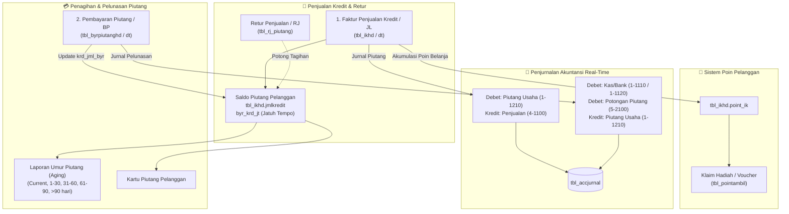

# Panduan Arsitektur & Spesifikasi Modul Piutang Pelanggan, Retur Jual, dan Sistem Poin Loyalitas iPos 4.0

Dokumen ini merupakan panduan teknis dan spesifikasi arsitektural komprehensif mengenai **Modul Piutang Usaha (Accounts Receivable)**, **Retur Penjualan (Sales Returns)**, dan **Sistem Poin Loyalitas Pelanggan** pada iPos 4.0. Spesifikasi ini disusun sebagai acuan rekayasa ulang (*reverse-engineering & modernization*) untuk implementasi aplikasi Web POS / ERP modern berbasis Web (React, Bun, TypeScript, Drizzle ORM, dan PostgreSQL).

---

## 📑 Daftar Isi
1. [Arsitektur Siklus Piutang Usaha & Penagihan](#1-arsitektur-siklus-piutang-usaha--penagihan)
2. [Master Data Pelanggan & Kontrol Plafon Kredit (`tbl_supel`)](#2-master-data-pelanggan--kontrol-plafon-kredit-tbl_supel)
3. [Timbulnya Piutang dari Faktur Penjualan (`tbl_ikhd` Tipe `JL`)](#3-timbulnya-piutang-dari-faktur-penjualan-tbl_ikhd-tipe-jl)
4. [Retur Penjualan Pemotong Piutang (`tbl_rj_piutang` / Tipe `RJ`)](#4-retur-penjualan-pemotong-piutang-tbl_rj_piutang--tipe-rj)
5. [Modul Pembayaran Piutang Pelanggan (`tbl_byrpiutanghd` & `tbl_byrpiutangdt`)](#5-modul-pembayaran-piutang-pelanggan-tbl_byrpiutanghd--tbl_byrpiutangdt)
   - [5.1 Alokasi Multi-Faktur & Potongan Pelunasan Cepat](#51-alokasi-multi-faktur--potongan-pelunasan-cepat)
   - [5.2 Penjurnalan Akuntansi Pembayaran Piutang](#52-penjurnalan-akuntansi-pembayaran-piutang)
6. [Laporan Analisa Umur Piutang (*Aging Schedule*) & Kartu Piutang](#6-laporan-analisa-umur-piutang-aging-schedule--kartu-piutang)
7. [Sistem Poin Loyalitas Pelanggan (`tbl_point_sa` & `tbl_pointambil`)](#7-sistem-poin-loyalitas-pelanggan-tbl_point_sa--tbl_pointambil)
8. [Blueprint Kode Implementasi Service Modern (TypeScript)](#8-blueprint-kode-implementasi-service-modern-typescript)

---

## 1. Arsitektur Siklus Piutang Usaha & Penagihan

Pada transaksi penjualan grosir/back-office (`5552/JL/UTM/1026`), barang seringkali diserahkan dengan pembayaran tempo (*kredit*). Sistem iPos 4.0 menghubungkan secara real-time: **Penjualan Kredit**, **Batas Limit Kredit (Plafon)**, **Pelunasan Bertahap**, dan **Buku Besar Kas/Bank**.



---

## 2. Master Data Pelanggan & Kontrol Plafon Kredit (`tbl_supel`)

Pelanggan disimpan di `tbl_supel` dengan filter `tipe = 'PL'`:

| Kolom | Tipe Data | Keterangan & Aturan Bisnis |
| :--- | :--- | :--- |
| `kode` | `VARCHAR` (PK) | Kode unik pelanggan (format otomatis: `PL0001`, `PL0355`). |
| `tipe` | `VARCHAR` | `PL` (*Pelanggan*) atau `SU` (*Supplier*). |
| `nama` | `VARCHAR` | Nama pelanggan perorangan atau badan usaha (CV/PT/KM Kapal). |
| `alamat`, `kota`, `telepon` | `VARCHAR` | Informasi kontak dan pengiriman pesanan. |
| `harijt` | `INTEGER` | Termin hari jatuh tempo bawaan pelanggan (misal `20` hari). |
| `limitjmlhupi` | `NUMERIC` | **Plafon Kredit Maksimum**: Total piutang yang diizinkan untuk pelanggan ini. |
| `limitharihupi` | `INTEGER` | **Batas Toleransi Hari Menunggak**: Jika pelanggan memiliki nota macet melebihi hari ini, transaksi baru dicegah. |
| `kgrup` | `VARCHAR` | Grup pelanggan (misal `General`, `Grosir`, `Distributor`) penentu Level Harga (Level 1-4). |
| `tipepot` | `VARCHAR` | Mode potongan harga bawaan (`GI` = Diskon Grup Item). |

### Validasi Plafon Kredit Saat Checkout:
Sebelum faktur penjualan kredit (`carabayar = 'KREDIT'`) disimpan:
$$\text{Total Piutang Berjalan} = \sum (\text{totalakhir} - \text{krd\_jml\_byr} - \text{krd\_jml\_pot}) \text{ dari seluruh nota aktif}$$
$$\text{Proyeksi Piutang} = \text{Total Piutang Berjalan} + \text{Nilai Nota Baru}$$
* Jika `limitjmlhupi > 0` dan $\text{Proyeksi Piutang} > \text{limitjmlhupi}$:
  - Sistem menampilkan peringatan **"Plafon Kredit Pelanggan Terlampaui!"**.
  - Transaksi diblokir atau membutuhkan otorisasi supervisor (`tbl_userakses.mButBukaTransaksi`).

---

## 3. Timbulnya Piutang dari Faktur Penjualan (`tbl_ikhd` Tipe `JL`)

Faktur penjualan yang dibayar secara tempo dicatat di `tbl_ikhd`:
* `totalakhir`: Total nilai faktur yang harus dilunasi.
* `jmlkredit`: Porsi piutang tempo (sama dengan `totalakhir` jika non-DP).
* `byr_krd_jt`: Tanggal jatuh tempo faktur:
  $$\text{byr\_krd\_jt} = \text{Tanggal Faktur} + \text{tbl\_supel.harijt}$$
* `krd_jml_byr`: Akumulasi uang pembayaran yang telah diterima (dimulai dari `0`).
* `krd_jml_pot`: Akumulasi potongan pelunasan cepat yang diberikan.
* `sisapiutang`: Dihitung secara dinamis:
  $$\text{Sisa Piutang} = \text{totalakhir} - \text{krd\_jml\_byr} - \text{krd\_jml\_pot}$$

---

## 4. Retur Penjualan Pemotong Piutang (`tbl_rj_piutang` / Tipe `RJ`)

Jika pelanggan mengembalikan barang rusak atau kelebihan kirim, toko menerbitkan bukti **Retur Penjualan (format `RJ`, misal `0001/RJ/UTM/0222`)**.

### Cara Kerja Pemotongan Piutang:
Tabel `tbl_rj_piutang` menautkan nota retur dengan nomor faktur penjualan asli yang dipotong tagihannya:
* `noretur`: Nomor bukti retur penjualan (`.../RJ/...`).
* `notrspot`: Nomor faktur penjualan yang dipotong (`.../JL/...`).
* `jmlpot`: Nilai nominal potongan retur.

### Update Saldo & Jurnal Akuntansi Retur:
1. Sisa piutang faktur `JL` langsung berkurang sebesar `jmlpot`.
2. Persediaan barang bertambah kembali ke gudang pada batch FIFO.
3. Jurnal otomatis di `tbl_accjurnal`:
   $$\begin{aligned}
   \text{[D] } & 4\text{-}1500 \quad \text{Retur / Potongan Penjualan} \\
   \text{[K] } & 1\text{-}1210 \quad \text{Piutang Usaha (Tagihan pelanggan berkurang)} \\
   \text{[D] } & 1\text{-}1301 \quad \text{Persediaan Barang Dagang (Stok masuk kembali)} \\
   \text{[K] } & 5\text{-}1100 \quad \text{Harga Pokok Penjualan (HPP dibalik)}
   \end{aligned}$$

---

## 5. Modul Pembayaran Piutang Pelanggan (`tbl_byrpiutanghd` & `tbl_byrpiutangdt`)

Ketika kasir/kolektor menerima pembayaran piutang dari pelanggan, transaksi dicatat pada formulir **Bayar Piutang (format `BP`, misal `0801/BP/UTM/25`)**.

### 5.1 Alokasi Multi-Faktur & Potongan Pelunasan Cepat

Struktur tabel pembayaran piutang:
* **Header (`tbl_byrpiutanghd`)**:
  - `notransaksi`: Nomor bukti pelunasan (`.../BP/...`).
  - `kodesupel`: Kode pelanggan yang melunasi.
  - `tanggal`: Tanggal uang kas/transfer diterima.
  - `totalbayar`: Total uang tunai / transfer yang diterima toko.
  - `acc_bayar`: Akun penerima kas (misal `1-1110` Kas Toko, `1-1120` Bank BCA).
  - `carabayar`: `TN` (Tunai), `TF` (Transfer Bank), `BG` (Bilyet Giro).
  - `stslunas`: Flag status pelunasan.
* **Detail Alokasi Faktur (`tbl_byrpiutangdt`)**:
  Satu bukti bayar `BP` dapat **membagi alokasi pembayaran ke beberapa faktur sekaligus**:
  - `notransaksi`: Nomor bukti `BP`.
  - `notrsmasuk`: Nomor faktur penjualan `JL` yang dilunasi.
  - `jmlkredit`: Saldo piutang faktur sebelum pelunasan.
  - `krd_jml_pot`: Potongan pelunasan cepat (*cash discount* atau pembulatan).
  - `krd_jml_byr`: Porsi uang yang dialokasikan melunasi faktur ini.
  - `krd_total`: Sisa piutang akhir faktur setelah pembayaran = $\text{jmlkredit} - \text{krd\_jml\_byr} - \text{krd\_jml\_pot}$.

### Update Status Faktur Asli:
Engine otomatis memperbarui kolom akumulasi pembayaran pada faktur penjualan terkait di `tbl_ikhd`:
$$\text{tbl\_ikhd.krd\_jml\_byr} = \text{tbl\_ikhd.krd\_jml\_byr} + \text{krd\_jml\_byr}$$
- Jika $\text{Sisa Piutang Faktur} \le 0$, maka faktur dinyatakan **LUNAS**.

---

### 5.2 Penjurnalan Akuntansi Pembayaran Piutang

Bukti transaksi riil pembayaran piutang `0801/BP/UTM/25` senilai `Rp 610.000` via kas toko (`1-1110`) yang melunasi 3 faktur (`3649/JL`, `3650/JL`, `4017/JL`):

| Posisi | Kode Akun | Nama Akun Perkiraan | Debet (Rp) | Kredit (Rp) | Keterangan |
| :---: | :---: | :--- | :---: | :---: | :--- |
| **Kredit**| `1-1210` | Piutang Usaha | 0,00 | 130.000,00 | Pelunasan faktur 3649/JL/UTM/0425 |
| **Kredit**| `1-1210` | Piutang Usaha | 0,00 | 40.000,00 | Pelunasan faktur 3650/JL/UTM/0425 |
| **Kredit**| `1-1210` | Piutang Usaha | 0,00 | 440.000,00 | Pelunasan faktur 4017/JL/UTM/0825 |
| **Debet** | `1-1110` | Kas Utama | 610.000,00 | 0,00 | Penerimaan uang tunai pelunasan |

*(Jika ada potongan pelunasan cepat misal Rp 10.000, maka Debet Kas Rp 600.000, Debet Potongan Pembayaran Piutang Akun `5-2100` Rp 10.000, dan Kredit Piutang Usaha `1-1210` Rp 610.000).*

---

## 6. Laporan Analisa Umur Piutang (*Aging Schedule*) & Kartu Piutang

### 6.1 Matriks Umur Piutang (*Aging Schedule*)
Untuk mengukur kolektibilitas piutang dan memperkirakan arus kas masuk, sistem mengelompokkan saldo faktur belum lunas ke dalam 5 keranjang umur per tanggal analisis (*As-of Date*):

$$\text{Hari Keterlambatan} = \text{Tanggal Analisis} - \text{Tanggal Jatuh Tempo (byr\_krd\_jt)}$$

| Kategori Keranjang (*Bucket*) | Kriteria Keterlambatan | Tingkat Risiko Kolektibilitas | Tindakan Penagihan |
| :--- | :--- | :---: | :--- |
| **Current / Belum JT** | $\text{Hari Keterlambatan} \le 0$ | 🟢 Lancar | Kirim reminder tagihan menjelang jatuh tempo. |
| **1 - 30 Hari** | $1 \le \text{Hari} \le 30$ | 🟡 Perhatian | Follow-up penagihan rutin oleh staf kasir/sales. |
| **31 - 60 Hari** | $31 \le \text{Hari} \le 60$ | 🟠 Peringatan | Kunjungan penagihan / telepon intensif. |
| **61 - 90 Hari** | $61 \le \text{Hari} \le 90$ | 🔴 Kritis | Tahan pesanan baru (*credit hold*) hingga ada cicilan. |
| **> 90 Hari** | $\text{Hari} > 90$ | 🛑 Macet | Somasi / restrukturisasi / pencadangan piutang ragu-ragu. |

---

### 6.2 Kartu Piutang Pelanggan (*Customer Ledger*)
Laporan mutasi kronologis yang menyajikan riwayat saldo piutang per pelanggan:
$$\text{Saldo Akhir} = \text{Saldo Awal (tbl\_hupi\_sa)} + \sum \text{Faktur Penjualan Kredit} - \sum \text{Pembayaran Piutang} - \sum \text{Retur Penjualan}$$

---

## 7. Sistem Poin Loyalitas Pelanggan (`tbl_point_sa` & `tbl_pointambil`)

iPos 4.0 menyediakan modul loyalitas pelanggan yang terintegrasi langsung dengan penjualan kasir:

### 1. Akumulasi Poin Belanja (`tbl_ikhd.point_ik`):
* Setiap kali transaksi penjualan dicatat untuk pelanggan member (bukan `UMUM`), sistem menghitung poin belanja:
  $$\text{Poin Diperoleh} = \left\lfloor \frac{\text{Total Akhir Faktur}}{\text{Nilai Pembagi Poin}} \right\rfloor$$
  *(Contoh: Belanja Rp 100.000 dengan rasio 1 poin per Rp 10.000 menghasilkan 10 poin).*
* Kolom `point_ik` pada `tbl_ikhd` menyimpan poin yang diperoleh dari faktur tersebut.

### 2. Penukaran Hadiah / Klaim Poin (`tbl_pointambil`):
* Pelanggan dapat menukarkan poin yang terkumpul dengan hadiah barang:
  - `notransaksi`: Bukti klaim penukaran poin.
  - `kodesupel`: Pelanggan yang menukar poin.
  - `tanggal`: Tanggal penukaran.
  - `jmlpoint`: Jumlah poin yang dipotong.
  - `hadiah`: Nama barang hadiah atau merchandise yang diambil.
* **Saldo Poin Pelanggan**:
  $$\text{Saldo Poin Aktif} = \text{Saldo Awal (tbl\_point\_sa)} + \sum \text{Poin Faktur (tbl\_ikhd.point\_ik)} - \sum \text{Poin Ditukar (tbl\_pointambil.jmlpoint)}$$

---

## 8. Blueprint Kode Implementasi Service Modern (TypeScript)

Berikut adalah implementasi service komprehensif siap pakai untuk backend TypeScript/Bun:

### `src/services/receivable-loyalty.service.ts`

```typescript
import postgres from "postgres";

export interface ReceivablePaymentAllocation {
  notrsmasuk: string; // Nomor faktur JL yang dilunasi
  bayarNominal: number;
  potonganNominal: number;
}

export interface ReceivablePaymentInput {
  notransaksi: string; // Format: .../BP/...
  kodekantor: string;
  kodesupel: string;
  tanggal: Date;
  accBayar: string; // Akun Kas (1-1110) atau Bank (1-1120)
  carabayar: string; // 'TN', 'TF', 'BG'
  alokasi: ReceivablePaymentAllocation[];
  user: string;
}

export interface PointRedemptionInput {
  notransaksi: string;
  kodekantor: string;
  kodesupel: string;
  tanggal: Date;
  jmlpoint: number;
  hadiah: string;
  keterangan: string;
}

export class ReceivableLoyaltyService {
  constructor(private sql: postgres.Sql) {}

  /**
   * 1. MENGAMBIL DAFTAR FAKTUR PENJUALAN BELUM LUNAS
   */
  async getOutstandingInvoices(customerCode?: string, kantor: string = "UTM") {
    return await this.sql`
      SELECT 
        i.notransaksi, i.tanggal, i.kodesupel, s.nama as namapelanggan,
        i.totalakhir, i.jmlkredit, i.krd_jml_byr, i.krd_jml_pot,
        (i.totalakhir - i.krd_jml_byr - i.krd_jml_pot) as sisapiutang,
        i.byr_krd_jt as jatuhtempo,
        CURRENT_DATE - COALESCE(i.byr_krd_jt::date, i.tanggal::date) as hariketerlambatan
      FROM tbl_ikhd i
      LEFT JOIN tbl_supel s ON i.kodesupel = s.kode
      WHERE i.tipe = 'JL' 
        AND i.kodekantor = ${kantor}
        AND (i.totalakhir - i.krd_jml_byr - i.krd_jml_pot) > 0
        ${customerCode ? this.sql`AND i.kodesupel = ${customerCode}` : this.sql``}
      ORDER BY i.tanggal DESC
    `;
  }

  /**
   * 2. PEMBAYARAN / PELUNASAN PIUTANG PELANGGAN (COLLECTION)
   */
  async payCustomerDebt(input: ReceivablePaymentInput) {
    return await this.sql.begin(async (tx) => {
      let totalBayar = 0;
      let totalPotongan = 0;

      for (const alok of input.alokasi) {
        totalBayar += alok.bayarNominal;
        totalPotongan += alok.potonganNominal;

        // Kunci baris faktur
        const [faktur] = await tx`
          SELECT totalakhir, krd_jml_byr, krd_jml_pot 
          FROM tbl_ikhd 
          WHERE notransaksi = ${alok.notrsmasuk}
          FOR UPDATE
        `;

        if (!faktur) throw new Error(`Faktur ${alok.notrsmasuk} tidak ditemukan.`);

        const saldoAwal = Number(faktur.totalakhir) - Number(faktur.krd_jml_byr) - Number(faktur.krd_jml_pot);
        const sisaAkhir = saldoAwal - alok.bayarNominal - alok.potonganNominal;

        // Simpan Detail Alokasi tbl_byrpiutangdt
        await tx`
          INSERT INTO tbl_byrpiutangdt (
            iddetail, notransaksi, notrsmasuk, tipe, matauang, ratetrs, 
            jmlkredit, krd_jml_pot, krd_total, krd_jml_byr
          ) VALUES (
            ${input.notransaksi + '-' + alok.notrsmasuk}, ${input.notransaksi}, 
            ${alok.notrsmasuk}, 'JL', 'IDR', 1.0, ${saldoAwal}, 
            ${alok.potonganNominal}, ${sisaAkhir}, ${alok.bayarNominal}
          )
        `;

        // Update Akumulasi Pembayaran di Faktur Penjualan tbl_ikhd
        await tx`
          UPDATE tbl_ikhd 
          SET krd_jml_byr = krd_jml_byr + ${alok.bayarNominal},
              krd_jml_pot = krd_jml_pot + ${alok.potonganNominal}
          WHERE notransaksi = ${alok.notrsmasuk}
        `;
      }

      // Simpan Header tbl_byrpiutanghd
      await tx`
        INSERT INTO tbl_byrpiutanghd (
          notransaksi, kodekantor, tanggal, tipe, kodesupel, totalbayar, 
          acc_bayar, carabayar, user1, stslunas
        ) VALUES (
          ${input.notransaksi}, ${input.kodekantor}, ${input.tanggal}, 'BP', 
          ${input.kodesupel}, ${totalBayar}, ${input.accBayar}, 
          ${input.carabayar}, ${input.user}, true
        )
      `;

      // Buat Jurnal Akuntansi Berimbang
      let urut = 1;
      const insertJurnal = async (kodeAcc: string, debet: number, kredit: number, ket: string) => {
        if (debet === 0 && kredit === 0) return;
        const idDetail = `${Date.now()}${String(urut).padStart(3, '0')}`;
        await tx`
          INSERT INTO tbl_accjurnal (
            iddetail, nourut, tipeinput, notransaksi, tanggal, kodeacc, jenis, 
            keterangan, matauang, rate, jumlah, posisi, debet, kredit, kantor
          ) VALUES (
            ${idDetail}, ${urut++}, 'R', ${input.notransaksi}, ${input.tanggal}, 
            ${kodeAcc}, 'Jurnal', ${ket}, 'IDR', 1.0, ${debet > 0 ? debet : kredit}, 
            ${debet > 0 ? 'D' : 'K'}, ${debet}, ${kredit}, ${input.kodekantor}
          )
        `;
      };

      // [D] Kas atau Bank Penerima Uang (1-1110 / 1-1120)
      await insertJurnal(input.accBayar, totalBayar, 0, `Penerimaan Piutang: ${input.notransaksi}`);
      // [D] Potongan Pelunasan Piutang (5-2100) jika ada diskon
      if (totalPotongan > 0) {
        await insertJurnal("5-2100", totalPotongan, 0, `Potongan Pelunasan Piutang: ${input.notransaksi}`);
      }
      // [K] Piutang Usaha (1-1210) berkurang
      await insertJurnal("1-1210", 0, totalBayar + totalPotongan, `Pelunasan Piutang Pelanggan: ${input.notransaksi}`);

      return {
        success: true,
        notransaksi: input.notransaksi,
        totalBayar,
        totalPotongan
      };
    });
  }

  /**
   * 3. LAPORAN ANALISA UMUR PIUTANG (CUSTOMER AGING SCHEDULE)
   */
  async getAgingReport(asOfDate: Date = new Date(), kantor: string = "UTM") {
    return await this.sql`
      SELECT 
        s.kode as kodepelanggan,
        s.nama as namapelanggan,
        s.telepon,
        COALESCE(SUM(CASE WHEN (COALESCE(i.byr_krd_jt::date, i.tanggal::date) - ${asOfDate}::date) >= 0 THEN (i.totalakhir - i.krd_jml_byr - i.krd_jml_pot) ELSE 0 END), 0) as belum_jatuh_tempo,
        COALESCE(SUM(CASE WHEN (${asOfDate}::date - COALESCE(i.byr_krd_jt::date, i.tanggal::date)) BETWEEN 1 AND 30 THEN (i.totalakhir - i.krd_jml_byr - i.krd_jml_pot) ELSE 0 END), 0) as hari_1_30,
        COALESCE(SUM(CASE WHEN (${asOfDate}::date - COALESCE(i.byr_krd_jt::date, i.tanggal::date)) BETWEEN 31 AND 60 THEN (i.totalakhir - i.krd_jml_byr - i.krd_jml_pot) ELSE 0 END), 0) as hari_31_60,
        COALESCE(SUM(CASE WHEN (${asOfDate}::date - COALESCE(i.byr_krd_jt::date, i.tanggal::date)) BETWEEN 61 AND 90 THEN (i.totalakhir - i.krd_jml_byr - i.krd_jml_pot) ELSE 0 END), 0) as hari_61_90,
        COALESCE(SUM(CASE WHEN (${asOfDate}::date - COALESCE(i.byr_krd_jt::date, i.tanggal::date)) > 90 THEN (i.totalakhir - i.krd_jml_byr - i.krd_jml_pot) ELSE 0 END), 0) as lebih_90_hari,
        COALESCE(SUM(i.totalakhir - i.krd_jml_byr - i.krd_jml_pot), 0) as total_piutang
      FROM tbl_supel s
      JOIN tbl_ikhd i ON s.kode = i.kodesupel
      WHERE i.tipe = 'JL' 
        AND i.kodekantor = ${kantor}
        AND (i.totalakhir - i.krd_jml_byr - i.krd_jml_pot) > 0
      GROUP BY s.kode, s.nama, s.telepon
      ORDER BY total_piutang DESC
    `;
  }

  /**
   * 4. SALDO POIN LOYALITAS PELANGGAN
   */
  async getCustomerPointBalance(customerCode: string) {
    const [earned] = await this.sql`
      SELECT COALESCE(SUM(point_ik), 0) as total_earned 
      FROM tbl_ikhd 
      WHERE kodesupel = ${customerCode}
    `;
    const [redeemed] = await this.sql`
      SELECT COALESCE(SUM(jmlpoint), 0) as total_redeemed 
      FROM tbl_pointambil 
      WHERE kodesupel = ${customerCode}
    `;
    const [sa] = await this.sql`
      SELECT COALESCE(SUM(jmlpoint), 0) as total_sa 
      FROM tbl_point_sa 
      WHERE kodesupel = ${customerCode}
    `;

    const balance = Number(sa.total_sa) + Number(earned.total_earned) - Number(redeemed.total_redeemed);
    return {
      kodesupel: customerCode,
      saldoAwal: Number(sa.total_sa),
      totalDiperoleh: Number(earned.total_earned),
      totalDitukar: Number(redeemed.total_redeemed),
      saldoPoinAktif: balance
    };
  }

  /**
   * 5. PENUKARAN POIN HADIAH PELANGGAN
   */
  async redeemCustomerPoints(input: PointRedemptionInput) {
    const balance = await this.getCustomerPointBalance(input.kodesupel);
    if (balance.saldoPoinAktif < input.jmlpoint) {
      throw new Error(`Poin tidak mencukupi. Saldo aktif: ${balance.saldoPoinAktif}, klaim: ${input.jmlpoint}`);
    }

    await this.sql`
      INSERT INTO tbl_pointambil (
        notransaksi, kodekantor, tanggal, kodesupel, jmlpoint, hadiah, keterangan
      ) VALUES (
        ${input.notransaksi}, ${input.kodekantor}, ${input.tanggal}, 
        ${input.kodesupel}, ${input.jmlpoint}, ${input.hadiah}, ${input.keterangan}
      )
    `;

    return {
      success: true,
      notransaksi: input.notransaksi,
      kodesupel: input.kodesupel,
      jmlpoint: input.jmlpoint,
      sisaPoin: balance.saldoPoinAktif - input.jmlpoint
    };
  }
}
```
