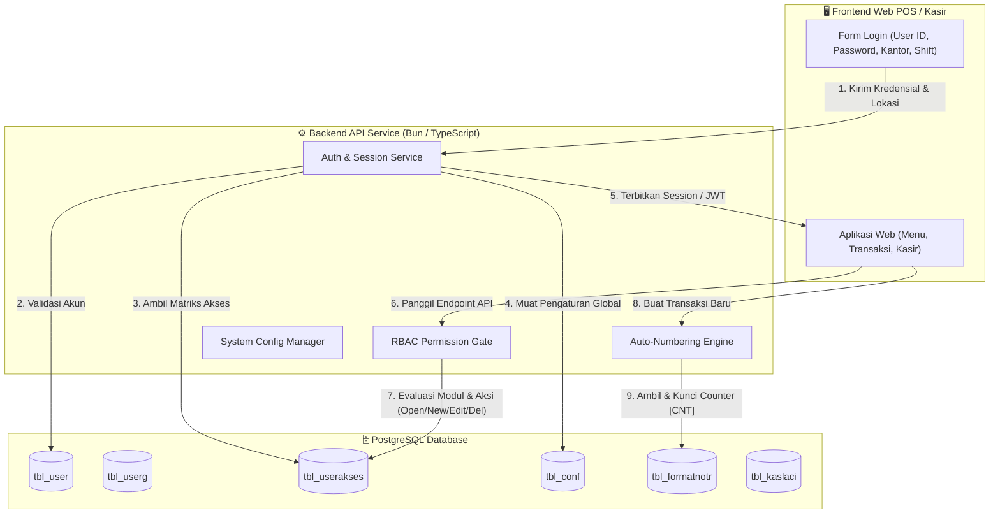
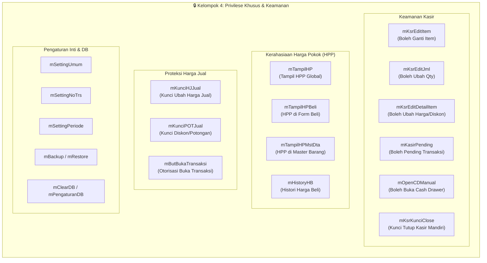
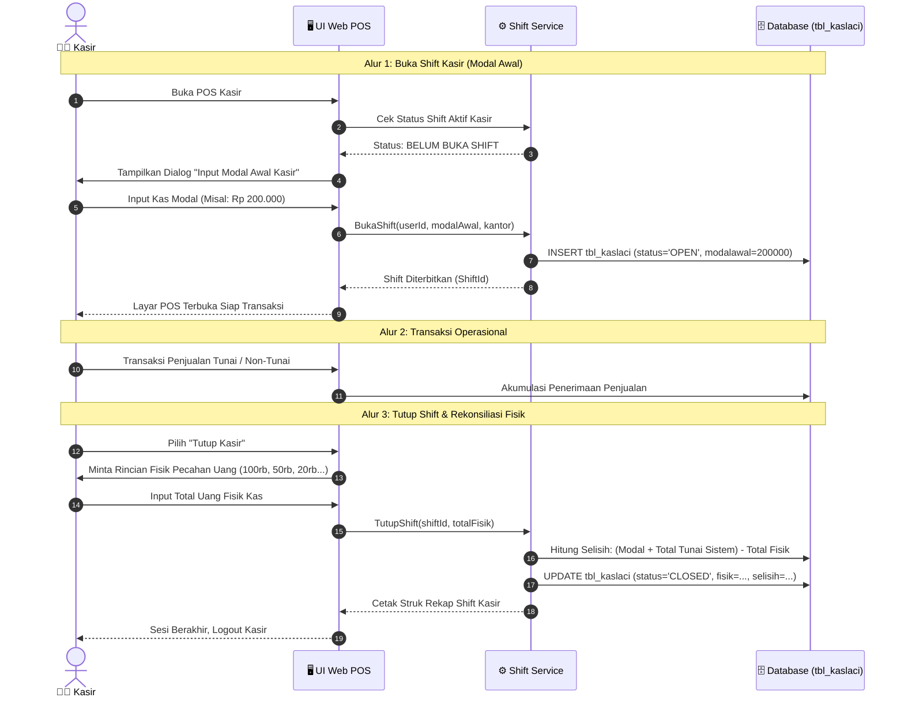

# Panduan Arsitektur & Spesifikasi Sistem Login, Role (RBAC), Format Penomoran, dan Konfigurasi iPos 4.0

Dokumen ini merupakan panduan teknis dan spesifikasi arsitektural lengkap mengenai **Sistem Autentikasi Pengguna**, **Role-Based Access Control (RBAC)**, **Format Penomoran Transaksi Otomatis**, dan **Kamus Konfigurasi Global (`tbl_conf`)** yang digunakan pada iPos 4.0. Spesifikasi ini disusun untuk menjadi blueprint implementasi pada proyek Web POS / ERP modern berbasis Web (React, Bun, TypeScript, Drizzle ORM, dan PostgreSQL).

---

## 📑 Daftar Isi
1. [Arsitektur Global & Siklus Hidup Autentikasi](#1-arsitektur-global--siklus-hidup-autentikasi)
2. [Sistem User & Autentikasi (`tbl_user`)](#2-sistem-user--autentikasi-tbl_user)
3. [Manajemen Kelompok Akses / Role (`tbl_userg`)](#3-manajemen-kelompok-akses--role-tbl_userg)
4. [Matriks Hak Akses & RBAC Modul Detail (`tbl_userakses`)](#4-matriks-hak-akses--rbac-modul-detail-tbl_userakses)
5. [Sistem Sandi Angka ke Huruf (`tbl_sandi`)](#5-sistem-sandi-angka-ke-huruf-tbl_sandi)
6. [Engine Generator Penomoran Otomatis (`tbl_formatnotr` & `tbl_formatnosp`)](#6-engine-generator-penomoran-otomatis-tbl_formatnotr--tbl_formatnosp)
7. [Kamus Lengkap Konfigurasi Global Sistem (`tbl_conf`)](#7-kamus-lengkap-konfigurasi-global-sistem-tbl_conf)
8. [Multi-Kantor / Multi-Gudang & Shift Kasir](#8-multi-kantor--multi-gudang--shift-kasir)
9. [Blueprint Implementasi Modern (TypeScript & Drizzle ORM)](#9-blueprint-implementasi-modern-typescript--drizzle-orm)

---

## 1. Arsitektur Global & Siklus Hidup Autentikasi

### 1.1 Model 2-Tier Desktop vs 3-Tier Web Modern
Pada aplikasi desktop aslinya, iPos 4.0 menggunakan arsitektur 2-tier (Client-to-Database):
1. **Database Layer**: PostgreSQL Server (port default `5444` untuk service `iPgSQL`, superuser default `admin`).
2. **Client Layer**: Aplikasi desktop VB.NET/WinForms langsung terhubung ke database via ODBC / Npgsql driver, lalu memverifikasi pengguna terhadap tabel `tbl_user`.

Untuk rekonstruksi Web POS / ERP modern, arsitektur ditransformasikan menjadi **3-Tier Cloud / Client-Server**:
- **Client (Frontend)**: React / Next.js / Vite SPA (Mobile & Desktop POS).
- **Application Server (Backend)**: Bun / Node.js + TypeScript + REST/GraphQL API.
- **Database Server**: PostgreSQL dengan pool koneksi aman dan otorisasi berbasis Token JWT / HTTP-only Cookies.



---

## 2. Sistem User & Autentikasi (`tbl_user`)

### 2.1 Struktur Tabel `tbl_user`
Tabel `tbl_user` menyimpan data kredensial, hak kantor, dan mode shift operasional:

| Nama Kolom | Tipe Data | Keterangan & Aturan Bisnis |
| :--- | :--- | :--- |
| `userid` | `VARCHAR` (PK) | Identifier unik user (Uppercase convention, misal `ADMIN`, `KASIR`, `SUPERVISOR`). Tidak boleh ada spasi. |
| `nama` | `VARCHAR` | Nama lengkap atau nama panggilan pengguna. |
| `password` | `VARCHAR` | Kata sandi login. Pada iPos 4.0 asli tersimpan teks biasa/case-preserved. Pada Web modern wajib di-hash menggunakan **Argon2id** atau **bcrypt**. |
| `tipe` | `VARCHAR` | Jenis otorisasi pengguna: <br>• `AU`: *Application User* (staf operasional biasa)<br>• `PU`: *Primary / Power User* (pemilik/super administrator). |
| `loginkantor` | `VARCHAR` | Kantor / cabang default tempat user bertugas (FK ke `tbl_kantor.kodekantor`, misal `UTM` untuk Kantor Utama, `GD` untuk Gudang). |
| `kelompok` | `VARCHAR` | Kelompok akses / peran yang diemban (FK ke `tbl_userg.kelompok`). |
| `loginshift` | `BOOLEAN` | Menentukan apakah user wajib menjalankan siklus shift kasir: <br>• `true`: Wajib buka kasir (modal awal) dan tutup kasir.<br>• `false`: User back-office / admin, bebas transaksi tanpa lock modal. |

### 2.2 Data Akun Default Bawaan Sistem
Sistem iPos 4.0 terinstal dengan akun default berikut:
- **User ID**: `ADMIN`
- **Password**: `ADMIN`
- **Kelompok**: `ADMINISTRATOR`
- **Tipe**: `AU`
- **Login Kantor**: `UTM`
- **Login Shift**: `false`

Akun kasir standar:
- **User ID**: `KASIR`
- **Password**: `kasir`
- **Kelompok**: `KASIR`
- **Login Kantor**: `UTM`
- **Login Shift**: `true`

---

## 3. Manajemen Kelompok Akses / Role (`tbl_userg`)

### 3.1 Struktur Tabel `tbl_userg`
Tabel `tbl_userg` mendefinisikan daftar nama kelompok hak akses:

| Kolom | Tipe | Deskripsi |
| :--- | :--- | :--- |
| `kelompok` | `VARCHAR` (PK) | Nama kelompok akses (misal `ADMINISTRATOR`, `KASIR`). |
| `urut` | `INTEGER` | Urutan hierarki atau urutan tampilan dropdown. |

### 3.2 Daftar Kelompok Standar iPos 4.0

| Urut | Nama Kelompok | Peruntukan & Deskripsi Otoritas |
| :---: | :--- | :--- |
| **1** | `ADMINISTRATOR` | Superuser sistem. Memiliki akses penuh (Open, New, Edit, Delete, Lock) ke seluruh master, transaksi, laporan, dan pengaturan database. |
| **2** | `MANAGER` | Manajemen operasional toko. Memiliki wewenang melihat seluruh laporan keuangan, neraca, laba rugi, serta mengubah konfigurasi harga pokok. |
| **3** | `SUPERVISOR` | Pengawas operasional kasir & gudang. Berwenang memberikan otorisasi diskon manual, membuka pending transaksi, pembatalan struk, dan stok opname. |
| **4** | `KASIR` | Staf kasir POS. Dibatasi hanya membuka form Point of Sale (`mKasir`), kas masuk/keluar harian, dan laci kasir. Dibatasi dari melihat HPP dan laporan laba rugi. |
| **5** | `Lain Lain 1` | Template kelompok kustom 1 (biasanya dikonfigurasi untuk Bagian Gudang: Item Masuk, Item Keluar, Transfer Item). |
| **6** | `Lain Lain 2` | Template kelompok kustom 2 (biasanya untuk Bagian Pembelian / Purchasing). |
| **7** | `Lain Lain 3` | Template kelompok kustom 3 (biasanya untuk Bagian Sales / Marketing). |
| **8** | `Lain Lain 4` | Template kelompok kustom 4 (biasanya untuk Bagian Akuntansi / Finance). |

---

## 4. Matriks Hak Akses & RBAC Modul Detail (`tbl_userakses`)

Tabel `tbl_userakses` merupakan inti dari sistem keamanan granular. Setiap baris mendefinisikan izin spesifik dari sebuah **Kelompok Akses (`klpakses`)** terhadap suatu **Modul (`modulid`)**.

### 4.1 Struktur Tabel `tbl_userakses`

| Kolom | Tipe | Keterangan |
| :--- | :--- | :--- |
| `klpakses` | `VARCHAR` | Nama kelompok akses (merujuk ke `tbl_userg.kelompok`). |
| `modulid` | `VARCHAR` | Identifier string unik untuk menu, fitur, atau izin khusus. |
| `mopen` | `BOOLEAN` | Izin untuk **Membuka / Melihat** form atau menu. |
| `mnew` | `BOOLEAN` | Izin untuk **Membuat Data Baru / Menambah Transaksi**. |
| `medit` | `BOOLEAN` | Izin untuk **Mengubah / Mengedit Data** yang sudah tersimpan. |
| `mdel` | `BOOLEAN` | Izin untuk **Menghapus / Membatalkan Data**. |
| `mlock` | `BOOLEAN` | Izin **Kunci / Otorisasi Khusus** (misal override supervisor). |
| `kelompok` | `INTEGER` | Kategori modul (1: Master, 2: Transaksi, 3: Lap Induk, 4: Privilese/Setting, 5: Sidebar, 6: Sub-Laporan). |
| `urut` | `INTEGER` | Urutan penataan pada layar konfigurasi hak akses. |

---

### 4.2 Matriks Klasifikasi Modul Berdasarkan Kategori

#### Kategori 1: Master Data (`kelompok = 1`)
| Modul ID | Deskripsi Fitur / Form | Keterangan Izin |
| :--- | :--- | :--- |
| `mItem` | Data Master Barang & Jasa | CRUD Data Barang, Jenis, Satuan, Barcode. |
| `mSupplier` | Data Master Pemasok | CRUD Supplier dan histori hutang. |
| `mPelanggan` | Data Master Pelanggan | CRUD Pelanggan, Plafon Piutang, Grup Diskon. |
| `mGudang` | Master Kantor & Gudang | CRUD Lokasi fisik gudang dan kantor cabang. |
| `mMU` | Master Mata Uang | Pengaturan kurs valuta asing. |
| `mSales` | Master Tenaga Penjual (Salesman) | Pendaftaran salesman dan persentase komisi. |
| `mEmoney` | Master Pembayaran Elektronik | Kartu Debit, Kartu Kredit, QRIS, E-Wallet. |
| `mItemDS` | Master Item Display / Paket Rakitan | Pengaturan komposisi paket bundling. |
| `mSandi` | Pengaturan Sandi Angka ke Huruf | Konfigurasi cipher sandi modal di barcode. |

---

#### Kategori 2: Transaksi Operasional (`kelompok = 2`)
| Modul ID | Deskripsi Fitur / Form | Alur Bisnis yang Dikontrol |
| :--- | :--- | :--- |
| `mKasir` | Point of Sale (POS Kasir Retail) | Penjualan langsung cepat di meja kasir. |
| `mJual` | Form Penjualan Back-Office / Grosir | Penjualan tempo/kredit, cetak faktur invoice besar. |
| `mPesanJual` | Pesanan Penjualan (Sales Order / SO) | Pencatatan pesanan inden atau PO pelanggan. |
| `mReturJual` | Retur Penjualan | Penerimaan pengembalian barang dari pelanggan. |
| `mBeli` | Form Pembelian Barang | Penerimaan faktur supplier dan stok masuk. |
| `mPesanBeli` | Pesanan Pembelian (Purchase Order / PO) | Pemesanan barang ke supplier. |
| `mReturBeli` | Retur Pembelian | Pengembalian barang rusak/cacat ke supplier. |
| `mItemMasuk` | Transaksi Item Masuk Lain-Lain | Penambahan stok di luar pembelian (hibah/bonus). |
| `mItemKeluar` | Transaksi Item Keluar Lain-Lain | Pengurangan stok rusak, expired, pemakaian sendiri. |
| `mTransferItem`| Transfer Item Antar Kantor/Gudang | Perpindahan fisik barang antar lokasi penyimpanan. |
| `mStokOpname` | Penyesuaian Fisik Stok (Stock Opname)| Koreksi selisih buku dengan fisik nyata. |
| `mKonsiIn` | Konsinyasi Masuk | Penerimaan barang titipan dari konsinyor. |
| `mKonsiRetuIn`| Retur Konsinyasi Masuk | Pengembalian titipan konsinyasi yang tidak laku. |
| `mKonsiBayarIn`| Pembayaran Konsinyasi Masuk | Pelunasan barang konsinyasi yang terjual. |
| `mKonsiInfoIn`| Monitoring Informasi Konsinyasi | Kartu stok status barang konsinyasi. |
| `mKasMasuk` | Penerimaan Kas Operasional | Pendapatan non-usaha, setoran modal, pendapatan lain. |
| `mKasKeluar` | Pengeluaran Kas Operasional | Biaya operasional, listrik, gaji, operasional toko. |
| `mKasTransfer`| Transfer Kas & Bank | Pemindahan dana antar kas kecil dan rekening bank. |
| `mKasLaci` | Manajemen Buka Laci Kasir | Pembukaan laci dan pencatatan kas laci harian. |
| `mBayarHutang`| Pembayaran Hutang Supplier | Pelunasan tagihan tempo supplier via kas/bank. |
| `mBayarPiutang`| Penerimaan Pembayaran Piutang | Penagihan faktur tempo pelanggan. |
| `mJurnal` | Jurnal Penyesuaian / Akuntansi | Entry ayat jurnal umum manual debit/kredit. |
| `mDaftarPerkiraan`| Daftar Akun / Bagan Akun (COA) | Pengelolaan Chart of Accounts akuntansi. |
| `mEksporCSV` | Ekspor Transaksi ke CSV | Ekspor raw data penjualan untuk integrasi pajak. |

---

#### Kategori 3: Laporan Induk (`kelompok = 3`)
| Modul ID | Menu Laporan | Lingkup Informasi |
| :--- | :--- | :--- |
| `mLapMaster` | Laporan Master Data | Daftar barang, harga jual, master pelanggan, supplier. |
| `mLapBeli` | Laporan Pembelian | Rekap pembelian, rincian per supplier, jatuh tempo. |
| `mLapJual` | Laporan Penjualan | Omset kasir, rincian barang terlaris, rekap kasir. |
| `mLapPersediaan`| Laporan Persediaan Stok | Nilai HPP persediaan, mutasi kartu stok, barang minus. |
| `mLapHu` | Laporan Hutang Dagang | Kartu hutang, buku besar hutang, jadwal jatuh tempo. |
| `mLapPi` | Laporan Piutang Dagang | Kartu piutang pelanggan, umur piutang (*aging report*). |
| `mLapKeuangan`| Laporan Finansial Akuntansi | Neraca Lajur, Laba/Rugi, Buku Besar, Neraca Saldo. |

---

#### Kategori 4: Privilese Khusus, Keamanan Kasir & Pengaturan (`kelompok = 4`)
Kategori ini mengatur **hak istimewa (security privileges)** yang sangat penting untuk mencegah kecurangan (*fraud*) dan menjaga kerahasiaan bisnis:



| Modul ID | Nama Hak Istimewa | Dampak Operasional Jika Diberikan (`true`) | Rekomendasi Kasir |
| :--- | :--- | :--- | :---: |
| `mKsrEditItem` | Edit Item Kasir | Kasir dapat mengganti kode item yang sudah masuk ke grid scan. | ❌ Disarankan Nonaktif |
| `mKsrEditJml` | Edit Jumlah Qty Kasir | Kasir dapat mengetik langsung angka kuantitas tanpa scan ulang. | ⚠️ Opsional |
| `mKsrEditDetailItem`| Edit Diskon / Harga di Kasir | Kasir dapat menimpa harga jual atau memberi diskon manual per baris. | ❌ Nonaktif (Fraud Risk) |
| `mKasirPending` | Pending Transaksi Kasir | Kasir dapat mem-pause transaksi saat pelanggan mengambil barang tambahan. | ✅ Aktif |
| `mOpenCDManual` | Buka Cash Drawer Manual | Kasir dapat membuka laci kas tanpa melakukan transaksi pembayaran. | ❌ Hanya Supervisor |
| `mKsrKunciClose` | Kunci Tutup Kasir Mandiri | Kasir tidak boleh tutup buku kasir tanpa input password supervisor. | ⚠️ Sesuai SOP Toko |
| `mKunciHJJual` | Kunci Harga Jual Penjualan | Kolom harga jual di-lock, staf tidak dapat mengubah harga seenaknya. | 🔒 Wajib Aktif (Locked) |
| `mKunciPOTJual` | Kunci Potongan Penjualan | Mengunci kolom diskon nota/persentase dari perubahan bebas. | 🔒 Wajib Aktif (Locked) |
| `mButBukaTransaksi`| Buka Kunci Transaksi | Membuka kembali nota transaksi yang sudah difinalisasi/dicetak. | ❌ Hanya Supervisor |
| `mTampilHP` | Tampilkan Harga Pokok Global | Menampilkan kolom HPP pada tabel data item. | ❌ Nonaktif bagi Kasir |
| `mTampilHPMstDta` | Tampilkan HPP di Master Data | Staf dapat melihat modal beli saat membuka daftar item. | ❌ Nonaktif bagi Kasir |
| `mTampilHPBeli` | Tampilkan HPP di Pembelian | Menampilkan histori kalkulasi HPP masuk. | ✅ Staff Purchasing |
| `mHistoryHB` | Histori Harga Beli Pemasok | Menampilkan grafik dan perbandingan fluktuasi harga supplier. | ❌ Hanya Manager/Owner |
| `mHistoryHJ` | Histori Harga Jual Pelanggan | Menampilkan riwayat penetapan harga jual ke konsumen. | ✅ Kasir / Sales |
| `mSettingUmum` | Buka Form Pengaturan Umum | Mengubah HPP (FIFO/Average), batas stok minus, jatuh tempo. | ❌ Hanya Administrator |
| `mSettingNoTrs` | Pengaturan Nomor Transaksi | Mengubah pola format nota dan mereset counter transaksi. | ❌ Hanya Administrator |
| `mSettingPeriode` | Pengaturan Periode Akuntansi | Melakukan tutup buku bulanan/tahunan atau ganti periode aktif. | ❌ Hanya Administrator |
| `mBackup` / `mRestore` | Backup & Pulihkan Database | Ekspor dan impor dump PostgreSQL (`.backup`). | ❌ Hanya Administrator |
| `mClearDB` | Kosongkan Data Transaksi | Menghapus seluruh transaksi sambil mempertahankan master barang. | ❌ Sangat Berbahaya |

---

#### Kategori 5: Visibilitas Menu & Sidebar Navigation (`kelompok = 5`)
Mengontrol apakah menu utama muncul di antarmuka pengguna:
- `mSMaster`: Navigasi Master Data
- `mSPembelian`: Navigasi Menu Pembelian
- `mSPenjualan`: Navigasi Menu Penjualan & Piutang
- `mSKasir`: Navigasi Menu Point of Sale
- `mSKonsinyasi`: Navigasi Menu Konsinyasi
- `mSPersediaan`: Navigasi Menu Persediaan Stok
- `mSAkuntansi`: Navigasi Menu Buku Besar & Kas Bank
- `mLaporanPoint`: Navigasi Poin Loyalitas Pelanggan
- `mSLaporan`: Navigasi Pusat Semua Laporan
- `mSPengaturan`: Navigasi Pengaturan & Konfigurasi Sistem
- `mSProsesData`: Navigasi Proses Tutup Buku & Opname

---

## 5. Sistem Sandi Angka ke Huruf (`tbl_sandi`)

Pada toko fisik ritel tradisional di Indonesia, seringkali label barcode atau stiker harga pada barang mencantumkan "kode rahasia" yang merepresentasikan modal beli (HPP) barang tersebut. Penjual di toko dapat mengetahui batas tawar menawar tanpa diketahui pembeli.

### 5.1 Struktur Tabel `tbl_sandi`

| Kolom | Tipe Data | Deskripsi |
| :--- | :--- | :--- |
| `angka` | `VARCHAR` (PK) | Digit angka `0` s/d `9`. |
| `huruf` | `VARCHAR` | Karakter sandi padanan 1 digit (huruf A-Z). |

### 5.2 Contoh Pemetaan Cipher Tradisional
Jika pemilik toko mengatur kata kunci 10 huruf tanpa pengulangan karakter:
`B E L I M U R A H X`

| Digit Angka | 0 | 1 | 2 | 3 | 4 | 5 | 6 | 7 | 8 | 9 |
| :---: | :---: | :---: | :---: | :---: | :---: | :---: | :---: | :---: | :---: | :---: |
| **Karakter Sandi** | `B` | `E` | `L` | `I` | `M` | `U` | `R` | `A` | `H` | `X` |

**Contoh Kasus:**
- Harga Modal Barang = `Rp 150.000`
- Kode Angka: `1 5 0 0 0 0`
- Hasil Sandi Label: `E U B B B B`
- Ketika staf melihat label `EUBBBB`, mereka langsung tahu harga beli modal toko adalah Rp 150.000.

---

## 6. Engine Generator Penomoran Otomatis (`tbl_formatnotr` & `tbl_formatnosp`)

iPos 4.0 memiliki engine nomor transaksi otomatis yang sangat fleksibel dan modular, dirancang untuk mendukung multi-kantor dan variasi format nota perusahaan.

### 6.1 Struktur Tabel Format Transaksi (`tbl_formatnotr`)

| Kolom | Tipe | Keterangan & Aturan Evaluasi |
| :--- | :--- | :--- |
| `trid` | `VARCHAR` | Identifier jenis transaksi (misal `JL`, `BL`, `KSR`, `IM`, `IK`). |
| `kantor` | `VARCHAR` | Kode kantor/cabang (misal `UTM`, `GD`). Counter nomor terisolasi per kantor. |
| `nomor` | `VARCHAR` | Nilai counter terakhir saat ini (angka numerik disimpan dalam string). |
| `slot1` s/d `slot5` | `VARCHAR` | Komponen penyusun nomor nota (bisa berupa token variabel atau teks statis). |
| `sep1` s/d `sep4` | `VARCHAR` | Karakter pemisah antar slot (misal `/`, `.`, `-`, atau string kosong). |
| `numdgt` | `INTEGER` | Jumlah digit angka penghitung otomatis (`[CNT]`) dengan zero-padding (misal 4 -> `0001`). |
| `notransaksi` | `VARCHAR` | String nomor terakhir yang dihasilkan sebagai preview/referensi. |

### 6.2 Token / Variabel Slot yang Didukung

| Token Slot | Nilai Pengganti Dinamis | Contoh Output |
| :--- | :--- | :--- |
| `[CNT]` | Nomor urut counter bertambah 1 dengan zero-padding sepanjang `numdgt` | `0001`, `0042`, `00000886` |
| `[DEPT]` | Kode kantor / cabang yang sedang aktif login | `UTM`, `GD`, `CB1` |
| `[BLNTHN]`| Bulan 2 digit digabung Tahun 2 digit (`MMYY`) | `1026` (Oktober 2026) |
| `[BLN]` | Bulan berjalan 2 digit (`MM`) | `01`, `08`, `10` |
| `[THN]` | Tahun berjalan 2 digit (`YY`) | `24`, `25`, `26` |
| *String Bebas*| Karakter tetap yang diketik manual | `JL`, `BL`, `KSR`, `010` |

### 6.3 Daftar Kode Transaksi (`trid`) dalam Database

| Kode `trid` | Jenis Transaksi | Format Slot Standar | Pola Nomor Terbentuk |
| :--- | :--- | :--- | :--- |
| `JL` | Penjualan Back-Office / Faktur | `[CNT] / JL / [DEPT] / [BLNTHN]` | `5552/JL/UTM/1026` |
| `BL` | Pembelian Supplier | `[CNT] / BL / [DEPT] / [BLNTHN]` | `3099/BL/UTM/1026` |
| `KSR` | Penjualan Kasir POS | `[CNT] / KSR / [DEPT] / [BLNTHN]` | `0001/KSR/UTM/1026` |
| `OJ` / `PJ` | Pesanan Penjualan (Sales Order) | `[CNT] / PJ / [DEPT] / [BLNTHN]` | `0001/PJ/UTM/0924` |
| `OB` / `PB` | Pesanan Pembelian (Purchase Order)| `[CNT] / PB / [DEPT] / [BLNTHN]` | `0001/PB/UTM/0924` |
| `RJ` | Retur Penjualan | `[CNT] / RJ / [DEPT] / [BLNTHN]` | `0001/RJ/UTM/0824` |
| `RB` | Retur Pembelian | `[CNT] / RB / [DEPT] / [BLNTHN]` | `0002/RB/UTM/0824` |
| `IM` | Item Masuk Lain-Lain | `[CNT] / PN / [DEPT] / [BLNTHN]` | `0001/PN/UTM/1026` |
| `IK` | Item Keluar Lain-Lain | `[CNT] / IK / [DEPT] / [BLNTHN]` | `0001/IK/UTM/1026` |
| `TR` | Transfer Antar Gudang | `[CNT] / TRF / [DEPT] / [BLNTHN]` | `0001/TRF/UTM/1026` |
| `OP` | Stok Opname | `[DEPT][BLNTHN][CNT]` | `UTM10260001` |
| `KASI` | Penerimaan Kas Masuk | `[CNT] / KSIN / [DEPT] / [BLNTHN]` | `0001/KSIN/UTM/1026` |
| `KASO` | Pengeluaran Kas Keluar | `[CNT] / KASO / [DEPT] / [BLNTHN]` | `0716/KASO/UTM/1026` |
| `KASTR` | Transfer Kas & Bank | `[CNT] / KASTR / [DEPT] / [BLNTHN]` | `0091/KASTR/UTM/1025` |
| `BH` | Pembayaran Hutang | `[CNT] / BH / [DEPT] / [BLNTHN]` | `0748/BH/UTM/1026` |
| `BP` | Penerimaan Piutang | `[CNT] / BP / [DEPT] / [THN]` | `1168/BP/UTM/25` |
| `JUR` | Jurnal Umum Akuntansi | `[CNT] / JUR / [DEPT] / [BLNTHN]` | `0002/JUR/UTM/1025` |
| `FP` | Seri Faktur Pajak Standar | `010 . 000 - [BLN] . [CNT]` | `010.000-10.00000886` |

### 6.4 Penomoran Otomatis Master Data (`tbl_formatnosp`)
Tabel `tbl_formatnosp` digunakan khusus untuk membuat kode ID otomatis entitas master:

| `trid` | Entitas Master | Prefix Slot | Counter (`numdgt`) | Contoh Kode Dihasilkan |
| :---: | :--- | :---: | :---: | :--- |
| `PL` | Pelanggan (*Customer*) | `PL` | 4 digit | `PL0699` |
| `SU` | Pemasok (*Supplier*) | `SP` | 4 digit | `SP0088` |
| `SE` | Tenaga Penjual (*Salesman*) | `SL` | 4 digit | `SL0001` |

---

## 7. Kamus Lengkap Konfigurasi Global Sistem (`tbl_conf`)

Tabel `tbl_conf` menyimpan konfigurasi operasional aplikasi dalam skema *Key-Value Pair* (`confname` dan `confvalue`). Seluruhnya berjumlah **56 parameter**, diklasifikasikan sebagai berikut:

### 7.1 Persediaan & Metode Valuasi HPP
| Kunci Konfigurasi | Nilai Default | Opsi & Penjelasan Teknis |
| :--- | :---: | :--- |
| `METHOD_HPP` | `FIFO` | **Metode Penilaian Persediaan:**<br>• `FIFO`: Alokasi antrean barang masuk terdahulu keluar lebih dulu.<br>• `AVERAGE`: Rata-rata bergerak (*Moving Average*). |
| `STOK_CEK` | `3` | **Tingkat Pengecekan Stok Saat Penjualan:**<br>• `1` = **Tidak Cek Stok**: Bebas jual stok minus tanpa peringatan.<br>• `2` = **Cek Stok Minimum**: Beri warning jika stok <= batas stok minimum.<br>• `3` = **Cek Stok Habis (Warning)**: Peringatan jika stok 0, tapi masih bisa lanjut simpan.<br>• `4` = **Stok Habis Tidak Bisa Dijual (Hard Stop)**: Blokir transaksi jika stok tidak mencukupi. |
| `MODE_OPNAME` | `2` | **Model Formulir Stok Opname:**<br>• `1` = Input hanya nilai selisih stok.<br>• `2` = Input total kuantitas fisik riil (sistem menghitung selisih otomatis). |
| `TRS_IM_BIAYA_HPP` | `0` | `1` = Biaya operasional pada Item Masuk menambah HPP; `0` = Dicatat sebagai beban langsung. |
| `TRS_IM_POT_HPP` | `0` | `1` = Potongan harga pada Item Masuk mengurangi HPP; `0` = Dicatat sebagai pendapatan potongan. |

### 7.2 Penjualan, Kasir & Perilaku POS
| Kunci Konfigurasi | Nilai Default | Opsi & Penjelasan Teknis |
| :--- | :---: | :--- |
| `DEF_PEL_UMUM` | `UMUM` | Kode pelanggan default untuk transaksi retail non-member kasir. |
| `HARGA_JUAL_KASIR` | `O` | Tingkat harga jual standar di kasir (`O` = Harga Umum, `1`-`4` = Level Harga 1-4). |
| `HARGA_JUAL_PENJUALAN` | `O` | Tingkat harga jual standar pada form Penjualan Back-Office. |
| `HARGA_JUAL_PJ` | `O` | Tingkat harga jual standar pada Pesanan Penjualan (PO Pelanggan). |
| `MODE_LACI_STATUS` | `0` | **Tipe Port Cash Drawer:**<br>• `0` = Terhubung ke RJ11 printer kasir (perintah ESC/POS).<br>• `1` = Port Serial COM / USB langsung. |
| `CFG_AKTIF_PEMBULATAN` | `1` | `1` = Aktifkan pembulatan total akhir nota kasir; `0` = Matikan. |
| `CFG_ITEM_PEMBULATAN` | `1` | Kode item perkiraan akuntansi penampung selisih lebih/kurang pembulatan. |
| `PIL_OPSI_NILAI_PEMBULATAN` | `3` | Pilihan nominal pembulatan (misal pembulatan kelipatan Rp 100). |
| `TRS_JUAL_GNTI_PEL` | `2` | **Perilaku Ketika Pelanggan Diganti di Tengah Transaksi:**<br>• `1` = Harga barang di grid tetap menggunakan harga lama.<br>• `2` = Hitung ulang seluruh harga sesuai level harga pelanggan baru. |
| `TRS_JUAL_KONFIRM_HP` | `1` | `1` = Peringatkan kasir/staf jika menjual barang di bawah harga pokok (cegah rugi). |

### 7.3 Pajak & Parameter Finansial
| Kunci Konfigurasi | Nilai Default | Opsi & Penjelasan Teknis |
| :--- | :---: | :--- |
| `DEFAULT_PAJAK_BELI` | `11` | Tarif PPN Pembelian default dalam persen (saat ini 11%). |
| `DEFAULT_PAJAK_JUAL` | `11` | Tarif PPN Penjualan default dalam persen (saat ini 11%). |
| `TRS_PAJAK_BELI` | `2` | **Mode Pajak Pembelian:** `0` = Non-Pajak, `1` = Include PPN, `2` = Exclude PPN. |
| `TRS_PAJAK_JUAL` | `2` | **Mode Pajak Penjualan:** `0` = Non-Pajak, `1` = Include PPN, `2` = Exclude PPN. |
| `JML_DIGIT` | `2` | Jumlah digit desimal mata uang (misal `2` untuk `10.500,00` atau `0` untuk Rupiah bulat). |
| `ACC_MU_UTAMA` | `IDR` | Simbol mata uang pembukuan utama. |
| `DEF_JATUH_TEMPO` | `10` | Standar hari jatuh tempo piutang/hutang jika tidak diatur di master pelanggan (10 hari). |

### 7.4 Periode Akuntansi & Tutup Buku
| Kunci Konfigurasi | Nilai Default | Opsi & Penjelasan Teknis |
| :--- | :---: | :--- |
| `ACC_START_YEAR` | `2022` | Tahun awal pembukuan database dimulai. |
| `ACC_START_MONTH` | `1` | Bulan awal pembukuan database dimulai (Januari). |
| `ACC_CURRENT_YEAR` | `2027` | Tahun periode akuntansi yang sedang aktif berjalan. |
| `ACC_CURRENT_MONTH` | `1` | Bulan periode akuntansi yang sedang aktif berjalan. |
| `ACC_END_MONTH_PER` | `12` | Bulan penutupan tahun fiskal (Desember). |

### 7.5 Profil Identitas Perusahaan
| Kunci Konfigurasi | Contoh Nilai | Keterangan Cetak Nota & Laporan |
| :--- | :--- | :--- |
| `CMP_NAMA` | `CV. BARUNA ARTHA LESTARI` | Nama badan usaha yang dicetak di kop faktur dan struk. |
| `CMP_ALAMAT1` | `JL. CUMI RAYA BLOK B NO.1...` | Baris alamat utama. |
| `CMP_ALAMAT2` | `RUKO GALANGAN KAPAL...` | Baris alamat tambahan (kelurahan/kota/kodepos). |
| `CMP_TELP` | `-` | Nomor telepon kantor. |
| `CMP_FAX` | `-` | Nomor faksimili. |
| `CMP_NPWP` | `-` | NPWP entitas untuk faktur pajak. |
| `CMP_LOGO_KASIR` | `-` | Nama file gambar logo hitam-putih untuk struk kasir mini. |
| `CMP_LOGO_KASIR_RATIO` | `300` | Rasio resolusi cetak logo printer thermal. |

### 7.6 Tampilan & Preferensi Grid UI
| Kunci Konfigurasi | Nilai Default | Penjelasan |
| :--- | :---: | :--- |
| `LIMIT_PAGE_SEARCH` | `40` | Batas jumlah baris per halaman pada popup pencarian barang. |
| `ITEM_MODE_BARIS` | `0` | Navigasi baris tabel (0 = otomatis baris baru saat enter). |
| `ITEM_MODE_EDIT` | `1` | Mode edit langsung pada tabel kasir. |
| `SHOW_IMAGE_TRS` | `0` | `1` = Tampilkan foto produk di layar transaksi; `0` = Mode teks ringkas. |
| `MSTR_EDIT_SHOW` | `1` | Menampilkan tombol edit pada daftar master data. |
| `JUAL_EDIT_SHOW` | `1` | Menampilkan tombol ubah transaksi pada riwayat penjualan. |
| `BELI_EDIT_SHOW` | `1` | Menampilkan tombol ubah transaksi pada riwayat pembelian. |

---

## 8. Multi-Kantor / Multi-Gudang & Shift Kasir

### 8.1 Manajemen Kantor / Cabang (`tbl_kantor`)
Setiap user ditugaskan pada suatu kantor aktif (`tbl_user.loginkantor`):

| `kodekantor` | Fungsi | Nama Kantor | Keterangan Operasional |
| :---: | :--- | :--- | :--- |
| `UTM` | `Utama` | Kantor Pusat / Toko Utama | Tempat transaksi retail kasir dan pusat pembukuan. |
| `GD` | `Gudang` | Gudang Distribusi | Khusus penyimpanan barang grosir dan transfer logistik. |

**Pengaruh Pemilihan Kantor saat Login:**
1. **Pemisahan Penomoran Transaksi**: Nomor urut counter nota diambil dari baris `tbl_formatnotr` yang memiliki nilai `kantor` sesuai sesi aktif (misal `.../JL/UTM/...` vs `.../JL/GD/...`).
2. **Filter Gudang Bawaan**: Transaksi kasir otomatis mengurangi stok gudang yang terhubung ke kantor tersebut.

---

### 8.2 Manajemen Shift Kasir & Rekonsiliasi Kas Laci

Jika user memiliki `tbl_user.loginshift = true`, sistem mengunci akses kasir hingga prosedur shift dijalankan:



---

## 9. Blueprint Implementasi Modern (TypeScript & Drizzle ORM)

Berikut adalah contoh skema dan implementasi siap pakai untuk backend Web POS modern:

### 9.1 Definisi Skema Drizzle ORM (`src/db/schema-auth.ts`)

```typescript
import { pgTable, varchar, integer, boolean, text, timestamp } from "drizzle-orm/pg-core";

// 1. Tabel Kelompok Akses / Roles
export const tblUserg = pgTable("tbl_userg", {
  kelompok: varchar("kelompok", { length: 50 }).primaryKey(),
  urut: integer("urut").notNull().default(0),
});

// 2. Tabel Pengguna
export const tblUser = pgTable("tbl_user", {
  userid: varchar("userid", { length: 50 }).primaryKey(),
  nama: varchar("nama", { length: 100 }).notNull(),
  password: text("password").notNull(), // Disarankan bcrypt/argon2id hash
  tipe: varchar("tipe", { length: 10 }).notNull().default("AU"), // AU / PU
  loginkantor: varchar("loginkantor", { length: 20 }).notNull().default("UTM"),
  kelompok: varchar("kelompok", { length: 50 }).notNull().references(() => tblUserg.kelompok),
  loginshift: boolean("loginshift").notNull().default(false),
});

// 3. Tabel Hak Akses Granular (RBAC Matrix)
export const tblUserakses = pgTable("tbl_userakses", {
  klpakses: varchar("klpakses", { length: 50 }).notNull().references(() => tblUserg.kelompok),
  modulid: varchar("modulid", { length: 50 }).notNull(),
  mopen: boolean("mopen").notNull().default(false),
  mnew: boolean("mnew").notNull().default(false),
  medit: boolean("medit").notNull().default(false),
  mdel: boolean("mdel").notNull().default(false),
  mlock: boolean("mlock").notNull().default(false),
  kelompok: integer("kelompok").notNull().default(1),
  urut: integer("urut").notNull().default(0),
});

// 4. Tabel Konfigurasi Global
export const tblConf = pgTable("tbl_conf", {
  confname: varchar("confname", { length: 50 }).primaryKey(),
  confvalue: text("confvalue"),
});

// 5. Tabel Format Penomoran Transaksi
export const tblFormatnotr = pgTable("tbl_formatnotr", {
  trid: varchar("trid", { length: 10 }).notNull(),
  kantor: varchar("kantor", { length: 20 }).notNull(),
  nomor: varchar("nomor", { length: 20 }).notNull().default("0"),
  slot1: varchar("slot1", { length: 20 }),
  slot2: varchar("slot2", { length: 20 }),
  slot3: varchar("slot3", { length: 20 }),
  slot4: varchar("slot4", { length: 20 }),
  slot5: varchar("slot5", { length: 20 }),
  sep1: varchar("sep1", { length: 5 }),
  sep2: varchar("sep2", { length: 5 }),
  sep3: varchar("sep3", { length: 5 }),
  sep4: varchar("sep4", { length: 5 }),
  numdgt: integer("numdgt").notNull().default(4),
  notransaksi: text("notransaksi"),
});
```

### 9.2 Service Generator Nomor Transaksi Atomik (`src/services/numbering.service.ts`)

```typescript
import postgres from "postgres";

export class NumberingService {
  constructor(private sql: postgres.Sql) {}

  /**
   * Menghasilkan nomor transaksi berikutnya secara aman terhadap konkurensi (atomic lock)
   */
  async generateNextNumber(trid: string, kantor: string): Promise<string> {
    return await this.sql.begin(async (tx) => {
      // 1. Ambil format dan kunci baris agar transaksi paralel tidak double-numbering
      const [format] = await tx`
        SELECT * FROM tbl_formatnotr 
        WHERE trid = ${trid} AND kantor = ${kantor} 
        FOR UPDATE
      `;

      if (!format) {
        throw new Error(`Format transaksi ${trid} untuk kantor ${kantor} tidak ditemukan.`);
      }

      // 2. Naikkan counter
      const currentCounter = parseInt(format.nomor || "0", 10);
      const nextCounter = currentCounter + 1;
      const counterStr = String(nextCounter).padStart(format.numdgt || 4, "0");

      // 3. Evaluasi token waktu & kantor
      const now = new Date();
      const mm = String(now.getMonth() + 1).padStart(2, "0");
      const yy = String(now.getFullYear()).slice(-2);
      const mmyy = `${mm}${yy}`;

      const resolveSlot = (slotVal: string | null) => {
        if (!slotVal) return "";
        if (slotVal === "[CNT]") return counterStr;
        if (slotVal === "[DEPT]") return kantor;
        if (slotVal === "[BLNTHN]") return mmyy;
        if (slotVal === "[BLN]") return mm;
        if (slotVal === "[THN]") return yy;
        return slotVal; // string konstan
      };

      const s1 = resolveSlot(format.slot1);
      const s2 = resolveSlot(format.slot2);
      const s3 = resolveSlot(format.slot3);
      const s4 = resolveSlot(format.slot4);
      const s5 = resolveSlot(format.slot5);

      // 4. Susun string lengkap dengan separator
      let result = s1;
      if (s2) result += (format.sep1 || "") + s2;
      if (s3) result += (format.sep2 || "") + s3;
      if (s4) result += (format.sep3 || "") + s4;
      if (s5) result += (format.sep4 || "") + s5;

      // 5. Perbarui database
      await tx`
        UPDATE tbl_formatnotr 
        SET nomor = ${String(nextCounter)}, notransaksi = ${result} 
        WHERE trid = ${trid} AND kantor = ${kantor}
      `;

      return result;
    });
  }
}
```

### 9.3 Middleware Pemeriksa Izin RBAC Express/Hono

```typescript
export interface UserSession {
  userId: string;
  nama: string;
  role: string;
  kantor: string;
}

export function requirePermission(modulId: string, action: "mopen" | "mnew" | "medit" | "mdel" | "mlock") {
  return async (req: any, res: any, next: any) => {
    const user: UserSession = req.user;
    if (!user) {
      return res.status(401).json({ error: "Sesi tidak valid / belum login." });
    }

    // Administrator memiliki bypass penuh
    if (user.role === "ADMINISTRATOR") {
      return next();
    }

    // Periksa izin di database / cache Redis
    const [perm] = await req.db`
      SELECT ${req.db(action)} as allowed
      FROM tbl_userakses 
      WHERE klpakses = ${user.role} AND modulid = ${modulId}
    `;

    if (!perm || !perm.allowed) {
      return res.status(403).json({
        error: `Akses ditolak: Anda tidak memiliki izin [${action}] untuk modul [${modulId}].`,
      });
    }

    next();
  };
}
```

---

## 10. Kesimpulan & Rekomendasi Arsitektur Proyek Web

1. **Keamanan Kredensial**: iPos 4.0 menyimpan kata sandi dalam teks asli di `tbl_user.password`. Pada proyek Web modern, lakukan migrasi satu arah dengan memverifikasi plaintext pada login pertama kali, lalu otomatis menyimpannya kembali dalam bentuk hash **Argon2id**.
2. **State Management Terpusat**: Saat user berhasil login, API mengembalikan payload JWT yang memuat:
   - Data Identitas: `userId`, `nama`, `role` (`kelompok`).
   - Sesi Aktif: `kantor` aktif dan `shiftId` (jika `loginshift = true`).
   - Matriks Hak Akses: Dictionary `{ [modulid]: { open, new, edit, del, lock } }` untuk mengontrol visibilitas tombol di frontend.
3. **Penyelarasan Pengaturan (`tbl_conf`)**: Nilai konfigurasi penting seperti `STOK_CEK` (1-4) dan `METHOD_HPP` (FIFO/Average) harus dimuat ke dalam cache memory backend dan disuplai ke frontend store untuk memvalidasi keranjang belanja kasir secara real-time sebelum dikirim ke server.
