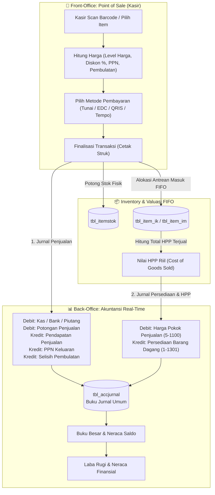
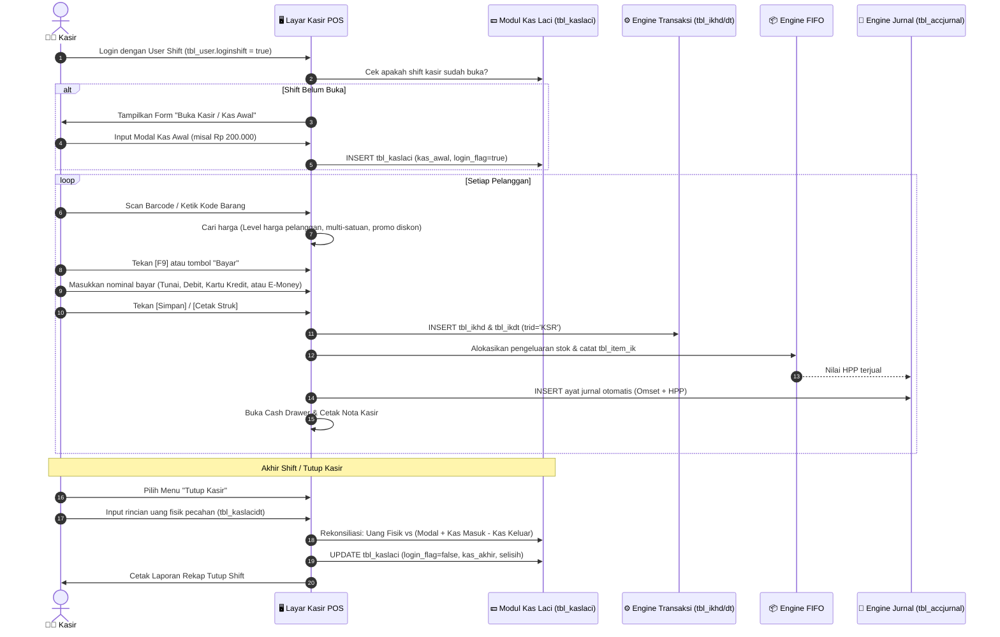
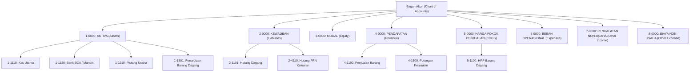

# Panduan Arsitektur & Spesifikasi Sistem POS (Kasir) dan Akuntansi iPos 4.0

Dokumen ini merupakan panduan teknis dan spesifikasi arsitektural komprehensif mengenai **Sistem Point of Sale (POS / Kasir)** dan **Sistem Akuntansi Finansial Terintegrasi** yang terdapat pada iPos 4.0. Spesifikasi ini disusun sebagai acuan rekayasa ulang (*reverse-engineering & modernization*) untuk implementasi aplikasi Web POS / ERP modern berbasis Web (React, Bun, TypeScript, Drizzle ORM, dan PostgreSQL).

---

## 📑 Daftar Isi
1. [Arsitektur Integrasi POS & Akuntansi](#1-arsitektur-integrasi-pos--akuntansi)
2. [Sistem Point of Sale (POS / Kasir)](#2-sistem-point-of-sale-pos--kasir)
   - [2.1 Alur Transaksi Kasir & Status Shift](#21-alur-transaksi-kasir--status-shift)
   - [2.2 Manajemen Kas Laci (`tbl_kaslaci` & `tbl_kaslacidt`)](#22-manajemen-kas-laci-tbl_kaslaci--tbl_kaslacidt)
   - [2.3 Struktur Data Transaksi Penjualan (`tbl_ikhd` & `tbl_ikdt`)](#23-struktur-data-transaksi-penjualan-tbl_ikhd--tbl_ikdt)
   - [2.4 Mekanisme Multi-Payment (Tunai, Kartu, E-Money, Kredit)](#24-mekanisme-multi-payment-tunai-kartu-e-money-kredit)
   - [2.5 Diskon Bertingkat, Pajak PPN & Pembulatan Kasir](#25-diskon-bertingkat-pajak-ppn--pembulatan-kasir)
   - [2.6 Fitur Pending Transaksi (F5) & Multi-Satuan](#26-fitur-pending-transaksi-f5--multi-satuan)
3. [Sistem Akuntansi Finansial Terintegrasi](#3-sistem-akuntansi-finansial-terintegrasi)
   - [3.1 Bagan Akun / Chart of Accounts (`tbl_perkiraan`)](#31-bagan-akun--chart-of-accounts-tbl_perkiraan)
   - [3.2 Pemetaan Akun Otomatis (`tbl_perksetting`)](#32-pemetaan-akun-otomatis-tbl_perksetting)
   - [3.3 Buku Jurnal Umum Real-Time (`tbl_accjurnal`)](#33-buku-jurnal-umum-real-time-tbl_accjurnal)
   - [3.4 Modul Kas & Bank (`tbl_acckashd` & `tbl_acckasdt`)](#34-modul-kas--bank-tbl_acckashd--tbl_acckasdt)
   - [3.5 Sinkronisasi FIFO Persediaan ke Jurnal HPP](#35-sinkronisasi-fifo-persediaan-ke-jurnal-hpp)
4. [Laporan Keuangan & Proses Tutup Buku](#4-laporan-keuangan--proses-tutup-buku)
   - [4.1 Buku Besar & Neraca Saldo](#41-buku-besar--neraca-saldo)
   - [4.2 Neraca Lajur (10 Kolom)](#42-neraca-lajur-10-kolom)
   - [4.3 Laporan Laba Rugi](#43-laporan-laba-rugi)
   - [4.4 Laporan Neraca Keuangan](#44-laporan-neraca-keuangan)
   - [4.5 Mekanisme Tutup Buku Bulanan & Tahunan](#45-mekanisme-tutup-buku-bulanan--tahunan)
5. [Blueprint Kode Implementasi Modern (TypeScript & Drizzle ORM)](#5-blueprint-kode-implementasi-modern-typescript--drizzle-orm)

---

## 1. Arsitektur Integrasi POS & Akuntansi

Pada iPos 4.0, sistem kasir (front-office) dan akuntansi (back-office) terhubung secara **real-time dengan metode persediaan perpetual (*Perpetual Inventory Method*)**. Artinya, saat kasir menekan tombol Simpan/Cetak Struk, sistem tidak hanya memotong stok fisik, melainkan secara instan langsung membuat **2 pasang ayat jurnal berimbang** di database akuntansi:



---

## 2. Sistem Point of Sale (POS / Kasir)

### 2.1 Alur Transaksi Kasir & Status Shift
Aplikasi kasir iPos 4.0 dirancang untuk kecepatan (*fast-checkout*), mendukung input papan ketik penuh (keyboard shortcut), pemindai barcode barcode laser/2D, cash drawer RJ11, dan mini printer thermal (58mm/80mm).



---

### 2.2 Manajemen Kas Laci (`tbl_kaslaci` & `tbl_kaslacidt`)

Tabel `tbl_kaslaci` mencatat sesi buku kasir setiap staf, mencegah kehilangan uang kas (*cash leak*) dan mempermudah audit serah terima pergantian shift:

#### Kolom Utama `tbl_kaslaci`:
| Kolom | Tipe Data | Deskripsi Operasional |
| :--- | :--- | :--- |
| `nama_user` | `VARCHAR` | User ID kasir yang bertugas (misal `KASIR`). |
| `shift` | `VARCHAR` | Nama shift (misal `Pagi`, `Siang`, `Shift 1`). |
| `nama_komputer` | `VARCHAR` | Nama PC / POS terminal kasir. |
| `wkt_mulai` | `TIMESTAMP` | Waktu kasir menekan tombol buka laci / input modal awal. |
| `wkt_akhir` | `TIMESTAMP` | Waktu kasir menyelesaikan tutup shift. |
| `login_flag` | `BOOLEAN` | `true` = Shift sedang berlangsung; `false` = Shift sudah ditutup. |
| `kas_awal` | `NUMERIC` | Nominal kas awal / modal receh laci dari supervisor. |
| `kas_masuk` | `NUMERIC` | Total penerimaan uang tunai dari penjualan + kas masuk manual. |
| `kas_keluar` | `NUMERIC` | Pengeluaran tunai langsung dari laci (ongkir/beli plastik/retur tunai). |
| `kas_akhir` | `NUMERIC` | Total saldo kas akhir sistem = `kas_awal + kas_masuk - kas_keluar`. |

#### Tabel Rincian Fisik Uang (`tbl_kaslacidt`):
Saat tutup kasir, kasir memasukkan jumlah lembar uang tunai:
- Pecahan: Rp 100.000, Rp 50.000, Rp 20.000, Rp 10.000, Rp 5.000, Rp 2.000, Rp 1.000, Rp 500, Rp 200, Rp 100.
- **Formula Selisih**:
  $$\text{Selisih Kasir} = \text{Total Uang Fisik Nyata} - \text{Kas Akhir Sistem}$$
  - Jika $\text{Selisih} < 0$: Kas tekor / kurang kas.
  - Jika $\text{Selisih} > 0$: Kas lebih.

---

### 2.3 Struktur Data Transaksi Penjualan (`tbl_ikhd` & `tbl_ikdt`)

Transaksi penjualan (baik kasir retail maupun back-office invoice) disimpan dalam skema terpadu:

#### 1. Header Penjualan (`tbl_ikhd`):
* `notransaksi` (PK): Kode unik transaksi (format Kasir: `0001/KSR/UTM/1026`, Back-office: `5552/JL/UTM/1026`).
* `kodekantor`: Kantor cabang (misal `UTM`).
* `tanggal`: Waktu transaksi dibuat.
* `tipe`: `JL` (Item Keluar Penjualan).
* `kodesupel`: Pelanggan (default `UMUM` jika pelanggan non-member).
* `subtotal`: Total penjumlahan kotor baris detail sebelum diskon nota.
* `potnomfaktur`: Nilai nominal potongan / diskon nota.
* `pajak`: Nilai nominal PPN (11%).
* `biayalain`: Ongkos kirim atau biaya admin tambahan.
* `selisihpembulatan`: Nilai pembulatan nominal total belanja kasir.
* `totalakhir`: Nilai bersih final yang dibayar:
  $$\text{Total Akhir} = (\text{Subtotal} - \text{Potongan Faktur} + \text{Pajak} + \text{Biaya Lain}) \pm \text{Pembulatan}$$
* `carabayar`: Metode pembayaran utama (`TUNAI`, `KREDIT`, `DEBIT`, `KK`, `EMONEY`).
* `user1`: ID staf kasir yang melayani transaksi.
* `shiftkerja`: Shift yang sedang aktif.

#### 2. Detail Item Penjualan (`tbl_ikdt`):
* `iddetail` (PK): Identifier baris unik.
* `notransaksi` (FK): Merujuk ke `tbl_ikhd.notransaksi`.
* `nobaris`: Urutan baris item (1, 2, 3...).
* `kodeitem`: Kode barang / barcode.
* `jumlah`: Kuantitas fisik terjual.
* `satuan`: Satuan yang dipilih (Pcs, Box, Dus, Lusin).
* `harga`: Harga satuan setelah level harga.
* `potongan`, `potongan2`, `potongan3`, `potongan4`: Diskon bertingkat baris.
* `total`: Subtotal baris bersih.
* `pajak`: Nominal pajak per baris item.

---

### 2.4 Mekanisme Multi-Payment (Tunai, Kartu, E-Money, Kredit)

iPos 4.0 mendukung pembayaran split (kombinasi beberapa cara bayar dalam 1 nota):

| Metode Bayar | Kolom Nominal di `tbl_ikhd` | Metadata Tambahan | Akun Akuntansi Default |
| :--- | :--- | :--- | :---: |
| **Tunai (Cash)** | `jmltunai` | - | `1-1110` (Kas) |
| **Kartu Debit** | `jmldebit` | `byr_debit_bank`, `byr_debit_no` (No Kartu/EDC) | `1-1120` (Kas Bank) |
| **Kartu Kredit** | `jmlkk` | `byr_kk_bank`, `byr_kk_no` | `1-1220` (Piutang Kartu Kredit)|
| **E-Money / QRIS**| `jmlemoney` | `byr_emoney_prod` (GoPay/OVO/ShopeePay), `byr_emoney_no` | `1-122X01` (Piutang E-Money) |
| **Tempo / Bon** | `jmlkredit` | `byr_krd_jt` (Tanggal Jatuh Tempo) | `1-1210` (Piutang Usaha) |

**Aturan Validasi Pembayaran:**
$$\text{Total Akhir} = \text{jmltunai} + \text{jmldebit} + \text{jmlkk} + \text{jmlemoney} + \text{jmlkredit}$$

---

### 2.5 Diskon Bertingkat, Pajak PPN & Pembulatan Kasir

1. **Diskon Bertingkat Baris**:
   Kasir dapat memberikan diskon bertingkat hingga 4 lapis (misal promo `20% + 10% + 5%`):
   $$\text{Harga Setelah Diskon} = \text{Harga} \times (1 - \text{pot}_1) \times (1 - \text{pot}_2) \times (1 - \text{pot}_3) \times (1 - \text{pot}_4)$$
2. **Pajak PPN 11%**:
   * Mode `TRS_PAJAK_JUAL = 1` (*Include PPN*): Harga jual di kasir sudah termasuk pajak 11%.
   * Mode `TRS_PAJAK_JUAL = 2` (*Exclude PPN*): Pajak 11% ditambahkan di akhir nota.
3. **Pembulatan Kasir (`CFG_AKTIF_PEMBULATAN`)**:
   Untuk mempercepat kembalian receh uang tunai, nilai nota kasir dibulatkan otomatis (misal kelipatan Rp 100):
   - Belanja: `Rp 24.340` $\rightarrow$ Dibulatkan jadi `Rp 24.400` (Selisih `+Rp 60` dicatat di akun `7-699X01`).

---

### 2.6 Fitur Pending Transaksi (F5) & Multi-Satuan

* **Pending Transaksi (`F5`)**:
  Jika konsumen sedang antre di meja kasir dan ingin mengambil barang tambahan, kasir dapat menekan tombol `[F5] Pending`. Transaksi disimpan sementara di memori tanpa memotong stok, sehingga kasir dapat langsung melayani antrean pelanggan berikutnya. Saat konsumen kembali, kasir membuka menu `Daftar Pending` dan melanjutkan transaksi dalam 1 klik.
* **Konversi Multi-Satuan Otomatis**:
  Jika barang memiliki satuan bertingkat (misal: 1 Dus = 10 Pak = 100 Pcs), kasir dapat mengetik barcode dus atau memilih satuan `Dus` di kasir. Engine otomatis mengalikan harga jual dus dan mengonversi pengeluaran persediaan ke satuan dasar stok.

---

## 3. Sistem Akuntansi Finansial Terintegrasi

### 3.1 Bagan Akun / Chart of Accounts (`tbl_perkiraan`)

iPos 4.0 menggunakan standar kode akun terstruktur dengan format `X-XXXX`:



#### Kolom Tabel `tbl_perkiraan`:
* `kodeacc` (PK): Kode akun rekening (misal `1-1110`, `4-1100`).
* `namaacc`: Nama akun perkiraan.
* `parentacc`: Kode akun induk (untuk hierarki laporan).
* `kelompok`: Digit kelompok (`1` s/d `8`).
* `tipe`: `H` (*Header / Induk*, tidak bisa dijurnal) atau `D` (*Detail*, akun jurnal aktif).
* `kasbank`: Flag boolean penanda apakah akun ini merupakan kas atau rekening bank.

---

### 3.2 Pemetaan Akun Otomatis (`tbl_perksetting`)

Tabel `tbl_perksetting` adalah "jembatan" yang menghubungkan setiap jenis transaksi operasional toko dengan akun buku besar yang sesuai:

| Kunci Setting (`accsetting`) | Kode Akun Default | Nama Akun Terhubung | Fungsi Penjurnalan Otomatis |
| :--- | :---: | :--- | :--- |
| `ACC_ITEM_PERS` | `1-1301` | Persediaan Barang Dagang | Akun aset stok barang dagang. |
| `ACC_ITEM_HPP` | `5-1100` | Harga Pokok Penjualan | Beban pokok saat barang terjual. |
| `ACC_ITEM_JUAL` | `4-1100` | Pendapatan Penjualan | Omset penjualan kotor. |
| `ACC_ITEM_JASA` | `4-2000` | Pendapatan Jasa | Pendapatan dari perbaikan/layanan jasa. |
| `ACC_KSR_TUNAI` / `ACC_JUAL_TUNAI` | `1-1110` | Kas Utama | Penerimaan uang tunai penjualan. |
| `ACC_KSR_DEBIT` / `ACC_JUAL_DEBIT` | `1-1120` | Kas Bank (Debit Card) | Penerimaan via mesin EDC Debit. |
| `ACC_KSR_KK` / `ACC_JUAL_KK` | `1-1220` | Piutang Kartu Kredit | Penjualan via kartu kredit. |
| `ACC_KSR_EMONEY` | `1-122X01` | Piutang E-Money / QRIS | Penjualan via GoPay, OVO, QRIS. |
| `ACC_KSR_KREDIT` / `ACC_JUAL_KREDIT`| `1-1210` | Piutang Usaha | Penjualan kredit / bon tempo pelanggan. |
| `ACC_KSR_POT` / `ACC_JUAL_POT` | `4-1500` | Potongan Penjualan | Diskon nota / potongan harga jual. |
| `ACC_KSR_PAJAK` / `ACC_JUAL_PAJAK` | `2-4110` | Hutang PPN Keluaran | Pajak pertambahan nilai yang dipungut. |
| `ACC_KSR_PEND_PEMBULATAN` | `7-699X01` | Pendapatan Pembulatan | Selisih pembulatan nominal transaksi kasir. |
| `ACC_BELI_TUNAI` | `1-1110` | Kas Utama | Pengeluaran kas beli tunai ke supplier. |
| `ACC_BELI_KREDIT` | `2-1101` | Hutang Dagang | Hutang pembelian tempo ke supplier. |
| `ACC_BELI_PAJAK` | `1-1410` | PPN Masukan | Pajak masukan pembelian dari supplier. |
| `ACC_BELI_POT` | `1-1390` | Potongan Pembelian | Diskon/potongan dari faktur supplier. |
| `ACC_OP_HPP` | `5-2200` | Selisih Stok Opname | Beban/pendapatan penyesuaian selisih stok. |
| `ACC_IM_HPP` | `5-2201` | HPP Penyesuaian Masuk | Penyesuaian item masuk non-beli. |
| `ACC_IK_HPP` | `5-2202` | HPP Penyesuaian Keluar | Kerusakan / kehilangan / expired barang. |
| `ACC_LABATAHAN` | `3-2000` | Laba Ditahan | Penampung laba bersih tahun-tahun lalu. |
| `ACC_LABAJALAN` | `3-3000` | Laba Tahun Berjalan | Penampung laba periode berjalan di neraca. |
| `ACC_HISTORICAL` | `3-9000` | Historical Balancing | Akun penyeimbang saldo awal neraca. |

---

### 3.3 Buku Jurnal Umum Real-Time (`tbl_accjurnal`)

Setiap ayat jurnal memiliki nomor urut (`nourut`), kode akun (`kodeacc`), posisi (`D` / `K`), dan nominal yang **wajib seimbang ($\sum \text{Debet} = \sum \text{Kredit}$)**.

#### Contoh Bukti Riil Jurnal Penjualan Kasir / Invoice (`5552/JL/UTM/1026`):
Transaksi penjualan barang senilai `Rp 2.680.000`, mendapat diskon nota `Rp 134.000`, sisa tagihan piutang `Rp 2.546.000`. Nilai modal HPP menurut antrean FIFO adalah `Rp 1.215.405,41`.

| No Urut | Kode Akun | Nama Akun | Posisi | Debet (Rp) | Kredit (Rp) | Keterangan |
| :---: | :---: | :--- | :---: | :---: | :---: | :--- |
| **1** | `1-1210` | Piutang Usaha | **D** | 2.546.000,00 | 0,00 | Penerimaan tagihan penjualan |
| **2** | `4-1100` | Pendapatan Penjualan | **K** | 0,00 | 2.680.000,00 | Nilai kotor omset penjualan |
| **3** | `4-1500` | Potongan Penjualan | **D** | 134.000,00 | 0,00 | Diskon yang diberikan toko |
| **4** | `5-1100` | Harga Pokok Penjualan | **D** | 1.215.405,41 | 0,00 | Beban pokok modal barang keluar |
| **5** | `1-1301` | Persediaan Barang Dagang | **K** | 0,00 | 1.215.405,41 | Pengurangan nilai aset stok fisik |

*Catatan Keseimbangan:*
- Sisi Omset: $\text{Debet } (2.546.000 + 134.000) = \text{Kredit } 2.680.000$ ✅
- Sisi Persediaan: $\text{Debet } 1.215.405,41 = \text{Kredit } 1.215.405,41$ ✅

---

### 3.4 Modul Kas & Bank (`tbl_acckashd` & `tbl_acckasdt`)

Selain dari transaksi jual-beli, pergerakan uang tunai dan rekening bank dicatat melalui menu Kas:
1. **Kas Masuk (`KASI`)**: Pendapatan sewa, setoran modal pemilik, atau pendapatan di luar operasional toko.
   $$\text{Debit: Kas/Bank (1-1110/1-1120)} \quad / \quad \text{Kredit: Akun Pendapatan Lawan}$$
2. **Kas Keluar (`KASO`)**: Pembayaran biaya listrik, internet, gaji staf, perlengkapan toko.
   $$\text{Debit: Beban Operasional (6-xxxx)} \quad / \quad \text{Kredit: Kas/Bank (1-1110/1-1120)}$$
3. **Kas Transfer (`KASTR`)**: Pemindahan dana antar rekening (misal setor tunai dari brankas toko ke rekening Bank BCA):
   $$\text{Debit: Bank Tujuan (1-1120)} \quad / \quad \text{Kredit: Kas Asal (1-1110)}$$

---

### 3.5 Sinkronisasi FIFO Persediaan ke Jurnal HPP

iPos 4.0 menghubungkan engine inventaris FIFO ke sistem akuntansi melalui alokasi kuantitas masuk:
1. Setiap kali terjadi penjualan di kasir, engine memeriksa stok masuk tertua di `tbl_item_im`.
2. Menghitung harga pokok perolehan dari batch tersebut dan mencatat riwayat pemakaian di `tbl_item_ik`.
3. Mengakumulasikan seluruh modal batch:
   $$\text{Total HPP} = \sum (\text{Qty Terjual dari Batch}_i \times \text{Harga Pokok Batch}_i)$$
4. Nilai total inilah yang langsung ditembakkan ke tabel `tbl_accjurnal` pada baris Debit `ACC_ITEM_HPP` dan Kredit `ACC_ITEM_PERS`.

---

## 4. Laporan Keuangan & Proses Tutup Buku

### 4.1 Buku Besar & Neraca Saldo
* **Buku Besar (*General Ledger*)**: Menyajikan seluruh kronologi mutasi debit dan kredit beserta saldo berjalan untuk setiap akun perkiraan dalam rentang tanggal yang dipilih.
* **Neraca Saldo (*Trial Balance*)**: Menampilkan daftar ringkas seluruh akun detail beserta saldo akhir debit atau kreditnya, membuktikan bahwa pembukuan berada dalam kondisi seimbang sebelum menyusun laporan keuangan.

### 4.2 Neraca Lajur (10 Kolom / *Worksheet*)
Mengompilasi 5 pasang kolom analisis keuangan:
1. Neraca Saldo Sebelum Penyesuaian
2. Ayat Jurnal Penyesuaian
3. Neraca Saldo Setelah Penyesuaian
4. Laba / Rugi (Akun Golongan 4, 5, 6, 7, 8)
5. Neraca Akhir (Akun Golongan 1, 2, 3)

### 4.3 Laporan Laba Rugi (*Income Statement*)
Mengukur kinerja profitabilitas toko dalam suatu periode:
$$\begin{aligned}
\text{Penjualan Bersih} &= \text{Penjualan (4-1100)} - \text{Potongan (4-1500)} - \text{Retur (4-1200)} \\
\text{Laba Kotor} &= \text{Penjualan Bersih} - \text{HPP (5-1100)} \\
\text{Laba Operasional} &= \text{Laba Kotor} - \text{Total Beban Operasional (6-xxxx)} \\
\text{Laba Bersih Sebelum Pajak} &= \text{Laba Operasional} + (\text{Pendapatan Lain} - \text{Biaya Lain})
\end{aligned}$$

### 4.4 Laporan Neraca Keuangan (*Balance Sheet*)
Menggambarkan posisi kesehatan finansial toko pada suatu tanggal tertentu:
$$\text{Total Aktiva (Golongan 1)} = \text{Total Kewajiban (Golongan 2)} + \text{Total Modal (Golongan 3)} + \text{Laba Tahun Berjalan}$$

### 4.5 Mekanisme Tutup Buku Bulanan & Tahunan
* **Tutup Buku Bulanan (`mProsesBulan`)**:
  Menghitung saldo akhir setiap akun pada bulan aktif, lalu mencatatnya ke tabel `tbl_acc_sa` sebagai saldo awal untuk bulan berikutnya. Mutasi transaksi di bulan yang sudah ditutup tidak boleh diedit kembali tanpa izin supervisor.
* **Tutup Buku Tahunan (`mProsesTahun`)**:
  1. Menutup semua saldo akun nominal (Pendapatan Akun 4, HPP Akun 5, dan Beban Akun 6, 7, 8) menjadi `0`.
  2. Akumulasi Laba Bersih tahunan dipindahkan secara permanen ke akun **Laba Ditahan (`3-2000`)** pada kelompok Modal.
  3. Memajukan konfigurasi `ACC_CURRENT_YEAR` ke tahun berikutnya.

---

## 5. Blueprint Kode Implementasi Modern (TypeScript & Drizzle ORM)

Berikut adalah contoh modul service kasir dan penjurnalan akuntansi otomatis siap pakai untuk backend modern:

### 5.1 Service Transaksi POS & Penjurnalan Otomatis (`pos-checkout.service.ts`)

```typescript
import postgres from "postgres";

export interface CartItem {
  kodeitem: string;
  jumlah: number;
  satuan: string;
  harga: number;
  potonganPersen: number;
}

export interface CheckoutPayload {
  notransaksi: string;
  kantor: string;
  pelanggan: string;
  kasirId: string;
  shiftKerja: string;
  items: CartItem[];
  potonganNota: number;
  pembulatan: number;
  pembayaran: {
    tunai: number;
    debit: number;
    debitBank?: string;
    kartuKredit: number;
    emoney: number;
    emoneyProd?: string;
    kreditTempo: number;
  };
}

export class PosCheckoutService {
  constructor(private sql: postgres.Sql) {}

  async processCheckout(payload: CheckoutPayload) {
    return await this.sql.begin(async (tx) => {
      // 1. Ambil Pengaturan Akun Otomatis dari tbl_perksetting
      const settings = await tx`
        SELECT accsetting, kodeacc FROM tbl_perksetting WHERE acckantor = ${payload.kantor}
      `;
      const accMap = new Map<string, string>();
      for (const s of settings) accMap.set(s.accsetting, s.kodeacc);

      // 2. Hitung Nilai Penjualan Detail & Total
      let subtotal = 0;
      let totalHpp = 0;

      for (let i = 0; i < payload.items.length; i++) {
        const item = payload.items[i];
        const lineNet = item.jumlah * item.harga * (1 - item.potonganPersen / 100);
        subtotal += lineNet;

        // Hitung FIFO HPP dari batch stok masuk
        const [fifoBatch] = await tx`
          SELECT sisa, hargasatuan FROM tbl_item_im 
          WHERE kodeitem = ${item.kodeitem} AND kodekantor = ${payload.kantor} AND sisa > 0 
          ORDER BY tanggal ASC LIMIT 1
        `;
        const itemHpp = fifoBatch ? Number(fifoBatch.hargasatuan) * item.jumlah : 0;
        totalHpp += itemHpp;

        // Simpan baris detail tbl_ikdt
        await tx`
          INSERT INTO tbl_ikdt (
            iddetail, nobaris, notransaksi, kodeitem, jumlah, satuan, harga, potongan, total
          ) VALUES (
            ${payload.notransaksi + '-' + (i + 1)}, ${i + 1}, ${payload.notransaksi}, 
            ${item.kodeitem}, ${item.jumlah}, ${item.satuan}, ${item.harga}, 
            ${item.potonganPersen}, ${lineNet}
          )
        `;
      }

      const totalAkhir = subtotal - payload.potonganNota + payload.pembulatan;

      // 3. Simpan Header tbl_ikhd
      await tx`
        INSERT INTO tbl_ikhd (
          notransaksi, kodekantor, tanggal, tipe, kodesupel, subtotal, potnomfaktur, 
          selisihpembulatan, totalakhir, carabayar, jmltunai, jmldebit, jmlkk, jmlemoney, 
          jmlkredit, user1, shiftkerja
        ) VALUES (
          ${payload.notransaksi}, ${payload.kantor}, NOW(), 'JL', ${payload.pelanggan}, 
          ${subtotal}, ${payload.potonganNota}, ${payload.pembulatan}, ${totalAkhir}, 
          ${payload.pembayaran.tunai > 0 ? 'TUNAI' : 'KREDIT'}, 
          ${payload.pembayaran.tunai}, ${payload.pembayaran.debit}, 
          ${payload.pembayaran.kartuKredit}, ${payload.pembayaran.emoney}, 
          ${payload.pembayaran.kreditTempo}, ${payload.kasirId}, ${payload.shiftKerja}
        )
      `;

      // 4. Buat Jurnal Akuntansi Berimbang Real-Time (tbl_accjurnal)
      let urut = 1;
      const tgl = new Date();

      const insertJurnal = async (kodeAcc: string, debet: number, kredit: number, ket: string) => {
        if (debet === 0 && kredit === 0) return;
        const idDetail = `${Date.now()}${String(urut).padStart(3, '0')}`;
        await tx`
          INSERT INTO tbl_accjurnal (
            iddetail, nourut, tipeinput, notransaksi, tanggal, kodeacc, jenis, 
            keterangan, matauang, rate, jumlah, posisi, debet, kredit, kantor
          ) VALUES (
            ${idDetail}, ${urut++}, 'R', ${payload.notransaksi}, ${tgl}, ${kodeAcc}, 
            'Jurnal', ${ket}, 'IDR', 1.0, ${debet > 0 ? debet : kredit}, 
            ${debet > 0 ? 'D' : 'K'}, ${debet}, ${kredit}, ${payload.kantor}
          )
        `;
      };

      // Ayat Jurnal 1: Penerimaan Kas / Bank / E-Money / Piutang (Debet)
      if (payload.pembayaran.tunai > 0) {
        await insertJurnal(accMap.get("ACC_KSR_TUNAI") || "1-1110", payload.pembayaran.tunai, 0, `Kas Penjualan: ${payload.notransaksi}`);
      }
      if (payload.pembayaran.debit > 0) {
        await insertJurnal(accMap.get("ACC_KSR_DEBIT") || "1-1120", payload.pembayaran.debit, 0, `Debit Card: ${payload.notransaksi}`);
      }
      if (payload.pembayaran.emoney > 0) {
        await insertJurnal(accMap.get("ACC_KSR_EMONEY") || "1-122X01", payload.pembayaran.emoney, 0, `E-Money / QRIS: ${payload.notransaksi}`);
      }
      if (payload.pembayaran.kreditTempo > 0) {
        await insertJurnal(accMap.get("ACC_KSR_KREDIT") || "1-1210", payload.pembayaran.kreditTempo, 0, `Piutang Penjualan: ${payload.notransaksi}`);
      }
      if (payload.potonganNota > 0) {
        await insertJurnal(accMap.get("ACC_KSR_POT") || "4-1500", payload.potonganNota, 0, `Diskon Nota: ${payload.notransaksi}`);
      }

      // Ayat Jurnal 2: Pendapatan Penjualan & Pembulatan (Kredit)
      await insertJurnal(accMap.get("ACC_ITEM_JUAL") || "4-1100", 0, subtotal, `Pendapatan Penjualan: ${payload.notransaksi}`);
      if (payload.pembulatan !== 0) {
        await insertJurnal(accMap.get("ACC_KSR_PEND_PEMBULATAN") || "7-699X01", 0, payload.pembulatan, `Pembulatan Kasir: ${payload.notransaksi}`);
      }

      // Ayat Jurnal 3: Pengakuan HPP dan Pengurangan Persediaan (Perpetual FIFO)
      if (totalHpp > 0) {
        await insertJurnal(accMap.get("ACC_ITEM_HPP") || "5-1100", totalHpp, 0, `HPP Penjualan: ${payload.notransaksi}`);
        await insertJurnal(accMap.get("ACC_ITEM_PERS") || "1-1301", 0, totalHpp, `Persediaan Keluar: ${payload.notransaksi}`);
      }

      return {
        success: true,
        notransaksi: payload.notransaksi,
        totalAkhir,
        totalHpp
      };
    });
  }
}
```

---

## 6. Ringkasan & Rekomendasi Modernisasi

1. **Sinkronisasi Kasir ke Akuntansi Real-Time**: Tidak diperlukan proses "Posting Jurnal" manual di akhir hari karena setiap nota kasir otomatis menjurnal ke `tbl_accjurnal` secara perpetual.
2. **Kesesuaian dengan Service Akuntansi**: Query laporan Neraca dan Laba Rugi yang telah dibuat di [`backend/src/services/accounting.service.ts`](file:///c:/Program%20Files%20(x86)/Program%20Kreatif/Program%20iPos%204.0/backend/src/services/accounting.service.ts) langsung membaca data yang dihasilkan oleh transaksi kasir di atas.
3. **Audit Trail Kasir**: Selalu gunakan siklus `tbl_kaslaci` (Modal Awal $\rightarrow$ Transaksi Penjualan $\rightarrow$ Rekonsiliasi Pecahan Fisik $\rightarrow$ Selisih Kasir) untuk menjamin transparansi kas meja kasir di toko ritel.
