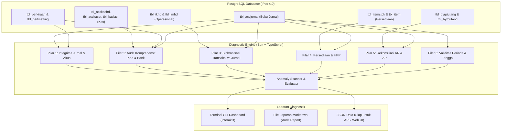

# Rencana Implementasi: Sistem Pendeteksi Anomali Database iPos 4.0

Dokumen ini memuat rencana teknis, arsitektur, dan katalog aturan (*ruleset*) untuk mendeteksi seluruh anomali data pada database PostgreSQL iPos 4.0 yang berpotensi menyebabkan **Laporan Keuangan (Neraca, Laba Rugi, Buku Besar, Arus Kas, dan Neraca Saldo)** menjadi invalid atau tidak mencerminkan kenyataan bisnis.

---

## 1. Latar Belakang & Temuan Khusus Kas & Bank
Pada aplikasi iPos 4.0, laporan akuntansi dibentuk dari relasi antara master akun (`tbl_perkiraan`), buku jurnal umum (`tbl_accjurnal`), transaksi operasional (`tbl_ikhd`, `tbl_imhd`), transaksi kas (`tbl_acckashd`), dan kas laci kasir (`tbl_kaslaci`).

Berdasarkan investigasi langsung pada database `i4_barunatrial`, ditemukan anomali nyata pada domain **Kas & Bank**:
1. **Saldo Kas / Bank Minus**:
   - Akun `1-1120 BANK BCA` memiliki saldo buku besar minus sebesar **-Rp 576.004.685**.
   - Akun `1-1122 BANK BCA HIP` memiliki saldo minus sebesar **-Rp 25.207.262**.
   - *Dampak*: Menampilkan nilai aset kas negatif di Neraca. Hal ini umumnya terjadi karena mutasi pengeluaran kas dicatat lebih awal mendahului pencatatan penerimaan, atau mutasi bank transfer/masuk belum diinput.
2. **Salah Konfigurasi Flag Kas (`kasbank = true`)**:
   - Ditemukan akun non-kas yang ditandai `kasbank = true` di `tbl_perkiraan`, yaitu:
     - `3-2000 LABA DITAHAN` (Modal)
     - `3-3000 LABA TAHUN BERJALAN` (Modal)
     - `5-1100 HARGA POKOK PENJUALAN` (HPP)
     - `6-3003 BIAYA BONUS KARYAWAN` (Biaya)
     - `1-1301 PERSEDIAAN BARANG` (Persediaan)
   - *Dampak*: Laporan Arus Kas, modul Kas Masuk / Kas Keluar, dan filter kas tercampur dengan akun non-likuid.

---

## 2. Arsitektur Modul Diagnostik (Bun + Drizzle ORM)



---

## 3. Katalog Aturan Deteksi Anomali Lengkap

### A. Pilar 1: Integritas Jurnal & Bagan Akun
| No | Kode Aturan | Kondisi Anomali yang Dideteksi | Severity | Dampak pada Laporan | Rekomendasi Solusi |
| :---: | :--- | :--- | :---: | :--- | :--- |
| 1 | `JUR_UNBALANCED` | $\sum(\text{Debet}) \neq \sum(\text{Kredit})$ pada transaksi yang sama di `tbl_accjurnal` | **CRITICAL** ($> 10$) / **INFO** ($\le 10$) | Neraca tidak seimbang (*out of balance*), Neraca Saldo selisih | Perbaiki jurnal atau alokasikan selisih desimal ke akun selisih pembulatan |
| 2 | `JUR_HEADER_POST` | Transaksi jurnal diposting ke akun Header (`tipe = 'H'`) | **CRITICAL** | Angka tidak muncul pada detail atau terhitung ganda (*double count*) | Pindahkan mutasi ke akun Detail (`tipe = 'D'`) di bawah header tersebut |
| 3 | `JUR_ORPHAN_ACC` | `kodeacc` pada jurnal tidak terdaftar di `tbl_perkiraan` | **CRITICAL** | Mutasi hilang dari pohon laporan keuangan | Tambahkan kode akun ke COA atau perbaiki nomor akun jurnal |
| 4 | `CFG_INVALID_MAP` | Mapping di `tbl_perksetting` merujuk ke kelompok akun yang salah | **CRITICAL** | Laba ditahan / berjalan atau jurnal otomatis modul salah kamar | Sesuaikan mapping akun sistem di menu pengaturan akuntansi iPos 4 |

### B. Pilar 2: Audit Komprehensif Kas & Bank ⭐
| No | Kode Aturan | Kondisi Anomali yang Dideteksi | Severity | Dampak pada Laporan | Rekomendasi Solusi |
| :---: | :--- | :--- | :---: | :--- | :--- |
| 5 | `CSH_INVALID_FLAG` | Akun non-kas (`HPP`, `LABA DITAHAN`, `PERSEDIAAN`, dll) ditandai `kasbank = true` di `tbl_perkiraan` | **CRITICAL** | Laporan Arus Kas & mutasi kas tercemar oleh akun non-likuid | Ubah field `kasbank = false` pada akun non-kas di `tbl_perkiraan` |
| 6 | `CSH_NEGATIVE_BALANCE` | Akun Kas / Bank (misal `BANK BCA 1-1120`) memiliki saldo berjalan $< 0$ di Buku Besar | **WARNING** | Kas di Neraca bernilai minus (secara fisik uang kas tidak bisa minus) | Audit mutasi bank: input penerimaan yang terlewat atau periksa pengeluaran ganda |
| 7 | `CSH_UNJOURNALED` | Bukti Kas Masuk (`KASI`), Keluar (`KASO`), atau Transfer (`KASTR`) di `tbl_acckashd` tanpa jurnal | **CRITICAL** | Mutasi uang operasional kantor hilang dari pembukuan | Jalankan proses jurnal ulang modul kas |
| 8 | `CSH_TRX_MISMATCH` | Nilai bayar tunai faktur jual (`jmltunai`), beli, atau bayar piutang/hutang $\neq$ mutasi kas di jurnal | **CRITICAL** | Saldo buku besar kas tidak mencerminkan mutasi riil kasir/toko | Koreksi penjurnalan transaksi tunai terkait |
| 9 | `CSH_TRANSFER_UNBALANCED` | Transaksi Kas Transfer (`KASTR`) di mana debet kas tujuan $\neq$ kredit kas asal | **CRITICAL** | Terjadi selisih dana transfer antar rekening/cabang | Samakan nilai mutasi debet kas penerima dan kredit kas pengirim |
| 10 | `CSH_DRAWER_DIFF` | Selisih kas laci kasir: $\text{kas\_awal} + \text{kas\_masuk} - \text{kas\_keluar} \neq \text{kas\_akhir}$ di `tbl_kaslaci` | **WARNING** | Ada kas lebih / kas tekor fisik kasir yang belum disesuaikan | Buat Jurnal Penyesuaian Selisih Kas Kasir (Kelebihan/Kekurangan Kas) |

### C. Pilar 3: Sinkronisasi Transaksi Operasional vs Jurnal
| No | Kode Aturan | Kondisi Anomali yang Dideteksi | Severity | Dampak pada Laporan | Rekomendasi Solusi |
| :---: | :--- | :--- | :---: | :--- | :--- |
| 11 | `SYNC_UNJOURNAL_SALE` | Faktur penjualan (`tbl_ikhd`) tidak memiliki pasangan jurnal di `tbl_accjurnal` | **CRITICAL** | Pendapatan & piutang di Laba Rugi / Neraca lebih rendah dari riil | Jalankan fitur *Proses Jurnal Ulang* modul penjualan |
| 12 | `SYNC_UNJOURNAL_BUY` | Faktur pembelian (`tbl_imhd`) tidak memiliki pasangan jurnal di `tbl_accjurnal` | **CRITICAL** | Persediaan & hutang di Neraca tidak tercatat | Jalankan fitur *Proses Jurnal Ulang* modul pembelian |
| 13 | `SYNC_AMOUNT_DIFF` | Nilai `totalakhir` faktur berbeda dengan debet/kredit jurnalnya | **WARNING** | Laporan omset operasional bertolak belakang dengan Laba Rugi | Koreksi nilai jurnal agar sesuai dengan faktur riil |

### D. Pilar 4: Integritas Persediaan & HPP
| No | Kode Aturan | Kondisi Anomali yang Dideteksi | Severity | Dampak pada Laporan | Rekomendasi Solusi |
| :---: | :--- | :--- | :---: | :--- | :--- |
| 14 | `INV_NEGATIVE_STOCK` | Nilai stok di `tbl_itemstok.stok < 0` | **WARNING** | HPP terdistorsi, nilai persediaan akhir di Neraca anomali | Lakukan *Item Masuk* atau *Stok Opname* penyesuaian |
| 15 | `INV_ZERO_HPP` | Item yang memiliki transaksi jual memiliki `hargapokok <= 0` | **WARNING** | HPP tercatat Rp 0, Laba Kotor fiktif / melonjak tidak wajar | Update harga pokok item berdasarkan faktur beli terakhir |
| 16 | `INV_LEDGER_DIFF` | Nilai fisik $(\text{Stok} \times \text{HPP})$ berbeda jauh dengan saldo Akun `1-1301` | **WARNING** | Nilai aset lancar persediaan di Neraca tidak valid | Sesuaikan melalui Jurnal Penyesuaian Nilai Persediaan |

### E. Pilar 5: Rekonsiliasi Buku Pembantu vs Buku Besar
| No | Kode Aturan | Kondisi Anomali yang Dideteksi | Severity | Dampak pada Laporan | Rekomendasi Solusi |
| :---: | :--- | :--- | :---: | :--- | :--- |
| 17 | `SUB_AR_DIFF` | Total saldo faktur piutang belum lunas $\neq$ Saldo Akun `1-1210` | **CRITICAL** | Laporan Umur Piutang tidak sama dengan angka di Neraca | Lakukan audit kartu piutang vs buku besar piutang |
| 18 | `SUB_AP_DIFF` | Total saldo faktur hutang belum lunas $\neq$ Saldo Akun `2-1101` | **CRITICAL** | Buku pembantu hutang supplier berbeda dengan kewajiban di Neraca | Lakukan rekonsiliasi faktur hutang vs buku besar hutang |

### F. Pilar 6: Validitas Periode & Tanggal
| No | Kode Aturan | Kondisi Anomali yang Dideteksi | Severity | Dampak pada Laporan | Rekomendasi Solusi |
| :---: | :--- | :--- | :---: | :--- | :--- |
| 19 | `DAT_FUTURE_TRANS` | Transaksi memiliki tanggal di masa depan ($> \text{hari ini}$) | **WARNING** | Transaksi tidak terhitung di periode berjalan atau loncat tahun | Koreksi tanggal transaksi ke tanggal riil transaksi |
| 20 | `DAT_OUT_OF_PERIOD` | Transaksi dengan tahun tidak valid (misal tahun 1900 atau sebelum setup awal) | **WARNING** | Mengacaukan perhitungan saldo awal dan laba ditahan | Koreksi tanggal ke periode buku yang sah |

---

## 4. Struktur Folder & Modul yang Akan Dibangun

```text
backend/
├── src/
│   ├── diagnostics/
│   │   ├── types.ts              # Type definition untuk anomali & laporan
│   │   ├── rules/
│   │   │   ├── journal.rules.ts   # Pilar 1: Integritas Jurnal & COA
│   │   │   ├── cash.rules.ts      # Pilar 2: Audit Komprehensif Kas & Bank (Flag, Minus, Transfer, Laci)
│   │   │   ├── sync.rules.ts      # Pilar 3: Sinkronisasi Transaksi vs Jurnal
│   │   │   ├── inventory.rules.ts # Pilar 4: Persediaan & HPP
│   │   │   ├── subledger.rules.ts # Pilar 5: Rekonsiliasi Piutang & Hutang
│   │   │   └── date.rules.ts      # Pilar 6: Validitas Tanggal
│   │   ├── scanner.ts            # Diagnostic runner utama
│   │   └── reporter.ts           # Generator output (Console, Markdown, JSON)
│   └── cli/
│       └── audit.ts              # Runner CLI: bun run audit
├── reports/                      # Folder penyimpanan riwayat laporan audit (.md)
└── package.json                  # Ditambahkan script "audit": "bun run src/cli/audit.ts"
```

---

## 5. Rencana Pengujian & Verifikasi

1. **Pengujian Deteksi Data Riil**:
   - Menjalankan `bun run audit` pada database `i4_barunatrial`.
   - Memverifikasi akun `1-1120 BANK BCA` (minus Rp 576 jt) dan `1-1122 BANK BCA HIP` terdeteksi di aturan saldo kas minus.
   - Memverifikasi salah flag `kasbank = true` pada `3-2000 LABA DITAHAN`, `5-1100 HPP`, dan `1-1301 PERSEDIAAN BARANG` tertangkap.
   - Memverifikasi 5 transaksi selisih pembulatan jurnal tertangkap di level `INFO`/`WARNING`.
   - Memverifikasi 7 barang dengan HPP $\le 0$ tertangkap di kategori `INV_ZERO_HPP`.
2. **Pengujian Performa**:
   - Seluruh kueri diagnosa menggunakan kueri SQL terindeks tanpa *table scan* berulang sehingga proses scan 35.000+ data jurnal selesai dalam waktu < 3 detik.
3. **Pengujian Output**:
   - Memastikan file audit Markdown terbit di folder `backend/reports/` dengan ringkasan eksekutif, tabel detail anomali, dan langkah-langkah solusi perbaikan.
