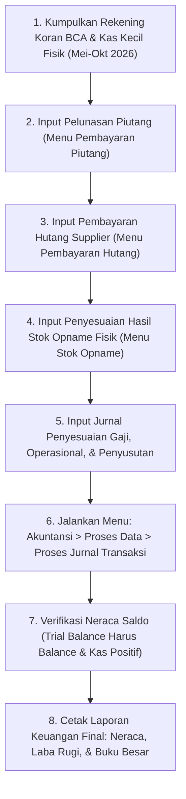

# Panduan & Dokumen Kesiapan Tutup Buku Periode Oktober 2026
## Audit Kesiapan Data Finansial Database `i4_barunatrial` (iPos 4.0)

Dokumen ini disusun oleh Auditor untuk manajemen dan staf akuntansi sebagai **Daftar Checklist Kekurangan Data (*Missing Data Checklist*)**, **Format Dokumen Fisik yang Wajib Disiapkan**, dan **Draf Jurnal Penyesuaian (*Adjusting Journal Entries*)** sebelum proses Tutup Buku periode Oktober 2026 dapat disahkan.

---

## 1. Verifikasi Status Saldo Awal 2022: SUDAH BALANCE ✅

> [!NOTE]
> **KONFIRMASI AUDITOR TENTANG SALDO AWAL (1 JANUARI 2022)**:
> Berdasarkan verifikasi visual formulir *Saldo Awal Perkiraan* dan kueri langsung pada tabel `tbl_acc_sa`, **Saldo Awal Neraca per 1-1-2022 telah 100% SEIMBANG (BALANCE)** dengan nilai:
> - **Total Aktiva**: `Rp 4.370.032.110,10`
> - **Total Kewajiban & Modal**: `Rp 4.370.032.110,10`
> - **Selisih Saldo Awal**: **Rp 0,00 (SEIMBANG)**
>
> Sesuai catatan sistem iPos 4: *"Persediaan dan Hutang Piutang langsung terhubung dari masing-masing saldo awal"*, nilai akun **`1-1301 PERSEDIAAN BARANG`** sebesar **Rp 3.958.334.480,08** otomatis diambil dari data stok awal (`2022-01-ITEMSA`).
> **PENTING: Jangan membuat jurnal memorial manual untuk saldo awal persediaan ini**, karena nilai tersebut sudah sah diakui di buku besar dan Neraca. Jika dijurnal ulang manual, persediaan akan tercatat ganda (*double counting*).

---

## 2. Ringkasan Eksekutif Kesiapan Tutup Buku Oktober 2026

> [!WARNING]
> **STATUS KESIAPAN PERIODE 2026: PERLU KELENGKAPAN DATA TRANSAKSI MUTASI (DATA CLEARING NEEDED)**
> Meskipun Saldo Awal 2022 sudah seimbang sempurna, penutupan buku periode Oktober 2026 membutuhkan pembersihan data mutasi operasional yang belum diinput selama periode Mei–Oktober 2026.

### Ringkasan Angka Kritis Berdasarkan Pemeriksaan Database:
1. **Mutasi Kas & Bank Vakum 6 Bulan (Mei – Oktober 2026)**:
   - Saldo Buku Besar `1-1120 BANK BCA`: **-Rp 903.729.085,00** (Minus Rp 903,7 Juta).
   - Saldo Buku Besar `1-1122 BANK BCA HIP`: **-Rp 25.207.262,20** (Minus Rp 25,2 Juta).
   - Terakhir ada mutasi jurnal di Bank BCA: **27 April 2026**. Sejak Mei hingga 19 Oktober 2026, **TIDAK ADA mutasi bank masuk/keluar** yang dicatat.
2. **Penjualan 601 Faktur Menggantung di Piutang (Rp 1,92 Miliar)**:
   - Seluruh 601 faktur penjualan sejak Mei s.d. Oktober 2026 dicatat sebagai **Piutang Usaha (`1-1210`)**.
   - **Nol (0) transaksi pelunasan piutang** diinput di tabel `tbl_byrpiutanghd` pada periode tersebut.
   - Saldo akun Piutang Usaha membengkak secara tidak wajar menjadi **Rp 7.107.125.252,00** (Rp 7,1 Miliar).
3. **Pembelian 274 Faktur Menggantung di Hutang (Rp 1,34 Miliar)**:
   - Seluruh 274 faktur pembelian sejak Mei s.d. Oktober 2026 dicatat sebagai **Hutang Dagang (`2-1101`)**.
   - **Nol (0) transaksi pembayaran hutang** ke supplier diinput di tabel `tbl_byrhutanghd`.
   - Saldo akun Hutang Dagang membengkak menjadi **Rp 2.801.433.735,59** (Rp 2,8 Miliar).
4. **Persediaan Barang Berjalan & Rekonsiliasi Gudang**:
   - Saldo Buku Besar Persediaan `1-1301` saat ini: **Rp 3.734.914.252,37** (Rp 3,73 Miliar).
   - Nilai Fisik Stok Barang di Gudang (`tbl_itemstok`): **Rp 3.807.023.925,58** (Rp 3,80 Miliar).
   - Selisih fisik vs buku besar hanya **Rp 72.109.673,21 (~1,8%)**, angka yang sangat wajar dan dapat diselaraskan melalui Berita Acara Stok Opname fisik per 31 Oktober 2026.
5. **Beban Operasional & Gaji Belum Dicatat**:
   - Biaya Gaji Karyawan (`6-3001` / `6-3002`): Belum dicatat sepanjang 2025 & 2026 (terakhir input 26 Desember 2024).
   - Biaya Listrik, Air, Telepon: Belum dicatat sejak September 2025.
   - Penyusutan Aktiva Tetap (Kendaraan & Peralatan): Belum pernah dicatat.

---

## 3. Matriks Kebutuhan Data yang Wajib Dilengkapi (*Missing Data Matrix*)

Berikut adalah data fisik dan administratif yang **WAJIB diminta kepada pihak manajemen/klien** sebelum tutup buku:

| No | Modul / Akun | Kondisi di Database Saat Ini | Dokumen Fisik yang Wajib Diminta | Langkah Eksekusi di iPos 4.0 |
| :---: | :--- | :--- | :--- | :--- |
| **1** | **Bank BCA & BCA HIP** (`1-1120`, `1-1122`) | Saldo minus total -Rp 928,9 Juta. Mutasi berhenti per 27 April 2026. | **Rekening Koran Bank BCA & BCA HIP** periode 1 Mei 2026 s.d. 31 Oktober 2026. | Input mutasi penerimaan transfer dan pembayaran melalui modul **Kas Masuk / Kas Keluar** atau rekonsiliasi bank. |
| **2** | **Piutang Penjualan** (`1-1210`) | 601 faktur jual (Rp 1,92 M) belum diinput pelunasannya. Saldo buku besar Rp 7,1 M. | **Rekapitulasi Pelunasan Piutang Kasir**: Bukti transfer pelanggan, nota bukti pelunasan toko, mutasi QRIS/EDC. | Input di menu **Penjualan > Pembayaran Piutang** untuk memotong sisa piutang faktur. |
| **3** | **Hutang Dagang** (`2-1101`) | 274 faktur beli (Rp 1,34 M) belum dicatat pembayarannya. Saldo buku besar Rp 2,8 M. | **Bukti Pengeluaran Kas/Bank Supplier**: Bukti transfer m-Banking, cek/giro, atau kwitansi pelunasan dari supplier. | Input di menu **Pembelian > Pembayaran Hutang** agar faktur lunas dan saldo hutang berkurang riil. |
| **4** | **Persediaan Barang** (`1-1301`) | Nilai buku Rp 3,73 M vs Fisik Rp 3,80 M (selisih wajar Rp 72 Juta). | **Berita Acara Stok Opname Fisik** per 31 Oktober 2026 yang ditandatangani kepala gudang dan auditor. | Input penyesuaian selisih di menu **Persediaan > Stok Opname**. |
| **5** | **Gaji Karyawan** (`6-3001` / `6-3002`) | Kosong sepanjang 2025 s.d. Oktober 2026 (terakhir input Desember 2024). | **Daftar Rekap Penggajian (Payroll)** bulanan staf & kasir dari Januari 2025 s.d. Oktober 2026. | Input jurnal akrual gaji bulanan melalui menu **Akuntansi > Jurnal Umum**. |
| **6** | **Biaya Utilitas & Operasional** | Kosong selama > 1 tahun (PLN, PDAM, Internet Indihome/Biznet, Sewa). | **Kwitansi / Struk Pembayaran**: Tagihan listrik PLN, air PDAM, internet, bensin, ATK toko, sewa. | Input transaksi pengeluaran kas di menu **Akuntansi > Kas Keluar**. |
| **7** | **Penyusutan Aktiva Tetap** | Akun Akumulasi Penyusutan tidak pernah dijurnal. | **Daftar Aktiva Tetap**: Bukti perolehan kendaraan operasional dan peralatan toko beserta estimasi masa manfaat. | Input Jurnal Penyesuaian Penyusutan Bulanan di menu **Akuntansi > Jurnal Umum**. |
| **8** | **Konfigurasi Flag Kas/Bank** | 12 akun non-kas (Laba Ditahan, HPP, Persediaan) ditandai `kasbank = true`. | Perbaikan internal master data. | Buka **Akuntansi > Data Perkiraan**, hilangkan centang opsi 'Kas/Bank' pada akun-akun non-likuid tersebut. |

---

## 4. Draf Jurnal Penyesuaian (*Adjusting Journal Entries*) yang Perlu Dibuat

### AJE-01: Rekonsiliasi Pelunasan Piutang Penjualan via Bank/Kas
*Tujuan: Mengakui penerimaan uang dari 601 faktur penjualan kredit yang sebenarnya telah ditransfer pembeli ke rekening koran.*
```text
Tanggal : 31 Oktober 2026
No Bukti: AJE/2026/10/001
Keterangan: Pengakuan Penerimaan Piutang Penjualan Pelanggan Mei-Okt 2026

(D) 1-1120  BANK BCA                            [Jumlah Sesuai Rekening Koran]
(D) 1-1110  KAS KECIL                           [Jumlah Diterima Tunai Toko]
    (K) 1-1210  PIUTANG PENJUALAN                   [Total Pelunasan Piutang]
```

### AJE-02: Rekonsiliasi Pembayaran Hutang Supplier via Bank BCA
*Tujuan: Mengakui pembayaran faktur pembelian barang ke supplier yang telah didebet dari rekening BCA.*
```text
Tanggal : 31 Oktober 2026
No Bukti: AJE/2026/10/002
Keterangan: Pengakuan Pembayaran Hutang Pembelian Supplier Mei-Okt 2026

(D) 2-1101  HUTANG DAGANG                       [Total Hutang Terbayar]
    (K) 1-1120  BANK BCA                            [Jumlah Keluar di Rekening Koran]
```

### AJE-03: Pengakuan Beban Gaji Karyawan Bulan Oktober 2026
```text
Tanggal : 31 Oktober 2026
No Bukti: AJE/2026/10/003
Keterangan: Beban Gaji Staf, Pramuniaga, dan Kasir Periode Oktober 2026

(D) 6-3001  BIAYA GAJI KARYAWAN                 [Total Nilai Payroll Gaji]
    (K) 1-1110  KAS KECIL / BANK BCA                [Nilai Ditransfer / Dibayar Tunai]
    (K) 2-1200  HUTANG BIAYA GAJI (Jika tertunda)   [Nilai Belum Dibayarkan]
```

### AJE-04: Pengakuan Beban Utilitas & Operasional Toko
```text
Tanggal : 31 Oktober 2026
No Bukti: AJE/2026/10/004
Keterangan: Beban Listrik, Air, dan Internet Toko Bulan Oktober 2026

(D) 6-1200  BIAYA LISTRIK & AIR                 [Nominal Struk PLN/PDAM]
(D) 6-1300  BIAYA TELEPON & INTERNET            [Nominal Tagihan Internet]
    (K) 1-1110  KAS KECIL                           [Total Pengeluaran Kas]
```

### AJE-05: Penyusutan Aktiva Tetap (Kendaraan & Peralatan) Bulan Oktober 2026
```text
Tanggal : 31 Oktober 2026
No Bukti: AJE/2026/10/005
Keterangan: Penyusutan Kendaraan Operasional & Peralatan Toko Periode Oktober 2026

(D) 6-8001  BIAYA PENYUSUTAN KENDARAAN          [Tarif Penyusutan/Bulan]
(D) 6-8002  BIAYA PENYUSUTAN PERALATAN          [Tarif Penyusutan/Bulan]
    (K) 1-2310  AKUM. PENYUSUTAN KENDARAAN          [Tarif Penyusutan/Bulan]
    (K) 1-2410  AKUM. PENYUSUTAN PERALATAN          [Tarif Penyusutan/Bulan]
```

---

## 5. Prosedur Standar Operasional (SOP) Tutup Buku Bulanan di iPos 4.0



---

_Dokumen ini diverifikasi secara resmi untuk pemeriksaan laporan keuangan database iPos 4.0 `i4_barunatrial`._
