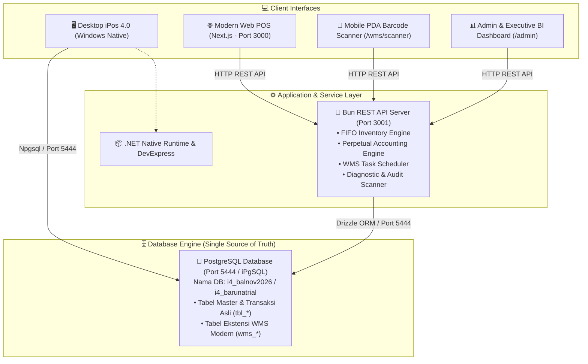
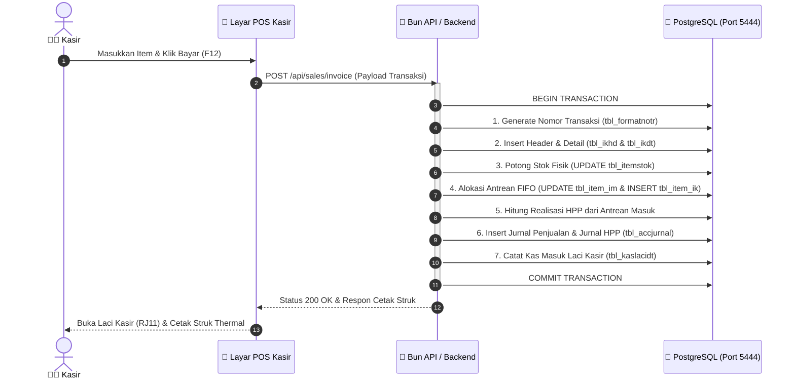

# 🏗️ Modul 00: Gambaran Umum & Arsitektur Sistem iPos 4.0

> **Cakupan**: Topologi sistem, perbandingan Desktop vs Web Enterprise, port jaringan, konfigurasi lingkungan kerja, dan diagram alur data menyeluruh.

---

## 1. Apa itu iPos 4.0?

**iPos 4.0** (Program Toko iPos 4.0 oleh Inspirasibiz / Program Kreatif) adalah perangkat lunak Point of Sale (POS) dan Enterprise Resource Planning (ERP) skala Usaha Kecil-Menengah (UKM) hingga Enterprise di Indonesia. Perangkat lunak ini mencakup:
- **Perdagangan Ritel & Grosir**: Kasir cepat (*fast-checkout*), multi-level harga, multi-satuan, barcode scanner.
- **Manajemen Persediaan Real-Time**: Metode perpetual dengan penilaian harga pokok penjualan (*HPP*) berbasis **FIFO (First-In, First-Out)** murni.
- **Akuntansi Terintegrasi Penuh (Full Double-Entry)**: Setiap transaksi operasional kasir, pembelian, dan gudang langsung membentuk ayat jurnal umum tanpa proses batch terpisah.
- **Multi-Cabang & Multi-Gudang**: Pemisahan data kantor cabang, gudang pusat, dan transfer stok.

---

## 2. Perbandingan: Desktop Legacy vs Modern Web Enterprise

Proyek di repositori ini merupakan jembatan modernisasi (*hybrid coexistence*) antara aplikasi desktop klasik iPos 4.0 dengan platform web modern:

| Komponen | Desktop Legacy iPos 4.0 | Modern Web Enterprise (Repo Ini) |
|:---|:---|:---|
| **Antarmuka (Frontend)** | C# / .NET WinForms, DevExpress v10.2 | Next.js 15 (App Router), React 19, Tailwind CSS |
| **State Management** | Form State & Dataset Memory lokal | Zustand Store (`pos-store`, `cart-store`, `wms-store`) |
| **Backend / API Engine** | Native DLLs (`SDX.dll`, `USBCR.DLL`, .NET BLL) | Bun 1.3 High-Performance REST API Router |
| **Akses Database** | Npgsql ADO.NET Driver | Drizzle ORM + `postgres` connection pooler |
| **Warehouse System** | Tabel daftar stok statis | Denah Visual 2D Gudang + Mobile PDA Scanner (`/wms/scanner`) |
| **Dukungan Perangkat** | Hanya PC Windows (x86/x64) | Seluruh perangkat (PC, Tablet, Smartphone, PDA Barcode) |
| **Database Server** | PostgreSQL 8.4 / 9.x (`iPgSQL` Service) | PostgreSQL yang sama (Shared Single Source of Truth) |

---

## 3. Topologi Jaringan & Port Layanan

Semua komponen beroperasi secara sinkron di atas database PostgreSQL yang sama:

### Parameter Konfigurasi Jaringan & Port Default:
- **Database iPos (iPgSQL)**: `localhost:5444` (atau `5432` pada installasi PostgreSQL standar).
  - User: `admin` atau `postgres`
  - Password Default iPos: Berbasis hash md5 atau password kustom instalasi.
- **REST API Backend (Bun)**: `http://localhost:3001`
  - Dokumentasi Endpoint: `http://localhost:3001/api/docs` (atau file [`DOKUMENTASI_REST_API_IPOS4.md`](file:///c:/Program%20Files%20(x86)/Program%20Kreatif/Program%20iPos%204.0/backend/DOKUMENTASI_REST_API_IPOS4.md)).
- **Web Frontend (Next.js)**: `http://localhost:3000`
  - Kasir POS: `http://localhost:3000/pos`
  - WMS Mobile Scanner: `http://localhost:3000/wms/scanner`
  - Admin Panel: `http://localhost:3000/admin/dashboard`

---

## 4. Alur Data End-to-End Transaksi Bisnis

Ketika transaksi penjualan kasir (POS) terjadi, aliran data dieksekusi secara atomik dalam satu transaksi database:

---

## 5. Script Peluncur Layanan (Launcher)

Di root direktori telah disediakan file otomasi batch untuk Windows:
- [`start-ipos4-enterprise.bat`](file:///c:/Program%20Files%20(x86)/Program%20Kreatif/Program%20iPos%204.0/start-ipos4-enterprise.bat): Menjalankan Backend Bun (Port 3001) dan Frontend Next.js (Port 3000) sekaligus.
- [`stop-ipos4-enterprise.bat`](file:///c:/Program%20Files%20(x86)/Program%20Kreatif/Program%20iPos%204.0/stop-ipos4-enterprise.bat): Mematikan proses node/bun latar belakang secara bersih.
