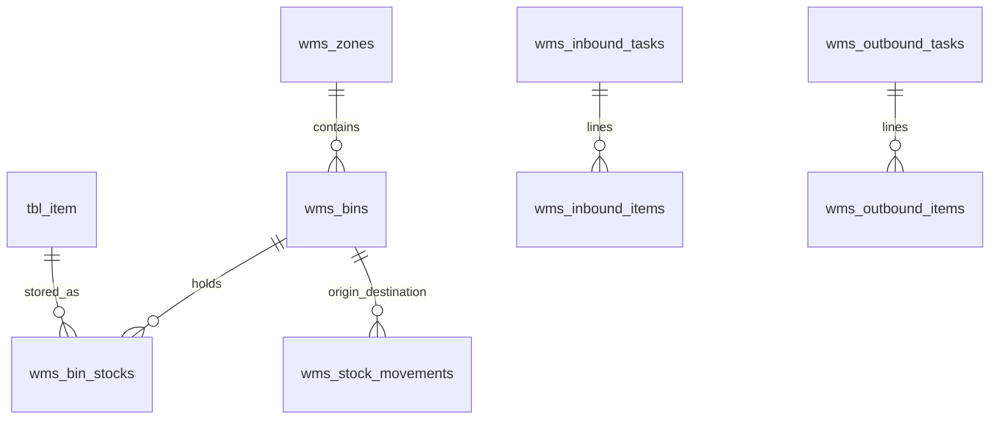

# 📖 Modul 01: Kamus Data & Skema Database iPos 4.0

> **Cakupan**: Konvensi penamaan, kamus data lengkap seluruh tabel utama (Master, Transaksi, Persediaan FIFO, Akuntansi, Kas Laci, Pengaturan), relasi foreign key, indeks, dan struktur ekstensi WMS.

---

## 1. Konvensi Penamaan & Karakteristik Database

Database iPos 4.0 menggunakan PostgreSQL dengan karakteristik arsitektural sebagai berikut:
- **Prefix Tabel**:
  - `tbl_`: Tabel asli bawaan iPos 4.0 Desktop.
  - `wms_`: Tabel ekstensi modern untuk sistem gudang (Warehouse Management System).
- **Suffix Master-Detail**:
  - `*hd` (*Header*): Menyimpan informasi ringkasan faktur (nomor transaksi, tanggal, pihak terkait, subtotal, total akhir, status pembayaran).
  - `*dt` (*Detail*): Menyimpan rincian baris barang/jasa (kode item, kuantitas, satuan, harga satuan, diskon baris, subtotal baris).
- **Suffix Saldo Awal**:
  - `*_sa`: Menyimpan snapshot saldo awal periode (contoh: `tbl_acc_sa`, `tbl_point_sa`).
- **Tipe Data Utama**:
  - `VARCHAR(n)` / `TEXT`: Kode unik, nomor transaksi, nama entitas.
  - `NUMERIC(15,2)` / `NUMERIC(18,4)`: Nilai moneter, harga, persentase diskon, dan kuantitas stok.
  - `TIMESTAMP` / `DATE`: Tanggal pencatatan dan tanggal transaksi bisnis.
  - `BOOLEAN` / `VARCHAR(1)`: Flag status aktif (`true`/`false` atau `'Y'`/`'N'`).

---

## 2. Kamus Data Master Data

### 2.1 `tbl_item` (Master Barang & Jasa)
Tabel sentral katalog inventaris dan layanan jasa.

| Nama Kolom | Tipe Data | Kunci | Keterangan |
|:---|:---|:---|:---|
| `kodeitem` | `VARCHAR(50)` | **PK** | Kode unik barang (SKU) |
| `barcode` | `VARCHAR(50)` | Index | Barcode pemindai kasir |
| `namaitem` | `VARCHAR(200)` | - | Nama lengkap barang / produk |
| `jenis` | `VARCHAR(20)` | - | Jenis item (`BARANG`, `JASA`, `RAKITAN`, `NON-INVENTORY`) |
| `tipe` | `VARCHAR(10)` | - | Kode tipe singkat (`B` = Barang, `J` = Jasa, `R` = Rakitan) |
| `kategori` | `VARCHAR(50)` | - | Kategori klasifikasi barang |
| `merek` | `VARCHAR(50)` | - | Brand / Merk produk |
| `rak` | `VARCHAR(50)` | - | Lokasi rak default desktop iPos |
| `satuan` | `VARCHAR(20)` | - | Satuan dasar (Satuan 1 / Satuan Terkecil) |
| `hargapokok` | `NUMERIC(15,2)` | - | HPP standar / HPP estimasi terakhir |
| `hargajual1` | `NUMERIC(15,2)` | - | Harga jual Satuan 1 level umum |
| `hargajual2` | `NUMERIC(15,2)` | - | Harga jual Satuan 1 level pelanggan 2 (Silver) |
| `hargajual3` | `NUMERIC(15,2)` | - | Harga jual Satuan 1 level pelanggan 3 (Gold) |
| `hargajual4` | `NUMERIC(15,2)` | - | Harga jual Satuan 1 level pelanggan 4 (Platinum) |
| `stokmin` | `NUMERIC(15,2)` | - | Ambang batas minimum stok (Reorder Point) |
| `stokmax` | `NUMERIC(15,2)` | - | Batas maksimum penampungan stok |
| `is_active` | `BOOLEAN` | - | Status aktif item (`true`/`false`) |

### 2.2 `tbl_itemsatuanjml` (Multi-Satuan & Konversi Kuantitas)
Mendukung item yang dijual/dibeli dalam berbagai kemasan (PCS, PACK, DUS, KARTON).

| Nama Kolom | Tipe Data | Kunci | Keterangan |
|:---|:---|:---|:---|
| `kodeitem` | `VARCHAR(50)` | **PK, FK** | Merujuk ke `tbl_item.kodeitem` |
| `satuan` | `VARCHAR(20)` | **PK** | Nama satuan (misal: `DUS`, `PACK`) |
| `konversi` | `NUMERIC(15,2)` | - | Faktor pengali terhadap Satuan 1 (misal: 1 DUS = 24 PCS -> 24.00) |
| `hargajual1` | `NUMERIC(15,2)` | - | Harga jual satuan ini untuk Level 1 |
| `hargajual2` | `NUMERIC(15,2)` | - | Harga jual satuan ini untuk Level 2 |
| `hargajual3` | `NUMERIC(15,2)` | - | Harga jual satuan ini untuk Level 3 |
| `hargajual4` | `NUMERIC(15,2)` | - | Harga jual satuan ini untuk Level 4 |
| `nourut` | `INTEGER` | - | Tingkatan satuan (1 = Dasar, 2, 3, 4) |

### 2.3 `tbl_itemstok` (Saldo Fisik Barang per Kantor/Gudang)
Menyimpan posisi kuantitas stok barang di masing-masing gudang cabang.

| Nama Kolom | Tipe Data | Kunci | Keterangan |
|:---|:---|:---|:---|
| `kodeitem` | `VARCHAR(50)` | **PK, FK** | Merujuk ke `tbl_item.kodeitem` |
| `kantor` | `VARCHAR(50)` | **PK, FK** | Merujuk ke `tbl_kantor.kodekantor` |
| `stok` | `NUMERIC(15,2)` | - | Kuantitas fisik riil dalam **Satuan 1** |

### 2.4 `tbl_supel` (Master Kontak Kontak: Supplier & Pelanggan)
Seluruh rekan bisnis disimpan dalam tabel tunggal ini.

| Nama Kolom | Tipe Data | Kunci | Keterangan |
|:---|:---|:---|:---|
| `kode` | `VARCHAR(50)` | **PK** | Kode unik pelanggan / supplier |
| `nama` | `VARCHAR(150)` | - | Nama perusahaan atau perorangan |
| `alamat` | `TEXT` | - | Alamat domisili |
| `telepon` | `VARCHAR(50)` | - | Nomor kontak / handphone |
| `tipe` | `VARCHAR(10)` | - | Jenis kontak: `'SU'` (Supplier), `'CU'` (Pelanggan), `'SC'` (Keduanya) |
| `plafon` | `NUMERIC(15,2)` | - | Batas maksimum piutang yang diperbolehkan |
| `termin` | `INTEGER` | - | Default jatuh tempo pembayaran (dalam hari, misal: 30) |
| `levelharga` | `INTEGER` | - | Level harga jual default pelanggan (1 s.d. 4) |
| `point` | `NUMERIC(15,2)` | - | Akumulasi poin reward pelanggan |

---

## 3. Kamus Data Persediaan & Antrean FIFO

### 3.1 `tbl_item_im` (Antrean Batch FIFO Barang Masuk)
Setiap mutasi penambahan stok (Pembelian, Saldo Awal, Item Masuk, Retur Jual) membuat satu baris batch antrean FIFO di tabel ini.

| Nama Kolom | Tipe Data | Kunci | Keterangan |
|:---|:---|:---|:---|
| `iddetailim` | `VARCHAR(100)` | **PK** | ID unik batch antrean (sering berupa `notransaksi + '_' + nourut`) |
| `notransaksi` | `VARCHAR(60)` | Index | Nomor transaksi sumber (faktur pembelian / saldo awal) |
| `tanggal` | `TIMESTAMP` | Index | Waktu masuk barang (kunci pengurutan FIFO: `ASC`) |
| `kodeitem` | `VARCHAR(50)` | Index | Merujuk ke `tbl_item.kodeitem` |
| `kantor` | `VARCHAR(50)` | Index | Merujuk ke `tbl_kantor.kodekantor` |
| `jumlah` | `NUMERIC(15,2)` | - | Kuantitas awal barang masuk (dalam Satuan 1) |
| `sisa` | `NUMERIC(15,2)` | - | **Sisa kuantitas yang belum terjual/keluar** (dalam Satuan 1) |
| `harga` | `NUMERIC(15,2)` | - | **Harga beli per unit Satuan 1** (HPP murni batch ini) |

### 3.2 `tbl_item_ik` (Log Alokasi FIFO Barang Keluar)
Merekam alokasi kuantitas pengeluaran barang terhadap batch penerimaan `tbl_item_im`.

| Nama Kolom | Tipe Data | Kunci | Keterangan |
|:---|:---|:---|:---|
| `iddetailik` | `VARCHAR(100)` | **PK** | ID unik pengeluaran |
| `notransaksi` | `VARCHAR(60)` | Index | Nomor transaksi penjualan/item keluar |
| `iddetailim` | `VARCHAR(100)` | Index | Merujuk ke batch masuk `tbl_item_im.iddetailim` |
| `kodeitem` | `VARCHAR(50)` | - | Kode barang yang keluar |
| `kantor` | `VARCHAR(50)` | - | Kantor lokasi barang keluar |
| `jumlah` | `NUMERIC(15,2)` | - | Kuantitas yang diambil dari batch `iddetailim` |
| `harga` | `NUMERIC(15,2)` | - | HPP per unit yang dialokasikan dari batch masuk |
| `subtotal` | `NUMERIC(15,2)` | - | Total HPP (`jumlah * harga`) |

---

## 4. Kamus Data Transaksi Penjualan & Pembelian

### 4.1 `tbl_ikhd` (Header Faktur Penjualan / Kasir POS)

| Nama Kolom | Tipe Data | Keterangan |
|:---|:---|:---|
| `notransaksi` | `VARCHAR(60)` **PK** | Format: `JL/YYMM/XXXXX` |
| `tanggal` | `TIMESTAMP` | Tanggal & waktu transaksi |
| `kodesupel` | `VARCHAR(50)` | Kode pelanggan (default `CASH` / Pelanggan Umum) |
| `kodekantor` | `VARCHAR(50)` | Cabang transaksi |
| `subtotal` | `NUMERIC(15,2)` | Total kotor sebelum diskon dan pajak |
| `potongan` | `NUMERIC(15,2)` | Potongan diskon nota global |
| `pajak` | `NUMERIC(15,2)` | Nilai PPN |
| `biayalain` | `NUMERIC(15,2)` | Biaya kirim / penanganan tambahan |
| `pembulatan` | `NUMERIC(15,2)` | Selisih pembulatan kasir (ke atas atau ke bawah) |
| `total` | `NUMERIC(15,2)` | Total bersih yang wajib dibayar |
| `bayartunai` | `NUMERIC(15,2)` | Pembayaran tunai kasir |
| `bayarkartu` | `NUMERIC(15,2)` | Pembayaran non-tunai (EDC/Debit/QRIS) |
| `bayarkredit` | `NUMERIC(15,2)` | Sisa tagihan yang masuk menjadi Piutang Usaha |
| `kembali` | `NUMERIC(15,2)` | Uang kembalian kasir |
| `carabayar` | `VARCHAR(10)` | `'TN'` (Tunai), `'KD'` (Kredit / Tempo), `'TF'` (Transfer) |
| `status` | `VARCHAR(20)` | Status transaksi (`LUNAS`, `BELUM LUNAS`, `BATAL`) |
| `user` | `VARCHAR(50)` | User kasir/operator pembuat |

### 4.2 `tbl_ikdt` (Detail Barang Faktur Penjualan)

| Nama Kolom | Tipe Data | Keterangan |
|:---|:---|:---|
| `notransaksi` | `VARCHAR(60)` **FK** | Merujuk ke `tbl_ikhd.notransaksi` |
| `nourut` | `INTEGER` | Urutan baris item pada struk |
| `kodeitem` | `VARCHAR(50)` **FK** | Merujuk ke `tbl_item.kodeitem` |
| `satuan` | `VARCHAR(20)` | Satuan yang dipilih saat transaksi |
| `jumlah` | `NUMERIC(15,2)` | Kuantitas transaksi dalam satuan terpilih |
| `harga` | `NUMERIC(15,2)` | Harga jual satuan transaksi |
| `potongan` | `NUMERIC(15,2)` | Diskon per baris item |
| `subtotal` | `NUMERIC(15,2)` | Total bersih baris (`(jumlah * harga) - potongan`) |
| `hpp` | `NUMERIC(15,2)` | Total HPP FIFO riil untuk baris ini |

### 4.3 `tbl_imhd` & `tbl_imdt` (Faktur Pembelian / Penerimaan Barang)
Struktur header dan detail pembelian identik dengan penjualan, menggunakan prefix nomor transaksi `BL/YYMM/XXXXX` dengan korelasi supplier (`kodesupel`) dan pencatatan hutang dagang (`bayarkredit`).

---

## 5. Kamus Data Akuntansi & Keuangan

### 5.1 `tbl_perkiraan` (Bagan Akun / Chart of Accounts)

| Nama Kolom | Tipe Data | Keterangan |
|:---|:---|:---|
| `kodeacc` | `VARCHAR(30)` **PK** | Kode akun standar (misal: `1-1110`, `1-1301`, `4-1100`) |
| `namaacc` | `VARCHAR(100)` | Nama rekening (misal: `KAS KASIR`, `PERSEDIAAN BARANG DAGANG`) |
| `tipe` | `VARCHAR(1)` | `'H'` = Header (Akun Induk/Grup), `'D'` = Detail (Akun Transaksional) |
| `level` | `INTEGER` | Tingkat hierarki (1 = Akun Kepala, 2 = Sub, 3 = Detail) |
| `induk` | `VARCHAR(30)` | Kode akun induk (`kodeacc` parent) |
| `posisi` | `VARCHAR(1)` | Saldo normal akun: `'D'` (Debet) atau `'K'` (Kredit) |
| `saldoawal` | `NUMERIC(18,2)` | Saldo awal tahun buku berjalan |

### 5.2 `tbl_accjurnal` (Buku Jurnal Umum Finansial)
Tabel utama penyimpan seluruh jejak audit finansial sistem secara double-entry.

| Nama Kolom | Tipe Data | Keterangan |
|:---|:---|:---|
| `idjurnal` | `SERIAL` **PK** | ID auto-increment baris jurnal |
| `iddetail` | `VARCHAR(100)` | Kunci unik detail transaksi sumber |
| `nourut` | `INTEGER` | Urutan posting jurnal dalam satu nomor transaksi |
| `tipeinput` | `VARCHAR(10)` | Kode modul (contoh: `'JL'`, `'BL'`, `'KM'`, `'KK'`, `'OP'`, `'CL'`) |
| `notransaksi`| `VARCHAR(60)` Index | Nomor dokumen transaksi sumber |
| `tanggal` | `TIMESTAMP` Index | Tanggal pengakuan akuntansi |
| `kodeacc` | `VARCHAR(30)` Index | Akun yang didebet atau dikredit (`tbl_perkiraan.kodeacc`) |
| `keterangan` | `TEXT` | Narasi penjelasan jurnal |
| `posisi` | `VARCHAR(1)` | Posisi ayat jurnal: `'D'` (Debet) atau `'K'` (Kredit) |
| `debet` | `NUMERIC(18,2)` | Nilai debet dalam mata uang dasar (IDR) |
| `kredit` | `NUMERIC(18,2)` | Nilai kredit dalam mata uang dasar (IDR) |
| `kantor` | `VARCHAR(50)` Index | Kode cabang / unit bisnis |

### 5.3 `tbl_perksetting` (Pemetaan Akun Otomatis Sistem)
Menentukan akun debit/kredit default untuk setiap modul otomatisasi.

| Kolom Kunci | Nilai Contoh | Penjelasan Pemetaan |
|:---|:---|:---|
| `KAS` | `1-1110` | Akun penampung uang tunai kasir |
| `PIUTANG` | `1-1210` | Akun piutang dagang penjualan kredit |
| `PERSEDIAAN`| `1-1301` | Akun aset persediaan barang dagang di Neraca |
| `HUTANG` | `2-1101` | Akun hutang dagang ke pemasok |
| `PENJUALAN` | `4-1100` | Akun pendapatan omset penjualan kotor |
| `DISCJUAL` | `4-1200` | Akun kontra-pendapatan potongan penjualan |
| `HPP` | `5-1100` | Akun beban Harga Pokok Penjualan di Laba Rugi |
| `PPN_KELUAR`| `2-1301` | Akun kewajiban titipan PPN keluaran penjualan |
| `PEMBULATAN`| `8-1100` | Akun selisih pembulatan kasir (Pendapatan/Biaya Lain) |

---

## 6. Kamus Data Ekstensi Gudang Modern (WMS)

Tabel tambahan non-destruktif yang dipasang via skrip migrasi `001_create_wms_tables.sql`:

1. **`wms_zones`**: Zona area gudang (`kodezone`, `kodekantor`, `namazone`, `deskripsi`).
2. **`wms_bins`**: Unit penyimpanan fisik terkecil (`kodebin`, `aisle`, `rack`, `tier`, `slot`, `kapasitas_max_qty`).
3. **`wms_bin_stocks`**: Posisi fisik barang di rak tertentu (`kodekantor`, `kodebin`, `kodeitem`, `jumlah`, `batch_no`, `expired_date`).
4. **`wms_inbound_tasks` & `wms_inbound_items`**: Perintah kerja Putaway penerimaan barang supplier ke rak bin.
5. **`wms_outbound_tasks` & `wms_outbound_items`**: Perintah kerja Picking pengambilan barang dari rak untuk order penjualan/transfer.
6. **`wms_stock_movements`**: Log audit jejak perpindahan barang antar-rak (`from_bin`, `to_bin`, `jumlah`, `operator`).
