# 📦 Modul 02: Engine Mutasi Persediaan & Valuasi FIFO

> **Cakupan**: Logika antrean FIFO (*First-In, First-Out*), tabel mutasi stok, algoritma alokasi HPP riil, stok opname, multi-satuan, dan kueri SQL esensial kartu stok.

---

## 1. Konsep Dasar Persediaan Perpetual & FIFO iPos 4.0

iPos 4.0 mengadopsi metode **Persediaan Perpetual (*Perpetual Inventory System*)** dengan penilaian harga pokok berbasis **FIFO Murni (*Pure First-In, First-Out*)**:
1. **Pemisahan Fisik vs Antrean Valuasi**:
   - **Stok Fisik**: Dicatat di tabel `tbl_itemstok` untuk mengetahui berapa unit barang yang tersedia di rak/gudang secara kuantitas.
   - **Antrean Valuasi FIFO**: Dicatat di tabel `tbl_item_im` (antrean batch masuk) dan `tbl_item_ik` (pencatatan konsumsi batch).
2. **Kapan HPP Terbentuk?**:
   - HPP (*Harga Pokok Penjualan*) **TIDAK** dihitung dari rata-rata (*Average*), melainkan dihitung detik per detik saat faktur disimpan berdasarkan harga modal dari barang yang masuk paling awal (*oldest available batch*).
3. **Satuan Terkecil sebagai Standar Mutasi**:
   - Seluruh perhitungan pada `tbl_itemstok`, `tbl_item_im`, dan `tbl_item_ik` **WAJIB** berada dalam unit **Satuan Dasar (Satuan 1)**.

---

## 2. Diagram Alur Engine FIFO

```mermaid
flowchart TD
    subgraph INBOUND["📥 Penerimaan Barang (Pembelian / Saldo Awal / Retur Jual)"]
        IN1["Faktur Masuk (Contoh: 100 unit @ Rp 10.000)"]
        IN1 -->|"1. Tambah Stok Fisik"| S1[("tbl_itemstok<br>stok = stok + 100")]
        IN1 -->|"2. Buat Batch Antrean Masuk"| F1[("tbl_item_im<br>jumlah = 100, sisa = 100, harga = 10.000")]
    end

    subgraph OUTBOUND["📤 Pengeluaran Barang (Penjualan Kasir / Retur Beli)"]
        OUT1["Penjualan (Contoh: Butuh 120 unit)"]
        OUT1 -->|"3. Scan Batch Masuk Tertua (ORDER BY tanggal ASC)"| QUEUE{"Apakah Batch 1<br>Mencukupi?"}
        
        QUEUE -->|"Sisa Batch 1 = 100"| ALOK1["Ambil 100 unit @ Rp 10.000<br>Sisa Batch 1 menjadi 0"]
        QUEUE -->|"Kekurangan 20 unit"| ALOK2["Buka Batch 2 (50 unit @ Rp 11.000)<br>Ambil 20 unit @ Rp 11.000<br>Sisa Batch 2 menjadi 30"]
        
        ALOK1 --> OUT_LOG[("tbl_item_ik<br>Catat Alokasi Pengeluaran")]
        ALOK2 --> OUT_LOG
        
        OUT_LOG --> HPP_CALC["Total HPP Riil = (100 * 10.000) + (20 * 11.000)<br>= Rp 1.000.000 + Rp 220.000 = Rp 1.220.000"]
        HPP_CALC -->|"4. Potong Stok Fisik"| S2[("tbl_itemstok<br>stok = stok - 120")]
        HPP_CALC -->|"5. Posting Jurnal Otomatis"| J1["Debit: HPP Penjualan (5-1100) = Rp 1.220.000<br>Kredit: Persediaan (1-1301) = Rp 1.220.000"]
    end
```



---

## 3. Algoritma Alokasi Batch FIFO (Step-by-Step)

Ketika sistem mengeksekusi pengeluaran barang sebanyak kuantitas $Q$ untuk item $X$ di kantor $K$:

1. **Kunci Baris Antrean Masuk**:
   Ambil batch penerimaan yang masih memiliki sisa stok dengan mengunci baris (*pessimistic lock*):
   ```sql
   SELECT iddetailim, notransaksi, sisa, harga 
   FROM tbl_item_im 
   WHERE kodeitem = 'ITEM001' 
     AND kantor = 'KANTOR_PUSAT' 
     AND sisa > 0 
   ORDER BY tanggal ASC, iddetailim ASC
   FOR UPDATE;
   ```
2. **Looping Alokasi Batch**:
   Untuk setiap batch yang ditemukan:
   - Hitung kuantitas yang dialokasikan: $A = \min(\text{batch.sisa}, Q_{\text{sisa}})$.
   - Hitung subtotal HPP baris: $\text{SubtotalHPP} = A \times \text{batch.harga}$.
   - Potong kolom `sisa` pada tabel `tbl_item_im`:
     ```sql
     UPDATE tbl_item_im 
     SET sisa = sisa - :A 
     WHERE iddetailim = :batch.iddetailim;
     ```
   - Catat baris konsumsi ke tabel `tbl_item_ik`:
     ```sql
     INSERT INTO tbl_item_ik (iddetailik, notransaksi, iddetailim, kodeitem, kantor, jumlah, harga, subtotal)
     VALUES (:newId, :noTrsKeluar, :batch.iddetailim, 'ITEM001', 'KANTOR_PUSAT', :A, :batch.harga, :SubtotalHPP);
     ```
   - Kurangi kebutuhan pengeluaran: $Q_{\text{sisa}} = Q_{\text{sisa}} - A$.
   - Jika $Q_{\text{sisa}} = 0$, hentikan perulangan (*break*).

3. **Penanganan Stok Habis / Stok Minus (*Out-of-Stock Fallback*)**:
   - Jika antrean batch habis tetapi kuantitas $Q_{\text{sisa}} > 0$:
   - Ambil harga fallback dari `tbl_item.hargapokok` atau harga beli transaksi terakhir.
   - Tetap potong `tbl_itemstok` (sehingga bernilai minus atau nol).
   - Catat anomali pada sistem log agar segera diperbaiki melalui koreksi stok masuk / stok opname.

---

## 4. Proses Stok Opname (`tbl_itemopname`)

Stok Opname adalah proses penyelarasan antara jumlah fisik di gudang dengan catatan sistem:

1. **Selisih Lebih Fisik (Fisik > Sistem Komputer)**:
   - Kuantitas fisik riil bertambah:
     ```sql
     UPDATE tbl_itemstok SET stok = :qtyFisik WHERE kodeitem = :kode AND kantor = :kantor;
     ```
   - Buat batch masuk baru di `tbl_item_im` dengan kuantitas selisih lebih:
     ```sql
     INSERT INTO tbl_item_im (iddetailim, notransaksi, tanggal, kodeitem, kantor, jumlah, sisa, harga)
     VALUES (:idOpname, :noOpname, NOW(), :kode, :kantor, :selisihLebih, :selisihLebih, :hppStandard);
     ```
   - Jurnal Akuntansi:
     - **Debet**: `1-1301` Persediaan Barang Dagang
     - **Kredit**: `8-1200` Pendapatan Selisih Stok Opname
2. **Selisih Kurang Fisik (Fisik < Sistem Komputer)**:
   - Kuantitas stok fisik diturunkan ke nilai riil.
   - Alokasikan pemotongan melalui engine FIFO (`tbl_item_ik`).
   - Jurnal Akuntansi:
     - **Debet**: `6-1900` Beban Selisih Stok Opname / Kerusakan Barang
     - **Kredit**: `1-1301` Persediaan Barang Dagang

---

## 5. Query SQL Esensial Persediaan & FIFO

### 5.1 Kartu Stok Detail per Item & Rentang Tanggal
```sql
SELECT 
  t.tanggal,
  t.notransaksi,
  t.keterangan,
  t.masuk,
  t.keluar,
  SUM(t.masuk - t.keluar) OVER (ORDER BY t.tanggal ASC, t.notransaksi ASC ROWS BETWEEN UNBOUNDED PRECEDING AND CURRENT ROW) AS saldo_kumulatif
FROM (
  -- Mutasi Masuk (Pembelian, Saldo Awal, Item Masuk)
  SELECT 
    tanggal, 
    notransaksi, 
    'Penerimaan Barang / Masuk' AS keterangan,
    jumlah AS masuk, 
    0 AS keluar
  FROM tbl_item_im
  WHERE kodeitem = 'ITEM001' AND kantor = 'PUSAT'

  UNION ALL

  -- Mutasi Keluar (Penjualan, Item Keluar)
  SELECT 
    tanggal, 
    notransaksi, 
    'Pengeluaran / Penjualan' AS keterangan,
    0 AS masuk, 
    jumlah AS keluar
  FROM tbl_item_ik
  WHERE kodeitem = 'ITEM001' AND kantor = 'PUSAT'
) t
WHERE t.tanggal BETWEEN '2026-01-01' AND '2026-12-31'
ORDER BY t.tanggal ASC;
```

### 5.2 Valuasi Nilai Persediaan FIFO Riil Aktif
```sql
SELECT 
  im.kodeitem,
  i.namaitem,
  im.kantor,
  SUM(im.sisa) AS total_sisa_unit,
  SUM(im.sisa * im.harga) AS total_valuasi_fifo_rp,
  CASE 
    WHEN SUM(im.sisa) > 0 THEN SUM(im.sisa * im.harga) / SUM(im.sisa)
    ELSE 0 
  END AS rataan_hpp_fifo_per_unit
FROM tbl_item_im im
JOIN tbl_item i ON im.kodeitem = i.kodeitem
WHERE im.sisa > 0
GROUP BY im.kodeitem, i.namaitem, im.kantor
ORDER BY total_valuasi_fifo_rp DESC;
```

### 5.3 Deteksi & Remediasi Saldo Stok Fisik Minus
```sql
SELECT 
  s.kodeitem,
  i.namaitem,
  s.kantor,
  s.stok AS stok_minus,
  i.hargapokok,
  ABS(s.stok * i.hargapokok) AS estimasi_kerugian_valuasi
FROM tbl_itemstok s
JOIN tbl_item i ON s.kodeitem = i.kodeitem
WHERE s.stok < 0
ORDER BY s.stok ASC;
```
