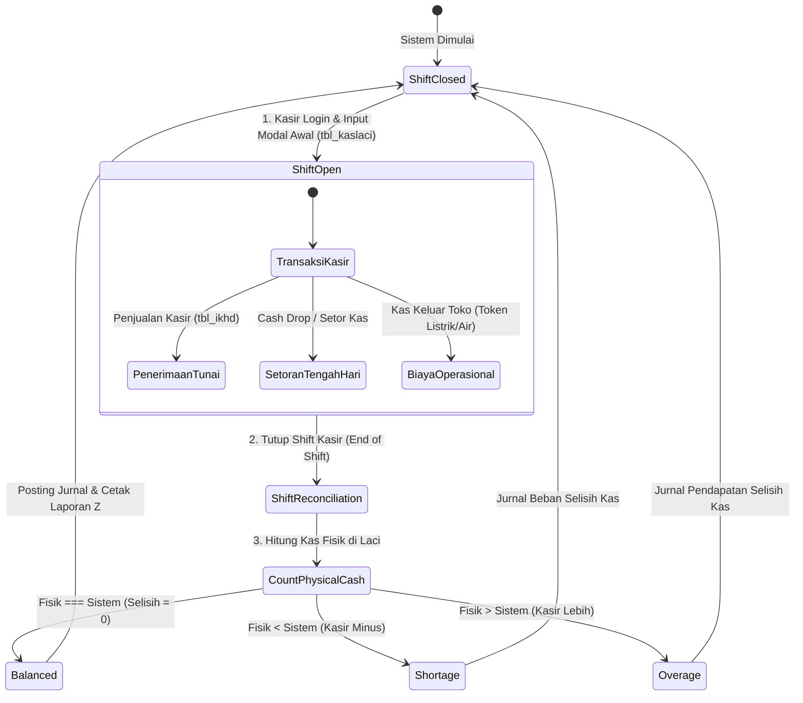

# 🛒 Modul 03: Transaksi Penjualan & Point of Sale (POS)

> **Cakupan**: Alur kerja kasir POS (*fast-checkout*), siklus shift kas laci (`tbl_kaslaci`), multi-metode pembayaran (Tunai, EDC, QRIS, Tempo), perhitungan diskon, PPN, pembulatan, dan kueri SQL transaksi penjualan.

---

## 1. Arsitektur Front-Office POS vs Back-Office Penjualan

Sistem penjualan iPos 4.0 mendukung dua moda operasional:
1. **Front-Office (Web POS / Kasir Retail)**:
   - Dioptimalkan untuk kecepatan (*fast-checkout*), keyboard shortcut penuh, pemindaian barcode instan, cetak printer struk thermal (58mm/80mm), dan pembukaan laci kasir otomatis (*cash drawer kick via RJ11*).
2. **Back-Office (Faktur Penjualan Grosir / Canvaser)**:
   - Ditujukan untuk penjualan partai besar, invoice penagihan kredit bertempo, pemilihan kurir logistik, dan cetak faktur kertas A4/Continuous Form.

### Peta Tombol Cepat Keyboard Kasir (POS Shortcuts):
- `[Enter]`: Scan barcode / tambah item ke keranjang.
- `[Space]`: Buka jendela pembayaran cepat (*Tender Modal*).
- `[F2]`: Ubah satuan item (PCS -> PACK -> DUS).
- `[F3]`: Ganti level harga item (Umum, Silver, Gold, Platinum).
- `[F4]`: Pencarian manual daftar barang berdasarkan nama.
- `[F5]`: Simpan transaksi sebagai antrean pending (*Hold Transaction*).
- `[F6]`: Buka kembali transaksi yang ditunda (*Recall Transaction*).
- `[F7]`: Ganti data pelanggan / pilih member.
- `[F8]`: Ubah kuantitas atau diskon item terpilih.
- `[F10]`: Pembayaran parsial / multi-payment.
- `[F12]`: Finalisasi transaksi & cetak struk (*Print & Close*).
- `[ESC]`: Batalkan transaksi / kosongkan layar keranjang.

---

## 2. Siklus Shift Kas Laci (`tbl_kaslaci` & `tbl_kaslacidt`)

Untuk mencegah kebocoran kasir, setiap sesi transaksi diikat dalam siklus shift laci kasir yang ketat:



### Tabel yang Terlibat:
- **`tbl_kaslaci`**: Header shift kasir (`idshift`, `user`, `tanggalbuka`, `tanggaltutup`, `modalawal`, `totalpenjualan`, `totalsetor`, `kasakhir_sistem`, `kasakhir_fisik`, `selisih`, `status`).
- **`tbl_kaslacidt`**: Log mutasi detail per transaksi uang masuk/keluar di laci kasir selama shift berlangsung.

---

## 3. Struktur Kalkulasi Finansial Faktur Penjualan

Setiap faktur penjualan (`tbl_ikhd`) mengikuti rumus kalkulasi standar:

$$\text{Subtotal} = \sum_{i=1}^{n} ((\text{jumlah}_i \times \text{harga}_i) - \text{potonganBaris}_i)$$

$$\text{Total Akhir} = \text{Subtotal} - \text{PotonganNota} + \text{PajakPPN} + \text{BiayaLain} + \text{Pembulatan}$$

$$\text{Sisa Piutang (Kredit)} = \text{Total Akhir} - (\text{BayarTunai} + \text{BayarKartu})$$

### Aturan Pajak & Pembulatan:
1. **PPN (Pajak Pertambahan Nilai)**:
   - Non-PPN: `pajak = 0`.
   - Inklusif: Nilai barang sudah termasuk PPN (DPP dihitung mundur: $\text{DPP} = \text{Harga} / 1.11$, PPN = $\text{Harga} - \text{DPP}$).
   - Eksklusif: PPN ditambahkan di atas subtotal faktur ($\text{PPN} = \text{Subtotal} \times 11\%$).
2. **Pembulatan Kasir (*Rounding*)**:
   - Diterapkan untuk memudahkan kembalian tunai (misalnya ke kelipatan Rp 100 terdekat).
   - Selisih pembulatan dibukukan ke akun `8-1100` (Pendapatan/Beban Selisih Pembulatan).

---

## 4. Pola Penjurnalan Otomatis Transaksi Penjualan

Setiap penyimpanan faktur penjualan akan menghasilkan **2 pasang ayat jurnal berimbang** di `tbl_accjurnal`:

### A. Jurnal Finansial Penjualan (Contoh: Total Transaksi Rp 150.000)
- **Kondisi 1: Penjualan Tunai Lunas**
  - **Debet**: `1-1110` Kas Kasir = Rp 150.000
  - **Kredit**: `4-1100` Penjualan Barang Dagang = Rp 150.000
- **Kondisi 2: Penjualan Non-Tunai / EDC Mandiri**
  - **Debet**: `1-1121` Bank Mandiri EDC = Rp 150.000
  - **Kredit**: `4-1100` Penjualan Barang Dagang = Rp 150.000
- **Kondisi 3: Penjualan Kredit (Tempo)**
  - **Debet**: `1-1210` Piutang Dagang = Rp 150.000
  - **Kredit**: `4-1100` Penjualan Barang Dagang = Rp 150.000

### B. Jurnal Penilaian HPP Persediaan (FIFO)
- **Debet**: `5-1100` Harga Pokok Penjualan (HPP) = Rp 110.000 *(Hasil kalkulasi FIFO riil)*
- **Kredit**: `1-1301` Persediaan Barang Dagang = Rp 110.000

---

## 5. Query SQL Esensial Penjualan & Kasir

### 5.1 Rekapitulasi Omset & Pembayaran Kasir Hari Ini
```sql
SELECT 
  DATE(tanggal) AS tgl_transaksi,
  COUNT(notransaksi) AS total_struk,
  SUM(subtotal) AS omset_kotor,
  SUM(potongan) AS total_diskon,
  SUM(total) AS omset_bersih,
  SUM(bayartunai) AS total_uang_tunai,
  SUM(bayarkartu) AS total_edc_qris,
  SUM(bayarkredit) AS total_piutang_tempo
FROM tbl_ikhd
WHERE tanggal >= CURRENT_DATE
  AND status != 'BATAL'
GROUP BY DATE(tanggal);
```

### 5.2 Top 10 Barang Paling Laris (Best Sellers) Periode Berjalan
```sql
SELECT 
  dt.kodeitem,
  i.namaitem,
  dt.satuan,
  SUM(dt.jumlah) AS total_qty_terjual,
  SUM(dt.subtotal) AS total_pendapatan_rp,
  SUM(dt.hpp) AS total_hpp_rp,
  SUM(dt.subtotal - dt.hpp) AS estimasi_laba_kotor_rp
FROM tbl_ikdt dt
JOIN tbl_ikhd hd ON dt.notransaksi = hd.notransaksi
JOIN tbl_item i ON dt.kodeitem = i.kodeitem
WHERE hd.tanggal BETWEEN '2026-10-01' AND '2026-10-31'
  AND hd.status != 'BATAL'
GROUP BY dt.kodeitem, i.namaitem, dt.satuan
ORDER BY total_qty_terjual DESC
LIMIT 10;
```

### 5.3 Audit Faktur Penjualan Menggantung (Belum Lunas Tanpa Jatuh Tempo)
```sql
SELECT 
  notransaksi,
  tanggal,
  kodesupel,
  total,
  bayartunai + bayarkartu AS total_terbayar,
  bayarkredit AS sisa_piutang,
  carabayar,
  status
FROM tbl_ikhd
WHERE bayarkredit > 0
  AND status = 'BELUM LUNAS'
ORDER BY tanggal ASC;
```
