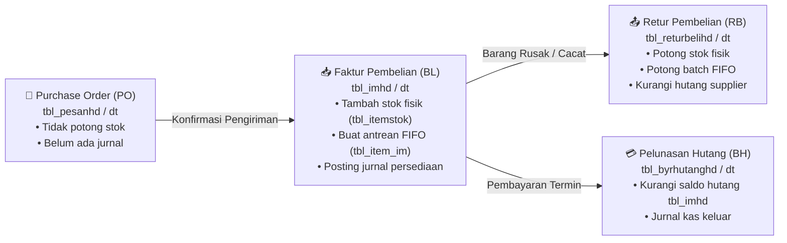

# 📦 Modul 04: Pengadaan Barang, Pembelian & Hutang Dagang

> **Cakupan**: Siklus pemesanan pembelian (PO), faktur pembelian (`tbl_imhd`/`tbl_imdt`), retur pembelian, pelunasan hutang supplier (`tbl_byrhutanghd`), analisa umur hutang (*Aging Schedule*), dan kueri SQL terkait.

---

## 1. Siklus Lengkap Pengadaan Barang (Procurement Cycle)

Siklus pengadaan barang pada iPos 4.0 mengintegrasikan aspek logistik gudang dan liabilitas akuntansi:



---

## 2. Struktur Data Faktur Pembelian (`tbl_imhd` & `tbl_imdt`)

Ketika faktur pembelian disimpan:
1. **Header Faktur (`tbl_imhd`)**:
   - `notransaksi`: Format baku `BL/YYMM/XXXXX`.
   - `kodesupel`: Kode pemasok pada `tbl_supel` (dengan `tipe = 'SU'`).
   - `carabayar`: `'TN'` (Tunai langsung lunas) atau `'KD'` (Kredit/Tempo).
   - `termin`: Jumlah hari jatuh tempo pembayaran (misal: 30 hari).
   - `sisahutang`: Saldo hutang belum terbayar yang diupdate setiap kali ada pembayaran.
2. **Detail Barang (`tbl_imdt`)**:
   - `jumlah`: Kuantitas dalam satuan transaksi.
   - `satuan`: Satuan pembelian (misal: `DUS`).
   - `harga`: Harga beli per kemasan.
   - `potongan`: Diskon pembelian per baris.
   - `subtotal`: Nilai baris bersih.

### Efek Otomatis ke Persediaan & Valuasi:
- **Konversi Kuantitas ke Satuan Dasar**:
  Jika membeli 10 DUS (1 DUS = 24 PCS), kuantitas yang ditambahkan ke `tbl_itemstok` dan `tbl_item_im` adalah **240 PCS**.
- **Harga Pokok Satuan Dasar**:
  Harga beli per PCS dihitung: $\text{HPP Satuan 1} = \text{Harga Beli Dus} / 24$.
- **Pencatatan Batch FIFO**:
  Sistem membuat baris baru di `tbl_item_im` dengan `jumlah = 240`, `sisa = 240`, dan `harga = HPP Satuan 1`.
- **Pembaruan Harga Pokok Terakhir**:
  Kolom `hargapokok` pada `tbl_item` diperbarui dengan HPP transaksi terbaru ini.

---

## 3. Pelunasan Hutang Supplier (`tbl_byrhutanghd` & `tbl_byrhutangdt`)

Pembayaran hutang dapat melunasi satu atau beberapa faktur pembelian sekaligus:
- **`tbl_byrhutanghd`**: Menyimpan nomor bukti pelunasan (`BH/YYMM/XXXXX`), tanggal, supplier, akun kas/bank pembayar, dan total yang dibayarkan.
- **`tbl_byrhutangdt`**: Menyimpan alokasi nominal pembayaran ke masing-masing faktur (`notransaksi` pada `tbl_imhd`).
- **Update Status**: Ketika akumulasi pelunasan menyamai nilai faktur, kolom `sisahutang` pada `tbl_imhd` bernilai 0 dan status berubah menjadi `LUNAS`.

---

## 4. Pola Penjurnalan Otomatis Pembelian & Hutang

### A. Jurnal Pembelian Kredit (Faktur Masuk Rp 10.000.000)
- **Debet**: `1-1301` Persediaan Barang Dagang = Rp 10.000.000
- **Kredit**: `2-1101` Hutang Dagang (Pemasok) = Rp 10.000.000

### B. Jurnal Pembelian Tunai dengan Diskon (Barang Rp 5.000.000, Diskon Rp 200.000)
- **Debet**: `1-1301` Persediaan Barang Dagang = Rp 5.000.000
- **Kredit**: `1-1120` Bank Transfer = Rp 4.800.000
- **Kredit**: `5-1200` Potongan Pembelian = Rp 200.000

### C. Jurnal Pelunasan Hutang Dagang (Pembayaran Rp 10.000.000 via Giro/Bank)
- **Debet**: `2-1101` Hutang Dagang = Rp 10.000.000
- **Kredit**: `1-1120` Bank BCA = Rp 10.000.000

---

## 5. Query SQL Esensial Pembelian & Hutang

### 5.1 Jadwal Umur Hutang Supplier (Aging Schedule)
Query untuk mengelompokkan liabilitas perusahaan berdasarkan bracket umur jatuh tempo:
```sql
SELECT 
  s.kode AS kodesupel,
  s.nama AS namasupel,
  SUM(im.bayarkredit - COALESCE(p.total_bayar, 0)) AS total_hutang,
  SUM(CASE WHEN CURRENT_DATE - (im.tanggal::date + im.termin) <= 0 
           THEN (im.bayarkredit - COALESCE(p.total_bayar, 0)) ELSE 0 END) AS belum_jatuh_tempo,
  SUM(CASE WHEN CURRENT_DATE - (im.tanggal::date + im.termin) BETWEEN 1 AND 30 
           THEN (im.bayarkredit - COALESCE(p.total_bayar, 0)) ELSE 0 END) AS aging_1_30_hari,
  SUM(CASE WHEN CURRENT_DATE - (im.tanggal::date + im.termin) BETWEEN 31 AND 60 
           THEN (im.bayarkredit - COALESCE(p.total_bayar, 0)) ELSE 0 END) AS aging_31_60_hari,
  SUM(CASE WHEN CURRENT_DATE - (im.tanggal::date + im.termin) BETWEEN 61 AND 90 
           THEN (im.bayarkredit - COALESCE(p.total_bayar, 0)) ELSE 0 END) AS aging_61_90_hari,
  SUM(CASE WHEN CURRENT_DATE - (im.tanggal::date + im.termin) > 90 
           THEN (im.bayarkredit - COALESCE(p.total_bayar, 0)) ELSE 0 END) AS aging_diatas_90_hari
FROM tbl_imhd im
JOIN tbl_supel s ON im.kodesupel = s.kode
LEFT JOIN (
  SELECT notrsmasuk, SUM(bayar) AS total_bayar
  FROM tbl_byrhutangdt
  GROUP BY notrsmasuk
) p ON im.notransaksi = p.notrsmasuk
WHERE im.bayarkredit > COALESCE(p.total_bayar, 0)
  AND im.status != 'BATAL'
GROUP BY s.kode, s.nama
ORDER BY total_hutang DESC;
```

### 5.2 Daftar Faktur Pembelian Jatuh Tempo Minggu Ini
```sql
SELECT 
  im.notransaksi,
  im.tanggal,
  s.nama AS namasupel,
  im.termin,
  (im.tanggal::date + im.termin) AS tanggal_jatuh_tempo,
  (im.bayarkredit - COALESCE(p.total_bayar, 0)) AS sisa_tagihan,
  (CURRENT_DATE - (im.tanggal::date + im.termin)) AS hari_lewat_jatuh_tempo
FROM tbl_imhd im
JOIN tbl_supel s ON im.kodesupel = s.kode
LEFT JOIN (
  SELECT notrsmasuk, SUM(bayar) AS total_bayar
  FROM tbl_byrhutangdt
  GROUP BY notrsmasuk
) p ON im.notransaksi = p.notrsmasuk
WHERE im.bayarkredit > COALESCE(p.total_bayar, 0)
  AND (im.tanggal::date + im.termin) <= (CURRENT_DATE + INTERVAL '7 days')
  AND im.status != 'BATAL'
ORDER BY tanggal_jatuh_tempo ASC;
```
