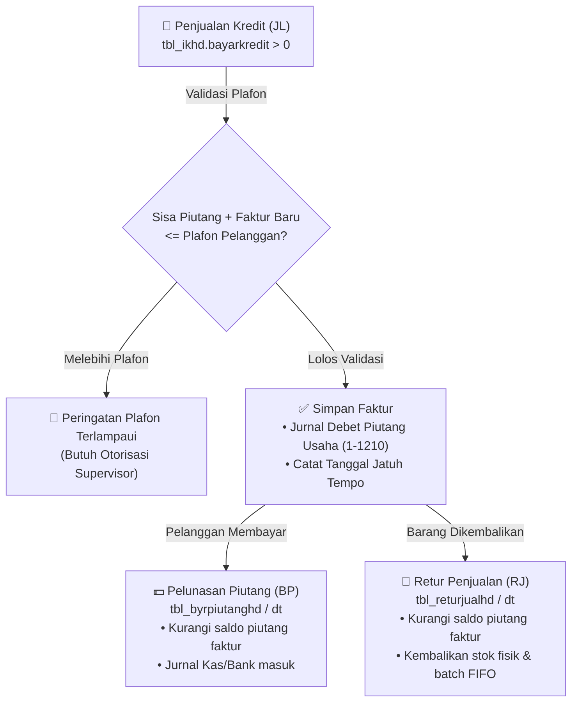

# 💰 Modul 05: Piutang Pelanggan, Retur & Poin Loyalitas

> **Cakupan**: Siklus piutang usaha (*Account Receivables*), batas kredit (*Credit Limit/Plafon*), analisa umur piutang (*Aging Piutang*), retur penjualan, dan sistem poin loyalitas pelanggan (`tbl_point_sa`, `tbl_pointambil`).

---

## 1. Arsitektur Piutang Dagang Penjualan

Penjualan bertempo (kredit) dicatat pada saat kasir atau staf penjualan memilih cara bayar `'KD'` (*Kredit*):



---

## 2. Pelunasan Piutang Pelanggan (`tbl_byrpiutanghd` & `tbl_byrpiutangdt`)

Mekanisme penerimaan tagihan dari pelanggan:
- **`tbl_byrpiutanghd`**: Menyimpan bukti kas masuk pelunasan (`BP/YYMM/XXXXX`), tanggal setor, kode pelanggan (`kodesupel`), serta akun kas/bank penampung.
- **`tbl_byrpiutangdt`**: Memetakan pembayaran ke nomor-nomor faktur penjualan (`notransaksi` pada `tbl_ikhd`).
- **Potongan Pembayaran / Diskon Termin**: Jika pelanggan melunasi lebih awal dan diberikan diskon tunai, selisihnya didebetkan ke akun `4-1200` (Potongan Penjualan).

---

## 3. Retur Penjualan & Dampaknya ke Akuntansi & FIFO

Ketika pembeli mengembalikan barang:
1. **Dampak ke Piutang / Kas**:
   - Jika faktur belum lunas, retur memotong sisa piutang faktur tersebut.
   - Jika faktur tunai telah lunas, uang dikembalikan secara tunai melalui kasir (`tbl_kaslaci`) atau disimpan sebagai deposit pelanggan.
2. **Dampak ke Persediaan**:
   - Stok fisik di `tbl_itemstok` bertambah kembali.
   - Batch baru dibuat di `tbl_item_im` dengan harga modal sesuai HPP saat barang tersebut terjual, agar antrean FIFO berikutnya tetap presisi.
3. **Jurnal Retur Penjualan**:
   - **Debet**: `4-1300` Retur Penjualan (Kontra Pendapatan)
   - **Kredit**: `1-1210` Piutang Dagang (atau `1-1110` Kas)
   - **Debet**: `1-1301` Persediaan Barang Dagang
   - **Kredit**: `5-1100` Harga Pokok Penjualan (HPP)

---

## 4. Sistem Poin Reward & Loyalitas Pelanggan

Pelanggan yang terdaftar sebagai Member di `tbl_supel` dapat mengumpulkan poin reward dari transaksi belanja:

### Rumus Saldo Poin Pelanggan Aktif:
$$\text{Saldo Poin} = \sum \text{Poin Saldo Awal} + \sum \text{Poin Penjualan Terbit} - \sum \text{Poin Telah Ditukar}$$

1. **`tbl_point_sa`**: Saldo awal poin member di awal tahun/sistem.
2. **`tbl_ikhd.point_ik`**: Poin reward yang otomatis didapatkan pelanggan dari setiap transaksi POS (misal: 1 poin per kelipatan belanja Rp 50.000).
3. **`tbl_pointambil`**: Log penukaran poin hadiah/merchandise oleh pelanggan.

---

## 5. Query SQL Esensial Piutang & Poin Loyalitas

### 5.1 Jadwal Umur Piutang Pelanggan (Aging Piutang)
```sql
SELECT 
  s.kode AS kodepelanggan,
  s.nama AS namapelanggan,
  s.telepon,
  s.plafon AS plafon_kredit,
  SUM(ik.bayarkredit - COALESCE(p.total_bayar, 0)) AS total_piutang_berjalan,
  SUM(CASE WHEN CURRENT_DATE - (ik.tanggal::date + COALESCE(ik.termin, 30)) <= 0 
           THEN (ik.bayarkredit - COALESCE(p.total_bayar, 0)) ELSE 0 END) AS belum_jatuh_tempo,
  SUM(CASE WHEN CURRENT_DATE - (ik.tanggal::date + COALESCE(ik.termin, 30)) BETWEEN 1 AND 30 
           THEN (ik.bayarkredit - COALESCE(p.total_bayar, 0)) ELSE 0 END) AS aging_1_30_hari,
  SUM(CASE WHEN CURRENT_DATE - (ik.tanggal::date + COALESCE(ik.termin, 30)) BETWEEN 31 AND 60 
           THEN (ik.bayarkredit - COALESCE(p.total_bayar, 0)) ELSE 0 END) AS aging_31_60_hari,
  SUM(CASE WHEN CURRENT_DATE - (ik.tanggal::date + COALESCE(ik.termin, 30)) BETWEEN 61 AND 90 
           THEN (ik.bayarkredit - COALESCE(p.total_bayar, 0)) ELSE 0 END) AS aging_61_90_hari,
  SUM(CASE WHEN CURRENT_DATE - (ik.tanggal::date + COALESCE(ik.termin, 30)) > 90 
           THEN (ik.bayarkredit - COALESCE(p.total_bayar, 0)) ELSE 0 END) AS aging_diatas_90_hari
FROM tbl_ikhd ik
JOIN tbl_supel s ON ik.kodesupel = s.kode
LEFT JOIN (
  SELECT notrskeluar, SUM(bayar) AS total_bayar
  FROM tbl_byrpiutangdt
  GROUP BY notrskeluar
) p ON ik.notransaksi = p.notrskeluar
WHERE ik.bayarkredit > COALESCE(p.total_bayar, 0)
  AND ik.status != 'BATAL'
GROUP BY s.kode, s.nama, s.telepon, s.plafon
ORDER BY total_piutang_berjalan DESC;
```

### 5.2 Rekapitulasi Saldo Poin Loyalitas Pelanggan
```sql
SELECT 
  s.kode AS kodesupel,
  s.nama AS namapelanggan,
  COALESCE(sa.total_sa, 0) AS poin_saldo_awal,
  COALESCE(ik.total_earned, 0) AS poin_didapat,
  COALESCE(rd.total_redeemed, 0) AS poin_ditukar,
  (COALESCE(sa.total_sa, 0) + COALESCE(ik.total_earned, 0) - COALESCE(rd.total_redeemed, 0)) AS saldo_poin_aktif
FROM tbl_supel s
LEFT JOIN (
  SELECT kodesupel, SUM(point_ik) AS total_sa FROM tbl_point_sa GROUP BY kodesupel
) sa ON s.kode = sa.kodesupel
LEFT JOIN (
  SELECT kodesupel, SUM(point_ik) AS total_earned FROM tbl_ikhd WHERE status != 'BATAL' GROUP BY kodesupel
) ik ON s.kode = ik.kodesupel
LEFT JOIN (
  SELECT kodesupel, SUM(jmlambil) AS total_redeemed FROM tbl_pointambil GROUP BY kodesupel
) rd ON s.kode = rd.kodesupel
WHERE s.tipe IN ('CU', 'SC')
ORDER BY saldo_poin_aktif DESC;
```
