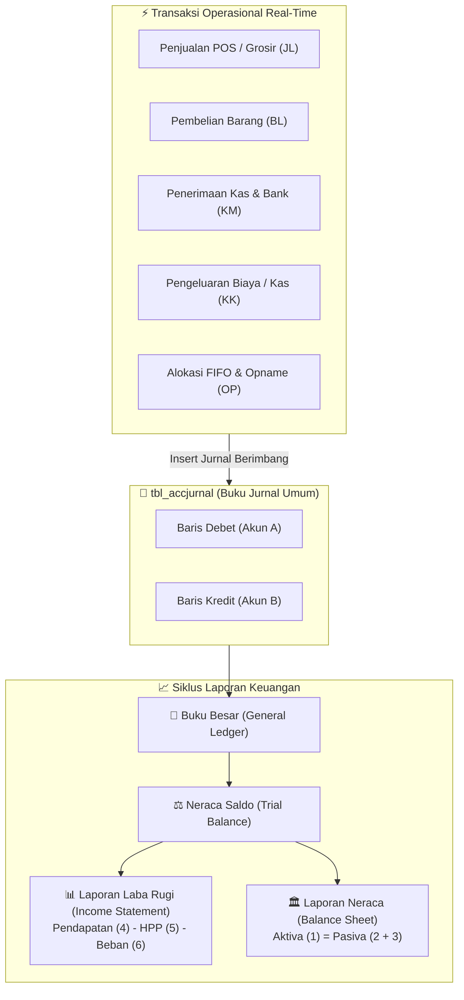

# 📊 Modul 06: Akuntansi Finansial, Double-Entry & Tutup Buku

> **Cakupan**: Bagan Akun / COA (`tbl_perkiraan`), pengaturan akun default (`tbl_perksetting`), buku jurnal umum (`tbl_accjurnal`), buku besar, neraca saldo, laba rugi, neraca keuangan, dan mekanisme tutup buku bulanan/tahunan.

---

## 1. Arsitektur Double-Entry Terintegrasi iPos 4.0

Akuntansi pada iPos 4.0 beroperasi secara **otomatis dan instan (Zero-Delay Auto-Journaling)**. Setiap ada mutasi barang, kas, hutang, atau piutang, sistem langsung membuat baris jurnal berpasangan di `tbl_accjurnal`.

### Persamaan Dasar Akuntansi:
$$\text{AKTIVA (Harta)} = \text{KEWAJIBAN (Hutang)} + \text{EKUITAS (Modal)} + \text{LABA TAHUN BERJALAN}$$



---

## 2. Struktur Bagan Akun / Chart of Accounts (`tbl_perkiraan`)

Sistem mengklasifikasikan nomor akun menggunakan prefix digit kepala:

| Kepala | Kategori Akun | Posisi Normal | Contoh Akun iPos 4 |
|:---|:---|:---:|:---|
| **1-XXXX** | **Aktiva / Harta** | **DEBET** | `1-1110` Kas Kasir, `1-1120` Bank BCA, `1-1210` Piutang Dagang, `1-1301` Persediaan Barang Dagang |
| **2-XXXX** | **Kewajiban / Hutang** | **KREDIT** | `2-1101` Hutang Dagang, `2-1301` Hutang PPN Keluaran, `2-1200` Hutang Biaya Operasional |
| **3-XXXX** | **Ekuitas / Modal** | **KREDIT** | `3-1100` Modal Disetor, `3-1200` Prive Pemilik, `3-2100` Laba Ditahan, `3-3100` Laba Periode Berjalan |
| **4-XXXX** | **Pendapatan Usaha** | **KREDIT** | `4-1100` Penjualan Barang Dagang, `4-1200` Potongan Penjualan (Debet), `4-1300` Retur Penjualan (Debet) |
| **5-XXXX** | **Harga Pokok Penjualan** | **DEBET** | `5-1100` HPP Penjualan, `5-1200` Potongan Pembelian (Kredit) |
| **6-XXXX** | **Beban Operasional** | **DEBET** | `6-1100` Beban Gaji Karyawan, `6-1200` Beban Listrik & Air, `6-1300` Beban Sewa Tempat |
| **8-XXXX** | **Pendapatan & Beban Lain** | **CAMPURAN** | `8-1100` Selisih Pembulatan Kasir, `8-1200` Pendapatan Bunga Bank, `8-2100` Biaya Administrasi Bank |

> [!IMPORTANT]
> **Aturan Akun Header vs Detail**:
> Kolom `tipe` pada `tbl_perkiraan`:
> - `'H'` = **Header**: Akun induk (contoh: `1-1100 KAS & SETARA KAS`). **DILARANG KERAS** memposting jurnal ke akun header!
> - `'D'` = **Detail**: Akun sub-operasional (contoh: `1-1110 KAS KASIR UTAMA`). Hanya akun detail yang boleh dicatat di `tbl_accjurnal`.

---

## 3. Pemetaan Akun Default (`tbl_perksetting`)

Aplikasi iPos 4.0 mengandalkan tabel `tbl_perksetting` untuk menentukan nomor akun secara dinamis saat transaksi terjadi:

| Pengaturan (`accsetting`) | Default Akun | Digunakan Saat |
|:---|:---|:---|
| `KAS` | `1-1110` | Penerimaan uang tunai penjualan di kasir |
| `PIUTANG` | `1-1210` | Penjualan kredit bertempo |
| `PERSEDIAAN` | `1-1301` | Nilai persediaan fisik barang di gudang |
| `HUTANG` | `2-1101` | Pembelian tempo ke pemasok |
| `PENJUALAN` | `4-1100` | Pengakuan omset penjualan kotor |
| `DISCJUAL` | `4-1200` | Potongan diskon faktur ke pembeli |
| `RETURJUAL` | `4-1300` | Pengembalian barang dari pembeli |
| `HPP` | `5-1100` | Pengakuan beban pokok barang yang laku terjual |
| `PPN_KELUARAN` | `2-1301` | PPN 11% yang ditagihkan ke pembeli |
| `PEMBULATAN` | `8-1100` | Kelebihan/kekurangan rupiah akibat pembulatan kasir |

---

## 4. Mekanisme Tutup Buku Bulanan & Tahunan

### A. Tutup Buku Bulanan (Monthly Closing)
1. Memverifikasi seluruh transaksi pada bulan berjalan telah lengkap (tidak ada faktur menggantung tanpa status).
2. Memastikan tidak ada jurnal tidak seimbang (*unbalanced journals*).
3. Melakukan rekonsiliasi kas/bank dan persediaan fisik melalui Stok Opname.
4. Mengunci tanggal cut-off agar pengguna biasa tidak dapat memanipulasi transaksi mundur (*backdated*).

### B. Tutup Buku Tahunan (Year-End Closing)
1. Menghitung Laba Bersih Tahun Berjalan: $\text{Laba Bersih} = \sum \text{Pendapatan (4, 8)} - \sum \text{Beban (5, 6, 8)}$.
2. Memindahkan saldo akun nominal (Kepala 4, 5, 6, 8) ke akun **Laba Ditahan (`3-2100`)** atau Modal.
3. Mengosongkan saldo akun nominal menjadi Rp 0 untuk membuka lembaran tahun buku baru.
4. Membentuk snapshot saldo awal neraca riil di tabel `tbl_acc_sa`.

---

## 5. Query SQL Esensial Akuntansi & Laporan Finansial

### 5.1 Neraca Saldo (Trial Balance) Periode Berjalan
```sql
SELECT 
  p.kodeacc,
  p.namaacc,
  p.posisi AS posisi_normal,
  COALESCE(sa.saldo, 0) AS saldo_awal,
  COALESCE(j.mutasi_debet, 0) AS mutasi_debet,
  COALESCE(j.mutasi_kredit, 0) AS mutasi_kredit,
  CASE 
    WHEN p.posisi = 'D' THEN COALESCE(sa.saldo, 0) + (COALESCE(j.mutasi_debet, 0) - COALESCE(j.mutasi_kredit, 0))
    ELSE COALESCE(sa.saldo, 0) + (COALESCE(j.mutasi_kredit, 0) - COALESCE(j.mutasi_debet, 0))
  END AS saldo_akhir
FROM tbl_perkiraan p
LEFT JOIN (
  SELECT kodeacc, saldo FROM tbl_acc_sa WHERE tahun = '2026'
) sa ON p.kodeacc = sa.kodeacc
LEFT JOIN (
  SELECT 
    kodeacc, 
    SUM(debet) AS mutasi_debet, 
    SUM(kredit) AS mutasi_kredit
  FROM tbl_accjurnal
  WHERE tanggal BETWEEN '2026-01-01' AND '2026-10-31'
  GROUP BY kodeacc
) j ON p.kodeacc = j.kodeacc
WHERE p.tipe = 'D'
ORDER BY p.kodeacc ASC;
```

### 5.2 Laporan Laba Rugi Real-Time
```sql
WITH MutasiBuku AS (
  SELECT 
    LEFT(j.kodeacc, 1) AS kepala,
    p.kodeacc,
    p.namaacc,
    SUM(j.debet) AS tot_debet,
    SUM(j.kredit) AS tot_kredit,
    CASE 
      WHEN LEFT(j.kodeacc, 1) IN ('4', '8') THEN SUM(j.kredit) - SUM(j.debet)
      ELSE SUM(j.debet) - SUM(j.kredit)
    END AS nilai_bersih
  FROM tbl_accjurnal j
  JOIN tbl_perkiraan p ON j.kodeacc = p.kodeacc
  WHERE j.tanggal BETWEEN '2026-01-01' AND '2026-10-31'
    AND LEFT(j.kodeacc, 1) IN ('4', '5', '6', '8')
  GROUP BY LEFT(j.kodeacc, 1), p.kodeacc, p.namaacc
)
SELECT 
  CASE 
    WHEN kepala = '4' THEN '1. PENDAPATAN USAHA'
    WHEN kepala = '5' THEN '2. HARGA POKOK PENJUALAN (HPP)'
    WHEN kepala = '6' THEN '3. BEBAN OPERASIONAL'
    WHEN kepala = '8' THEN '4. PENDAPATAN / BEBAN LAIN'
  END AS kategori,
  kodeacc,
  namaacc,
  nilai_bersih
FROM MutasiBuku
ORDER BY kodeacc ASC;
```

### 5.3 Validasi Integritas Keseimbangan Jurnal (Unbalanced Journals)
```sql
SELECT 
  notransaksi,
  DATE(tanggal) AS tgl,
  tipeinput,
  SUM(debet) AS total_debet,
  SUM(kredit) AS total_kredit,
  ABS(SUM(debet) - SUM(kredit)) AS selisih
FROM tbl_accjurnal
GROUP BY notransaksi, DATE(tanggal), tipeinput
HAVING ABS(SUM(debet) - SUM(kredit)) > 0.01
ORDER BY selisih DESC;
```
