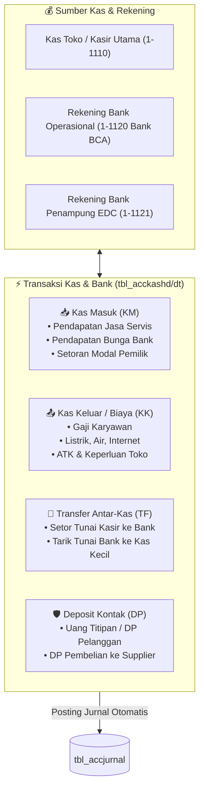

# 💵 Modul 07: Manajemen Kas, Bank & Biaya Operasional

> **Cakupan**: Transaksi kas & bank masuk/keluar non-dagang (`tbl_acckashd`/`dt`), mutasi transfer antar-bank, titipan deposit pelanggan/supplier, dan rekonsiliasi kas.

---

## 1. Arsitektur Modul Kas & Bank

Selain transaksi jual-beli barang dagang, perusahaan mengelola likuiditas harian dan pengeluaran operasional melalui modul Kas & Bank:



---

## 2. Struktur Data Kas & Bank (`tbl_acckashd` & `tbl_acckasdt`)

- **`tbl_acckashd` (Header)**:
  - `notransaksi`: Format baku `KM/YYMM/XXXXX` (Masuk), `KK/YYMM/XXXXX` (Keluar), atau `TF/YYMM/XXXXX` (Transfer).
  - `tanggal`: Waktu pencatatan mutasi kas.
  - `kodeacc`: Akun kas/bank utama yang didebet atau dikredit.
  - `tipe`: Kode transaksi (`'KM'`, `'KK'`, `'TF'`).
  - `jumlah`: Total nominal moneter.
  - `keterangan`: Deskripsi umum keperluan transaksi.
- **`tbl_acckasdt` (Detail Rincian)**:
  - `notransaksi`: Merujuk ke nomor transaksi header.
  - `nourut`: Urutan alokasi biaya/akun lawan.
  - `kodeacc`: Akun lawan (misal: `6-1100` Biaya Gaji, `6-1200` Biaya Listrik).
  - `jumlah`: Nilai per baris alokasi biaya.

---

## 3. Pola Penjurnalan Transaksi Kas & Bank

### A. Kas Keluar untuk Biaya Operasional (Bayar Listrik Rp 750.000 Tunai)
- **Debet**: `6-1200` Beban Listrik & Air = Rp 750.000
- **Kredit**: `1-1110` Kas Kasir = Rp 750.000

### B. Kas Masuk Non-Operasional (Pendapatan Jasa Kirim/Servis Rp 300.000)
- **Debet**: `1-1110` Kas Toko = Rp 300.000
- **Kredit**: `4-2100` Pendapatan Jasa Servis = Rp 300.000

### C. Transfer Antar-Bank (Setoran Kasir Rp 5.000.000 ke Bank BCA)
- **Debet**: `1-1120` Bank BCA = Rp 5.000.000
- **Kredit**: `1-1110` Kas Kasir Utama = Rp 5.000.000

### D. Deposit Uang Muka Penjualan (Customer DP Rp 2.000.000 Transfer ke BCA)
- **Debet**: `1-1120` Bank BCA = Rp 2.000.000
- **Kredit**: `2-1250` Uang Muka / Deposit Pelanggan = Rp 2.000.000

---

## 4. Query SQL Esensial Kas & Bank

### 4.1 Posisi Saldo Kas & Bank Real-Time
```sql
SELECT 
  p.kodeacc,
  p.namaacc,
  COALESCE(sa.saldo, 0) AS saldo_awal,
  COALESCE(SUM(j.debet), 0) AS total_masuk,
  COALESCE(SUM(j.kredit), 0) AS total_keluar,
  (COALESCE(sa.saldo, 0) + COALESCE(SUM(j.debet), 0) - COALESCE(SUM(j.kredit), 0)) AS saldo_kas_riil
FROM tbl_perkiraan p
LEFT JOIN (
  SELECT kodeacc, saldo FROM tbl_acc_sa WHERE tahun = '2026'
) sa ON p.kodeacc = sa.kodeacc
LEFT JOIN tbl_accjurnal j ON p.kodeacc = j.kodeacc
WHERE p.kodeacc LIKE '1-11%' -- Akun Kas & Bank
  AND p.tipe = 'D'
GROUP BY p.kodeacc, p.namaacc, sa.saldo
ORDER BY p.kodeacc ASC;
```

### 4.2 Rekapitulasi Biaya Operasional per Kategori Bulan Ini
```sql
SELECT 
  p.kodeacc,
  p.namaacc AS kategori_biaya,
  COUNT(DISTINCT j.notransaksi) AS jumlah_transaksi,
  SUM(j.debet - j.kredit) AS total_biaya_keluar
FROM tbl_accjurnal j
JOIN tbl_perkiraan p ON j.kodeacc = p.kodeacc
WHERE j.kodeacc LIKE '6-%' -- Akun Beban Operasional
  AND j.tanggal BETWEEN '2026-10-01' AND '2026-10-31'
GROUP BY p.kodeacc, p.namaacc
ORDER BY total_biaya_keluar DESC;
```
