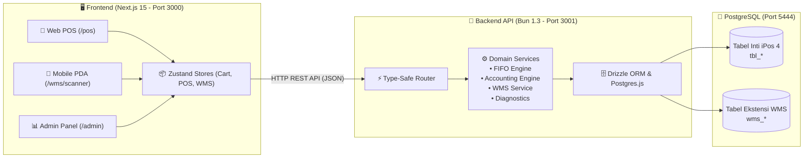

# 🌐 Modul 09: Modernisasi Web Enterprise & Ekstensi Visual WMS

> **Cakupan**: Arsitektur Next.js 15, Bun REST API, Drizzle ORM, layout visual 2D gudang, alur mobile PDA barcode scanner (`/wms/scanner`), dan skrip otomasi.

---

## 1. Arsitektur Stack Web Enterprise

Untuk menjawab tantangan integrasi multi-cabang, mobilitas perangkat (smartphone/tablet), dan visualisasi pergudangan modern, dibangun platform web terintegrasi di atas database PostgreSQL iPos 4.0:

---

## 2. Ekstensi Warehouse Management System (WMS 2D)

### Masalah pada Desktop iPos 4.0 Klasik:
Desktop iPos 4 hanya mencatat kuantitas total per cabang di `tbl_itemstok`. Staf gudang tidak mengetahui di lorong, rak, tingkat, atau kotak (*bin*) mana barang tersebut disimpan secara fisik.

### Solusi Ekstensi WMS Additif:
Tabel additif `wms_*` dirancang aman (*non-destructive*) tanpa mengubah skema tabel bawaan desktop:

1. **Struktur Penomoran Bin Lokasi**:
   Format: `[LORONG]-[RAK]-[TINGKAT]-[KOTAK]` (Contoh: `A-02-03-01`)
   - `aisle`: Lorong A
   - `rack`: Rak 02
   - `tier`: Tingkat/Tingkatan 03
   - `slot`: Kotak/Slot 01
2. **Visual 2D Warehouse Layout (`/admin/wms`)**:
   - Menampilkan denah lantai gudang secara grafis interaktif.
   - Dilengkapi *occupancy indicator* (Warna Hijau: Kosong, Kuning: Terisi Parsial, Merah: Penuh).
   - Klik pada rak untuk melihat daftar item, batch number, tanggal kadaluarsa (*expired date*), dan kuantitas fisik di rak tersebut.
3. **Mobile PDA Barcode Scanner (`/wms/scanner`)**:
   - Antarmuka khusus untuk operator gudang pemegang perangkat PDA genggam (Android Barcode Terminal atau smartphone berkamera).
   - **Mode Putaway**: Pindai barcode barang penerimaan faktur beli -> sistem menyarankan bin kosong terdekat -> operator memindai barcode bin rak tujuan -> stok rak ter-update.
   - **Mode Picking**: Mengambil barang pesanan penjualan (SO) berdasarkan urutan rute terpendek (*optimized picking sequence*).
   - **Mode Relocation**: Pindahkan stok antar-bin dalam satu gudang secara instan.

---

## 3. Struktur Route Backend REST API (Bun)

Entry point HTTP server berada di port `3001` dengan struktur rute modular:

| Prefix URL | File Route Handler | Fungsi & Domain |
|:---|:---|:---|
| `/api/system` | `system.routes.ts` | Status server, verifikasi database, cadangan (*backup*), audit kesehatan |
| `/api/auth` | `auth.routes.ts` | Login operator, verifikasi role, pembagian token JWT |
| `/api/master` | `master.routes.ts` | CRUD Katalog item, multi-satuan, level harga, supplier, pelanggan |
| `/api/inventory`| `inventory.routes.ts`| Cek stok fisik realtime, kartu stok FIFO, mutasi & stok opname |
| `/api/sales` | `sales.routes.ts` | Transaksi POS kasir, pembayaran split, diskon promo, cetak struk |
| `/api/purchasing`| `purchasing.routes.ts`| Penerimaan faktur beli, pelunasan hutang, analisa aging supplier |
| `/api/orders` | `orders.routes.ts` | Backlog Purchase Order (PO) & Sales Order (SO) |
| `/api/cash-bank`| `cash-bank.routes.ts` | Kas masuk/keluar operasional, transfer dana, deposit kontak |
| `/api/accounting`| `accounting.routes.ts`| Buku besar, neraca saldo, laba rugi, neraca keuangan, jurnal manual |
| `/api/wms` | `wms.routes.ts` | Master bin/zona, tugas putaway/picking, layout 2D gudang |
| `/api/analytics` | `analytics.routes.ts`| Business Intelligence (BI), analisis Pareto/ABC, tren omset |

---

## 4. Skrip Eksekusi & Otomasi Batch

Di folder root dan subfolder `tools/` tersedia beberapa modul pembantu:
- `start-ipos4-enterprise.bat`: Skrip otomatisasi peluncuran satu klik (*1-Click Launcher*) untuk Windows yang menyalakan Backend Bun dan Frontend Next.js di terminal latar belakang terpisah.
- `stop-ipos4-enterprise.bat`: Menutup semua proses aktif Node/Bun terkait sistem iPos Modern.
- `tools/ipos_auto_processor/`: Skrip otomasi berbasis Python/Node untuk rekonsiliasi data dan sinkronisasi berkala.
